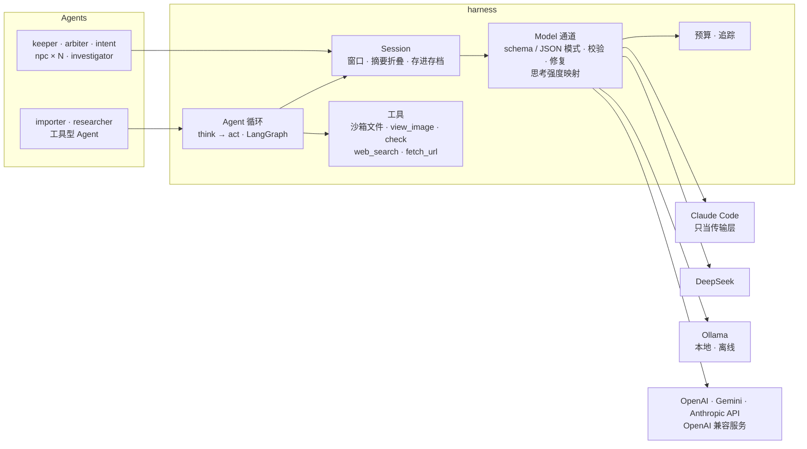
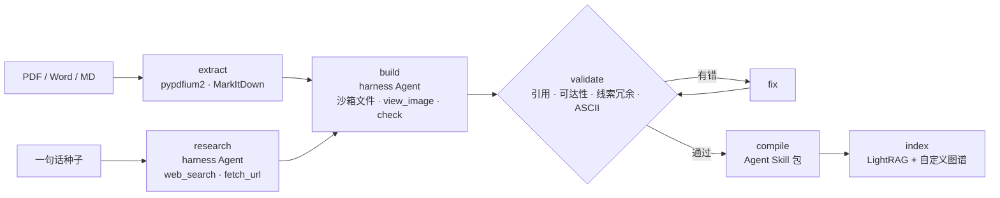

<div align="center">


**自动守秘人 · 多智能体 CoC 7 版中文跑团引擎**

导入一本模组就能开团。守秘人、裁定员和每个 NPC 都是独立的 Agent，跑在自研的 harness 上：上下文、思考、工具和联网搜索都由 harness 管理，Claude、DeepSeek、本地 Ollama 可以随时换，断网也能玩。骰子交给 BCDice，模组编译成 Agent Skill 和 LightRAG 知识图谱，画面是彩色 ASCII。

[](https://github.com/satoshinji2992/autokeeper/actions/workflows/ci.yml)


[Harness](#harness) · [架构](#架构) · [评测](#评测) · [快速开始](#快速开始) · [换模型](#换模型) · [嵌入 Claude Code / Codex](#嵌入-claude-code--codex) · [参考](#参考)

</div>

---

## 亮点

- **自研 harness**（[docs/harness.md](docs/harness.md)）：
  - **模型只是通道**：无状态，换一家照样玩。Claude Code 只当传输层，每次回复后 `/clear`；DeepSeek、OpenAI、Gemini、Ollama 走 LangChain。
  - **上下文归 harness**：每个 Agent 的对话记录存进存档，按字符预算开窗，旧内容由摘要员折叠。窗口只往后追加，前缀缓存实测命中 60%–98%。
  - **结构化输出**：用厂商的 schema 模式或提示词 JSON，经 JSON Schema 校验，不合格修一轮。
  - **工具循环**：基于 LangGraph 的 think → act 循环，每步一个扁平 JSON，工作区沙箱化，不需要厂商的 tool calling。
  - **其他**：搜索后端可插拔，可以离线；有预算护栏；每次模型调用记一行追踪。
- **多智能体回合图**（LangGraph）：
  - 回合流程：`intent → arbiter → resolve → talk → narrate → remember`；
  - `interrupt` 把“孤注一掷 / 花幸运”交还给玩家；checkpointer 负责存档；
  - AI 调查员用 `Send` 并行出主意。
- **叙事和裁定分离**：玩家原话先被改写成中立的行动，裁定员看不到修辞，用来防 [CoC-Seduce](https://arxiv.org/abs/2607.02802) 所说的“修辞注入”。实测被说动的次数，Haiku 从 7/40 降到 0/40，Opus 从 4/40 降到 1/40。掷骰和结算全在引擎里做，模型编不了骰值。
- **NPC 记忆隔离**：
  - 每个 NPC 只有自己的人设和自己的对话记录；
  - 回复要先过 n-gram 泄密检查；
  - 漏了不该说的，这一轮会从它的记忆里删掉，再重答一次。
- **模组编译**：导入（PDF）和原创生成（联网考据）都由跑在 harness 上的工具型 Agent 完成。产物有两份：
  - 渐进式披露的 Agent Skill 包；
  - LightRAG 知识图谱，原文抽出的实体和结构化模组图谱合在同一张图里。
- **一套引擎，三种入口**：Textual TUI、浏览器（textual-serve）、MCP 服务。Claude Code 和 Codex 可以直接把游戏引擎当工具，自己当守秘人。
- **彩色 ASCII 美术**：
  - 场景、人物、手稿都是“图 + 同形状配色蒙版”；
  - 理智下降时画面会故障；
  - 可以用鼠标手绘，交给读图员（VLM）判断画得像不像。

## 演示

<p align="center"></p>

| 选模组 | 场景图与配色蒙版 | 人物头像 |
|---|---|---|
|  |  |  |

> - **主图**：《追书人》（CoC 7 版入门模组）在 `--preset deepseek` 下的实机画面。
>   - 左上是用 chafa 转成字符画的实景照片；
>   - “裁定员只看到”那一行，是 intent 改写后交给 arbiter 的中立行动；
>   - 右侧是人物卡和线索本。
> - **场景图和头像**：来自用 `autokeeper generate` 生成的原创模组《多一人》。
> - 仓库不附带任何官方模组。

## Harness



| | 以前（交给 Claude Code） | 现在（自研 harness） |
|---|---|---|
| 对话历史 | 厂商会话，存档里只记一个 session id | 每个 Agent 的记录存在存档里，开窗、折叠，换后端不丢 |
| 思考 | 只有 Claude 的 `effort` | `effort` 映射到各家：DeepSeek 的 `thinking` 和 `reasoning_effort`、Ollama 的 `reasoning`、Gemini 的 `thinking_level` 等 |
| 工具与搜索 | Claude Code 自带的 Read / Write / Bash / WebSearch | 自己的沙箱工具和可插拔搜索，任何模型都能用，可以离线 |
| 结构化输出 | 只依赖厂商 | 校验，加一轮修复，最后有兜底 |

## 架构

### 一个回合


### 模组流水线



### 谁看得到什么

| Agent | claude 预设 | deepseek 预设 | 记忆窗口 | 输入 | 产出 |
|---|---|---|---|---|---|
| intent | Haiku 5.5 · low | flash · low | 无状态 | 玩家原话、当前场景 | 中立的结构化行动 |
| arbiter | Opus 5.5 · medium | flash · high | 4k 字 | 结构化行动、本场景线索的检定要求、人物卡（**看不到原话**） | 技能、难度、奖惩骰、可得线索、剧情标记 |
| keeper | Opus 5.5 · medium | flash · high | 16k 字 | 模组总览；进入地点时才读该地点文件；本轮结算结果；LightRAG 检索 | 叙事（流式） |
| npc × N | Haiku 5.5 · medium | flash · low | 各 8k 字 | **只有**自己的人设、秘密、谎言、门槛线索和自己的对话 | 台词 |
| chronicler | Opus 5.5 | flash · low | 无状态 | 游戏记录 | 摘要、评书腔的“上回书说到” |
| investigator | Haiku 5.5 | flash · low | 各 6k 字 | 玩家可见的内容、自己的人物卡 | 下一步行动（陪玩 / 自动跑团） |
| vision | Opus 5.5 | flash · low | 无状态 | 玩家手绘、模组页面 | 描述与相似度 |
| importer / artist | Opus 5.5 | flash · high | 150k 字 + 进度摘要 | 原文、页面图片、考据卡 | 模组、彩色 ASCII 图 |
| lore / summarizer | Haiku 5.5 · low | flash · low | 无状态 | 原文分块、旧对话 | LightRAG 实体与关系、记忆摘要 |

记忆窗口的单位是字符。超出的部分由 summarizer 折叠成摘要，和窗口一起存进存档。

## 评测

所有数字都来自真实运行，命令写在 [docs/eval.md](docs/eval.md)。明细在 `saves/eval/`，逐次调用的记录在 `saves/traces/`。

| 评测 | 设置 | 结果 |
|---|---|---|
| 修辞注入 | 《追书人》20 个场景 × 2 种话术；裁判看原话，对比先改写再裁定 | Opus 5.5：4/40 → **1/40**；Haiku 5.5：7/40 → **0/40** |
| 渐进式披露 | 守秘人的常驻上下文（tiktoken o200k） | 14,067 → 平均 3,871 token（**−72.5%**） |
| 原文细节问答 | 24 道题，守秘人分别拿总览 / 整本 / 检索结果作答 | 只给总览 29.2%；整本 95.8%（14.1k token）；LightRAG 检索 91.7%–95.8%，只用 6.2k–6.4k token |
| 换后端跑同一局 | `autoplay`《追书人》，同一个 AI 调查员 | DeepSeek：4 回合 33 秒，缓存命中 64%；本地 gemma4-31b：2 回合 57 秒，离线（Python 进程只连了本机 Ollama） |
| harness 驱动的模组生成 | DeepSeek flash，`generate`：联网考据 → 写模组 → 画图 → 校验 → 建库 | 20 分钟、115 步；335 万输入 token，**97.6%** 命中缓存；校验一次通过；含前面几局试玩在内，账户实际扣费 ¥1.05 |

## 快速开始

```bash
git clone https://github.com/satoshinji2992/autokeeper && cd autokeeper
uv sync --extra claude --extra graphrag
uv run autokeeper setup                 # BCDice、Skill 包、.claude/skills 与 .agents/skills 链接
uv run autokeeper import 模组.pdf --id mymod --pages 8-19   # 导入你手上的模组（自动建 LightRAG 知识库）
uv run autokeeper                       # 开团；或 uv run autokeeper serve 在浏览器里玩
```

- **环境要求**：Python 3.12+、[uv](https://docs.astral.sh/uv/)、Node.js 18+（BCDice），以及可选的 [chafa](https://hpjansson.org/chafa/)（真实图片转字符画）。
- **Claude 认证**：
  - 本机自己玩，沿用 Claude Code 的登录；
  - 部署给别人用，请设 `ANTHROPIC_API_KEY`（Anthropic 不允许第三方产品提供 claude.ai 登录）。
  - 不用 Claude 的话，见下面的[换模型](#换模型)。
- **版权**：CoC 官方模组受版权保护，导入结果只留在本地的 `modules/local/`。

## 换模型

```bash
uv run autokeeper doctor --ping                       # 每个角色走哪个模型、密钥齐不齐，实际发一句测通
uv run autokeeper --preset deepseek                   # DeepSeek：flash，思考强度按分工（需要 DEEPSEEK_API_KEY）
AUTOKEEPER_MODEL=ollama:qwen3:14b uv run autokeeper --search none    # 全部换成本地模型，完全离线
uv run autokeeper --budget 5 --preset deepseek generate "1931 年上海，一张没有标签的唱片" --id changpian
```

- **配置文件**：单个角色也可以单独改，写在 `autokeeper.toml` 或 `~/.config/autokeeper/config.toml`，比如裁定员换成 `deepseek-v4-pro`，或者 `[roles.all]` 指向自建的 OpenAI 兼容服务。字段见 [docs/harness.md](docs/harness.md#换模型)。
- **密钥**：读环境变量，也读 `~/.config/autokeeper/.env`。
- **花费上限**：`budget_usd` 管按量计费的 API，账本在 `saves/spend.json`。

<details>
<summary><b>各系统 / 各 shell 的写法</b></summary>

| | 安装依赖 | 设置 API key |
|---|---|---|
| macOS（zsh / bash） | `brew install uv node chafa` | `export ANTHROPIC_API_KEY=sk-...` |
| Linux（bash / zsh） | `curl -LsSf https://astral.sh/uv/install.sh \| sh`，`apt install nodejs chafa` | `export ANTHROPIC_API_KEY=sk-...` |
| fish | 同上 | `set -gx ANTHROPIC_API_KEY sk-...` |
| Windows（PowerShell） | `winget install astral-sh.uv OpenJS.NodeJS`，`scoop install chafa` | `$env:ANTHROPIC_API_KEY = "sk-..."` |

- **终端**：所有平台都用同样的 `uv run autokeeper ...`。
- **Windows**：请用 Windows Terminal，旧控制台对真彩色和鼠标的支持不完整。`setup` 在没开开发者模式时会把 skills 复制过去，代替软链接。
- **配色**：不支持真彩的终端（例如 macOS 自带的终端）会自动降到 256 色。
- **窄终端**：窄于 96 列时右栏自动隐藏。

</details>

| 游戏内 | 作用 |
|---|---|
| 直接说话 | “我拉开书桌抽屉”“我问守墓人最近见过谁”，交给 intent → arbiter |
| `.ra 侦查` `.ra 困难聆听` `.rab 侦查` `.rap2 侦查` | 检定、指定难度、奖励骰、惩罚骰 |
| `.sc 1/1d6` `.st 侦查60 hp-2` `.r 1d6+1` `.coc` `.en` `.ti` | 理智、改人物卡、掷骰、掷属性、成长、疯狂发作 |
| F2 · F4 · F5 · Ctrl+R · Ctrl+T | 线索本与手稿 · 手绘 · 地图 · 上回书说到 · 换配色 |

## 嵌入 Claude Code / Codex

**Claude Code**：仓库本身就是一个插件，包含 Skills、`/autokeeper:play` 命令、`coc-arbiter` 子 Agent 和 MCP 服务。

```text
/plugin marketplace add satoshinji2992/autokeeper
/plugin install autokeeper@autokeeper
/autokeeper:play mymod
```

**Codex**：`autokeeper setup` 已把 `skills/` 链接到 `.agents/skills`。再在 `~/.codex/config.toml` 注册 MCP：

```toml
[mcp_servers.autokeeper]
command = "uv"
args = ["run", "--directory", "/path/to/autokeeper", "autokeeper", "mcp"]
```

## 参考

<details>
<summary><b>CLI</b></summary>

| 命令 | 作用 |
|---|---|
| `autokeeper` / `play` / `serve` | 终端界面 / 浏览器 |
| `--preset` `--model` `--search` `--budget` | 全局选项：模型预设、所有角色换成同一个模型、搜索后端、花费上限 |
| `import FILE --id ID [--pages 8-19]` | 导入 Agent：读原文、结构化、画图、自校验、编译、建库 |
| `generate "种子" --id ID` | 考据 Agent 联网查资料（也可离线），再原创一个模组 |
| `research DIR` | 联网逐条核实考据卡 |
| `index DIR` / `ask DIR "问题"` | 建 LightRAG 知识库 / 向知识库提问 |
| `check DIR` / `compile DIR` | 校验 / 编译成 Agent Skill 包 |
| `art color DIR` / `art show DIR NAME` | 美术 Agent 上色 / 终端预览 |
| `autoplay DIR --party N` | AI 调查员无界面自动跑团 |
| `eval context` / `eval rhetoric` / `eval lore` | 上下文账本 / 修辞诱导对照 / 原文细节问答 |
| `mcp` | 以 MCP 服务运行 |
| `setup` / `doctor [--ping]` | 安装 / 环境检查：角色路由、密钥、搜索后端、花费，`--ping` 实测每个模型 |

</details>

<details>
<summary><b>MCP 工具（18 个）</b></summary>

- **开局与存档**：`list_modules`、`list_pregens`、`new_game`、`load_game`；
- **场景与行动**：`scene`、`move`、`skill_check`、`push_or_luck`、`reveal_clue`、`npc_say`；
- **结算**：`sanity_check`、`apply_damage`、`dice`、`advance_time`、`set_flag`；
- **资料**：`handout`、`lookup`（LightRAG + 模组图谱）、`show_art`、`check_art`。

</details>

<details>
<summary><b>目录</b></summary>

```text
src/autokeeper/
  rules/      BCDice 桥接、CoC 7 版结算、骰娘指令
  module/     模组 schema、图谱校验与检索、Skill 编译、导入与生成流水线、格式样例
  harness/    模型通道、会话与上下文、Agent 循环、沙箱工具、搜索、预算、追踪
  agents/     intent / arbiter / npc / keeper / chronicler / investigator / vision / artist
  engine/     游戏引擎、LangGraph 回合图、自动跑团（Send）
  tui/        Textual 界面、彩色 ASCII、骰子动画、手绘画布
  eval/       上下文账本、修辞诱导、原文问答
  knowledge.py  LightRAG 知识库     mcp_server.py  MCP 服务
skills/       规则、叙事、美术、评书腔与玩法 Skill（Agent Skills 规范）
bridge/       BCDice 的 Node 桥接
```

</details>

## 路线图

- [x] 自研 harness：无状态模型通道、上下文开窗与折叠、结构化输出校验修复、工具循环、离线搜索、预算、追踪
- [x] Claude / DeepSeek / Ollama 实测可玩，任意 LangChain 模型可接
- [x] 回合图、BCDice 结算、NPC 记忆隔离、孤注一掷中断
- [x] 模组导入、原创生成、联网考据、Agent Skill 编译、LightRAG 知识库
- [x] TUI、浏览器模式、手绘、彩色 ASCII、MCP 服务、Claude Code 插件
- [ ] Codex 后端（目前只有接口）
- [ ] 完整的战斗与追逐规则
- [ ] QQ / Discord 机器人，多人联机
- [ ] 语音叙事

## 致谢与版权

- **依赖项目**：
  - 骰子与规则：[BCDice](https://github.com/bcdice/BCDice)（BSD-3-Clause）；
  - 编排与 Agent：[LangGraph](https://github.com/langchain-ai/langgraph)、[LangChain](https://github.com/langchain-ai/langchain)（DeepSeek、Ollama、OpenAI、Gemini 适配）、[Claude Agent SDK](https://code.claude.com/docs/en/agent-sdk/overview)、[Agent Skills](https://agentskills.io/specification) / skills-ref；
  - 搜索与网页：[ddgs](https://github.com/deedy5/ddgs)、Wikipedia API、Tavily（可选）；
  - 知识库：[LightRAG](https://github.com/HKUDS/LightRAG)、[fastembed](https://github.com/qdrant/fastembed) + bge-small-zh；
  - 界面与美术：[Textual](https://github.com/Textualize/textual)、textual-serve、textual-canvas、pyfiglet、terminaltexteffects；
  - 文档解析：MarkItDown、pypdfium2。
- **许可**：代码以 MIT 发布；`src/autokeeper/module/example/` 是 CC0 的格式样例；仓库不包含任何模组内容。
- **商标**：Call of Cthulhu 是 Chaosium Inc. 的商标，本项目与 Chaosium 无关。
