<div align="center">

<a href="docs/img/title.png"></a>

*Ph'nglui mglw'nafh Cthulhu R'lyeh wgah'nagl fhtagn.*

*我以为，世上最仁慈的事，莫过于人类的心智无法把它所知的一切关联起来。*<br>

<sub><i>H. P. 洛夫克拉夫特，《克苏鲁的呼唤》</i></sub>

<br>

**《克苏鲁的呼唤》第 7 版 · AI 守秘人**

真彩字符画 · 程序配乐 · 单人与联机 · 终端 / 浏览器

[项目网页](https://satoshinji2992.github.io/autokeeper/) · [游戏特色](#游戏特色) · [安装](#安装) · [第一局](#第一局) · [文档](#文档)

</div>

AutoKeeper 是一款中文跑团游戏。AI 担任《克苏鲁的呼唤》第 7 版的守秘人（KP，跑团的主持人），你扮演调查员，用自然语言行动、交谈和探索。AI 负责备团、扮演人物、裁定检定、安排遭遇，并按调查进展掌握节奏。可以一个人玩、带上 AI 同伴，也可以让朋友用浏览器加入同一场故事。

- **模组只是起点**：玩家走到原作没写的地方，守秘人会补出新的人物、线索和支线。世界引擎记下每个人在哪、手里有什么、说过什么、答应过什么，后面的故事接着用。
- **规则照书执行**：检定、孤注一掷、理智与疯狂、战斗和追逐按第 7 版规则结算，骰子由物理模拟投出。
- **看得见，也听得见**：照片转成真彩字符画，画面随时间、天气和剧情变化；配乐由程序实时编写。
- **什么故事都能开团**：导入自己的模组，AI 整理成可以直接玩的版本；也可以只给一句设定，让 AI 写一本原创模组。

<p align="center">
  <a href="docs/img/game.png"></a>
  <br><sub>《追书人》：在阿诺兹堡图书馆翻旧报。检定的骰子落定后，守秘人讲出报上的内容；右栏是人物状态、调查经过和玩家自己的笔记。</sub>
</p>

## 游戏特色

### 一局跑团怎么进行

《追书人》从早班火车驶入阿诺兹堡开始。委托人托马斯住在小镇尽头的公墓旁，你可以先向站务员问路、在餐馆吃早饭，或者去图书馆翻旧报纸。在输入框写下想做的事，比如“请管理员拿来十多年前的旧报合订本”，守秘人判断要不要检定、花多少时间、能发现什么，再把结果讲给你听。

旅途、闲谈和人物关系也是故事的一部分，不必每一步都直奔线索。守秘人决定何时留出交谈和休整的空间，何时让异状出现、危险逼近。叙述的篇幅、节奏和恐怖程度可以调整；想严格按原作玩，可以关掉即兴。

### 有自己打算的人物

每个 NPC 都有动机、秘密和没做完的事。他们会帮忙、隐瞒、撒谎、抢先一步，也会被说服、威胁或打动而改变主意。说“钥匙不在我这里”的人可能在撒谎，钥匙在谁手里以实际交接为准；答应“我陪您去”，就得真的同行。不在场的人按自己的日程行动，你换个场景或过一段时间再回来，事情可能已经变了。

撞开的门、掉在地上的武器、受过的伤、打空的弹匣，都会留到下一次遭遇。游戏每回合自动存档，续玩时整局的世界和经历都还在。

### 模组之外的故事

下面两张是玩家游玩《冬雪之下》的实机截图。

**一局麻将。** 玩家在饭桌上提议打麻将，原模组没有这段。多琳问起玩法，门廊边的年轻人也接过话头，守秘人顺着凑一桌的需要让人物入局，一场临时起意的消遣成了结识 NPC 的机会。

<p align="center">
  <a href="docs/img/play-mahjong.png">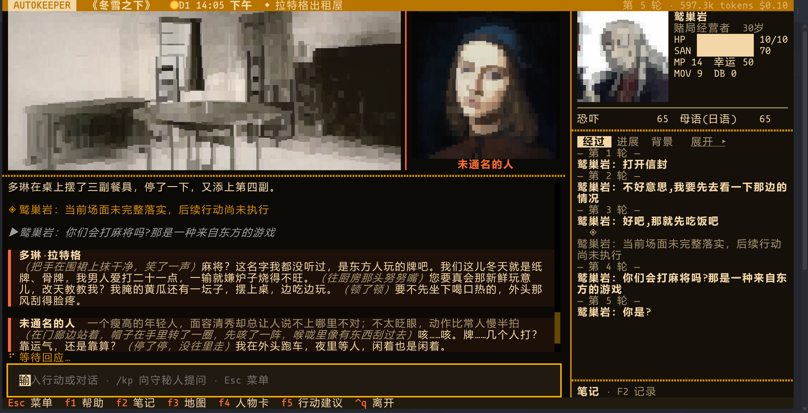</a>
</p>

**会合之后。** 两组玩家分头调查后在诊所会合，有人把贝尔当成了诊所的护士，医生在交谈中纠正：她是来查病情的。各组分头得到的见闻，通过对话汇进了同一个场面。

<p align="center">
  <a href="docs/img/play-reunion.png">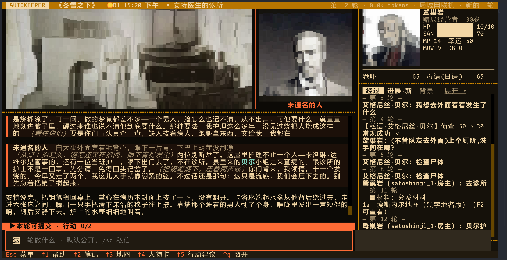</a>
</p>

### 和朋友一起：分头行动，各看各的

房主开好房间，把网址发给朋友，对方用浏览器就能加入，不用安装，也不用配置模型。每个座位可以是真人，也可以交给 AI 调查员。

分头调查时，各组同时推进，各自看到所在现场的叙述；个人观察、私信、图片和手稿只发给实际的收件人，玩家之间可以保留信息差。各组共用同一个世界：同一个 NPC 不会同时出现在两处，一组拿走的东西，另一组就找不到了。检定结果要不要公开、要不要接受队友替你提的行动，都由你自己决定。有人断线时，AI 暂时替他行动，重连后交还。

<p align="center">
  <a href="docs/img/apart.png">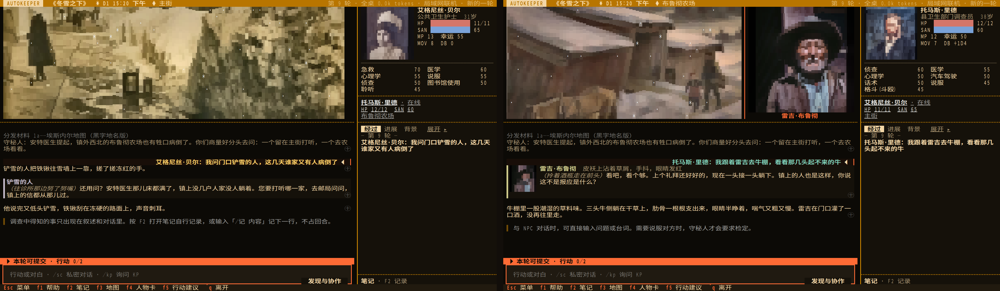</a>
  <br><sub>同一局《冬雪之下》里两位玩家的屏幕：一人在主街向铲雪的人打听，一人在布鲁彻农场跟着雷吉去牛棚。各自只看到自己现场的叙述，右栏显示队友在哪。</sub>
</p>

### 画面跟着故事变

模组里的照片和插图会转成真彩字符画。天色随游戏时间变化，雨、雪、雾叠在画面上；在场人物的小像嵌在画面一角，色调跟着场景走。按 `Ctrl+A` 换画法：

<p align="center">
  <a href="docs/img/styles.png">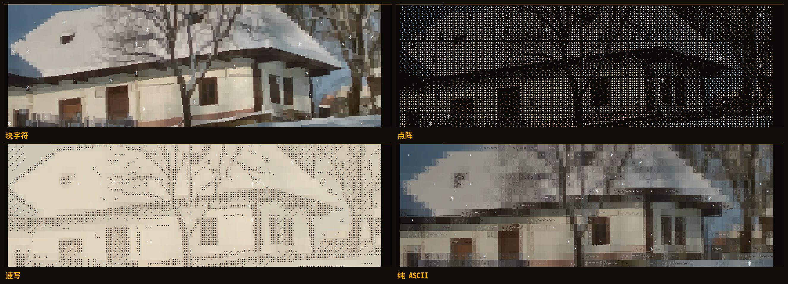</a>
  <br><sub>同一张照片的四种画法：块字符、点阵、速写、纯 ASCII。另有两种带轮廓线的块字符画法。</sub>
</p>

同一个地点的画面会随剧情换版本。某人来了、线索找到了、天黑了，画面就换成相应的版本，构图不变，事情过去再换回来；老宅失火这样的长期变化，本局会重画一张。编译时还会给值得细看的东西准备特写，比如卡洛琳地窖里的香炉、废弃农舍墙上的符号。这些版本由 AI 照原图绘制，需要本机装有 Codex。

<p align="center">
  <a href="docs/img/variants.png">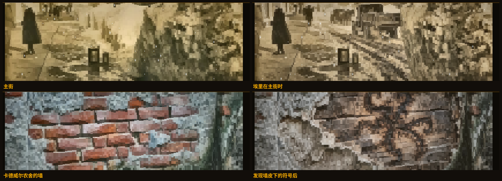</a>
  <br><sub>《冬雪之下》：埃里在主街时，街角多了他的卡车；发现线索后，农舍的墙皮下露出烧出来的符号。</sub>
</p>

开场、危机和结局用整屏「大场景」呈现。模组缺图的地点、人物和物件，会从公共图库找照片，由读图模型挑选和裁剪；找不到合适的，由 AI 补画（Codex、Nano Banana 或豆包 Seedream）。

<p align="center">
  <a href="docs/img/showcase.png">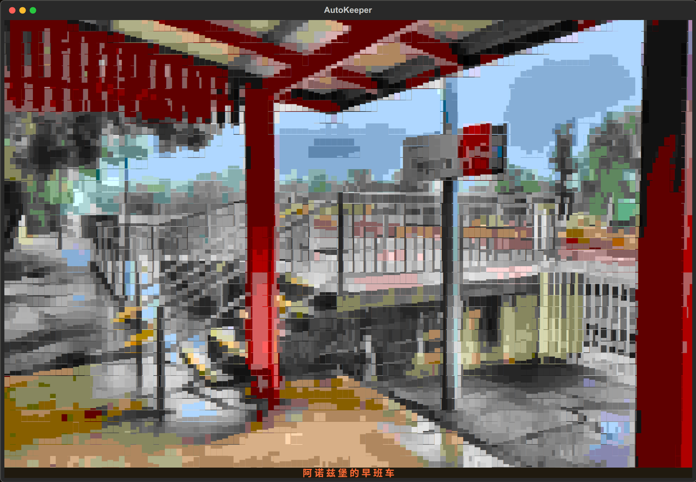</a>
  <br><sub>整屏大场景：《追书人》开场，早班火车停在阿诺兹堡。</sub>
</p>

### 实时编写的配乐

配乐不是预先录好的曲子，而是程序边玩边写。守秘人叙述的气氛变了（日常、悬疑、不安、恐怖、紧迫、悲伤、震撼、余波），音乐在下一小节跟着变；战斗、追逐和理智损失由游戏直接处理，室外和夜晚的音色也不同。每局有自己的调性和主题，同一场景每隔几个乐句换一次主奏乐器和节奏，弦乐、钢琴、竖琴、八音盒、管风琴、玻璃琴、长笛、大提琴、圆号、马林巴轮流出现；恐怖时有男声的仪式吟唱，悲伤时有女声无词哼唱。终端和浏览器都能播放，标题画面有自己的曲子。

试听：[▶ 悬疑](https://satoshinji2992.github.io/autokeeper/media/music-mystery.mp3) · [▶ 恐怖](https://satoshinji2992.github.io/autokeeper/media/music-dread.mp3) · [▶ 紧迫](https://satoshinji2992.github.io/autokeeper/media/music-action.mp3)（各二十多秒，由游戏的作曲与合成代码离线渲染，也可以在[项目网页](https://satoshinji2992.github.io/autokeeper/#music)上直接播放）

<p align="center">
  <a href="docs/img/music.png">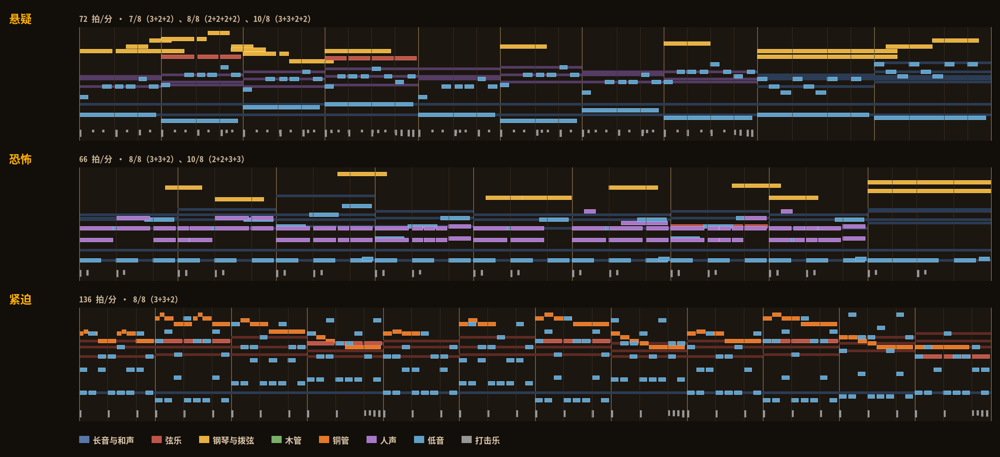</a>
  <br><sub>上面三段试听的前十二小节，按乐器分色。竖线是小节线，淡线是重音分组：3+2+2 就是一个 7/8 小节。</sub>
</p>

### 手稿与资料

信件、日记、剪报、电报和典籍各有纸色、墨色和版式，手写的信和日记用斜体，墨迹逐字显现；有原件扫描的，可以在游戏里全屏查看。游戏不替你整理线索清单，发现都在叙述、对话和材料里；你可以把任何一段原文存进自己的笔记（`F2`）。

<table>
  <tr>
    <td width="50%"><a href="docs/img/paper.png">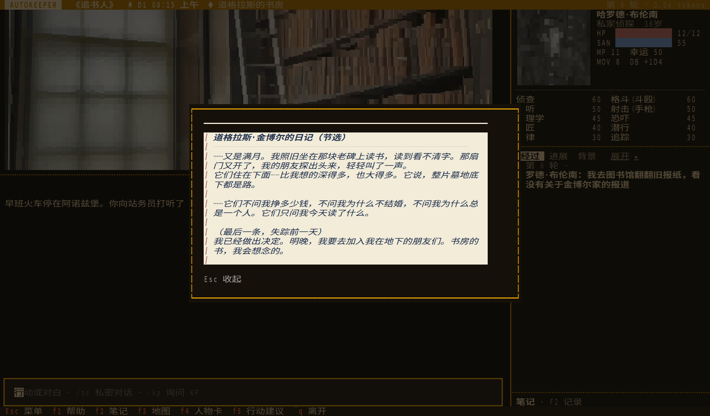</a></td>
    <td width="50%"><a href="docs/img/telegram.png">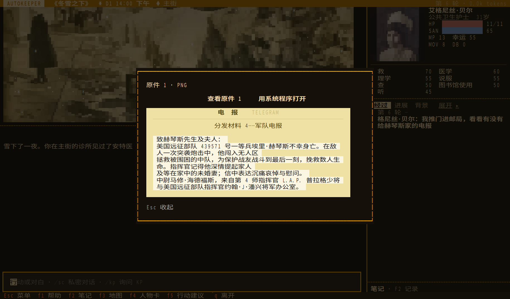</a></td>
  </tr>
  <tr>
    <td align="center"><sub>《追书人》：道格拉斯的日记</sub></td>
    <td align="center"><sub>《冬雪之下》：军队电报</sub></td>
  </tr>
</table>

### 照规则书结算

需要检定时，你亲手掷 3D 物理模拟的十面骰，骰子有六种皮肤可选。失败后可以花幸运，也可以说明新的做法孤注一掷，由裁定员复核实际耗时和后果。理智损失、临时与不定性疯狂、重伤与濒死、急救与医学、幕间成长都按规则结算；调查卡住时可以请求灵感检定（`Ctrl+L`）。

战斗逐轮结算，包括以多打少、射击修正、卡壳、贯穿和濒死；对手只能按它实际看到、听到的行动，跟丢了就追不上。追逐沿地图路线展开，翻墙、钻灌木、撞门各有检定，追逐和战斗可以互相转换，伤势、弹药和掉落的武器一直保留。

<table>
  <tr>
    <td width="50%"><a href="docs/img/fight.png">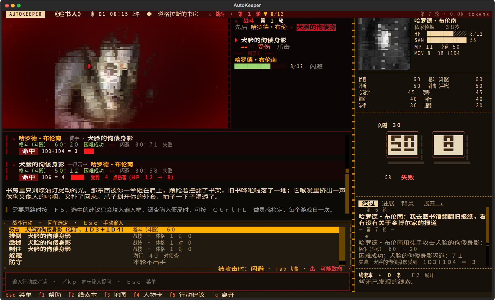</a></td>
    <td width="50%"><a href="docs/img/chase.png">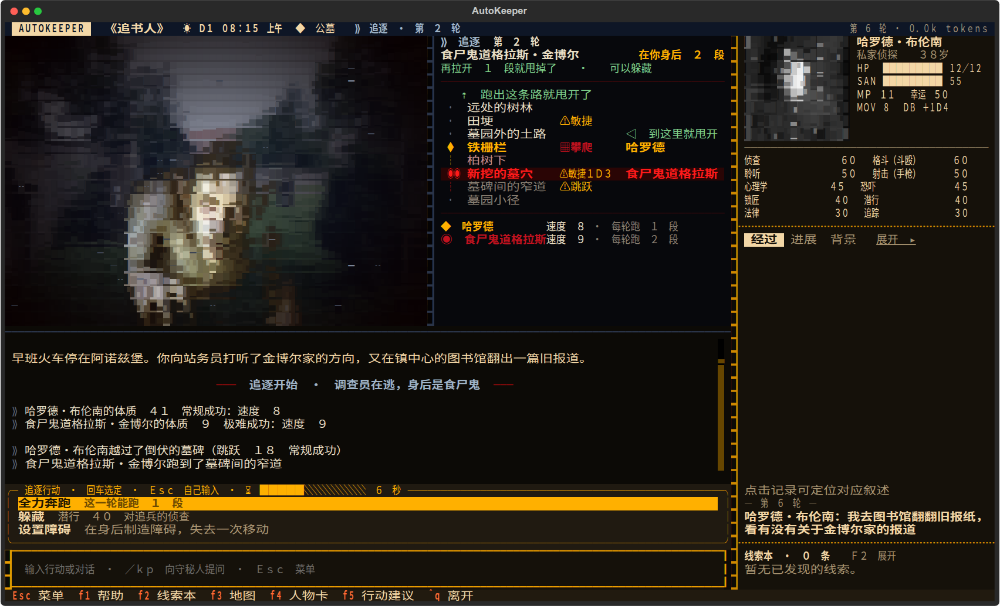</a></td>
  </tr>
  <tr>
    <td align="center"><sub>书房里的战斗：对手只显示伤势描述，被攻击时按 Tab 切换应对</sub></td>
    <td align="center"><sub>墓园里的追逐：右侧是通往出口的路线和障碍</sub></td>
  </tr>
</table>

手上有规则书的话，可以导入建立本地索引。裁定员遇到引擎没有实现的规则（溺水、坠落、火、法术等）会查原文，你用 `/kp` 问规则时也会附上原文和页码。施法的魔法值、POW 与理智消耗按法术条目原文结算，学会的法术记在人物卡上。年代不限于 1920 年代，现代团的技能和武器同样能用。

### 什么故事都能开团

把 PDF、Word、Markdown、纯文本或 ZIP 拖进「导入模组」。AI 读完原文，整理出人物的知识与动机、线索的发现条件、事件日程、房间与平面图、战斗数值和追逐路线，保留原有的插图和手稿，再对照原文复核一遍。年代照原文，现代团、维多利亚时代都可以；别的规则体系的模组或小说也能导入，剧情照原文，机制换成第 7 版。导入中断了，下次接着做。

也可以只给一句设定，由 AI 查资料、写一本原创模组：

```bash
autokeeper generate "1931 年上海，一张没有标签的唱片" --id changpian
```

游戏自带《追书人》《冬雪之下》《有些人油盐不进》三本模组，第一次玩推荐单人入门的《追书人》。

<table>
  <tr>
    <td width="50%"><a href="docs/img/map.png">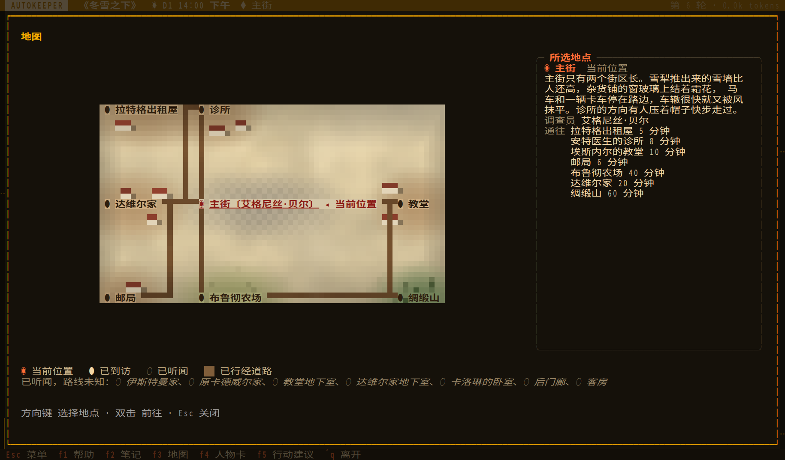</a></td>
    <td width="50%"><a href="docs/img/plan.png">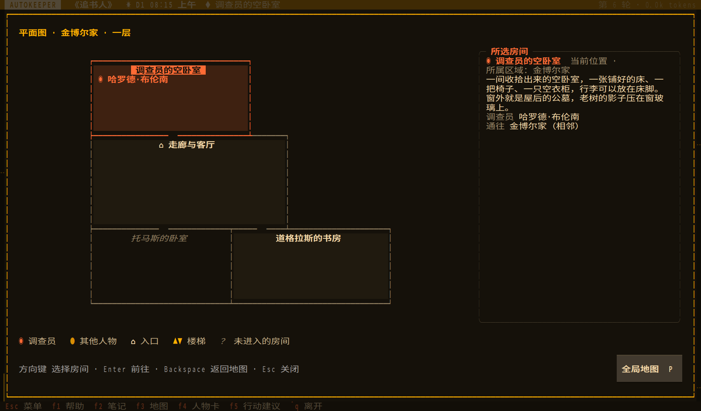</a></td>
  </tr>
  <tr>
    <td align="center"><sub>地图只画已知的地点和道路，选中地点可以直接前往</sub></td>
    <td align="center"><sub>在楼里打开地图是平面图，标出每个房间里的人</sub></td>
  </tr>
</table>

### 调查员

开局可以选模组预设的调查员，也可以自己建卡。写一句设想（“落魄的禁酒令私家侦探”），或者给一个历史人物的名字，AI 会查资料、找肖像，结合模组年代问你三个背景问题，再按第 7 版规则算好属性和技能点。已有的卡可以直接导入：骰娘 `.st` 属性串、Excel、PDF、Word、纸质人物卡的照片，以及酒馆角色卡（PNG / JSON）。

<p align="center">
  <a href="docs/img/cards.png"></a>
  <br><sub>角色库：自己创建和导入的人物卡，可以编辑、导出，带进新的调查。</sub>
</p>

<details>
<summary><b>更多界面：开房间、选模组、人物卡、存档、模型设置</b></summary>
<br>

<p align="center">
  <a href="docs/img/lobby.png">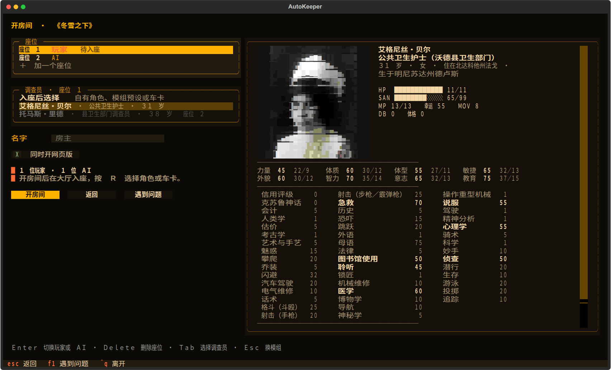</a>
  <br><sub>开房间：安排真人与 AI 座位、选择调查员，预览人物卡。</sub>
</p>

<table>
  <tr>
    <td width="50%"><a href="docs/img/module.png"></a></td>
    <td width="50%"><a href="docs/img/sheet.png">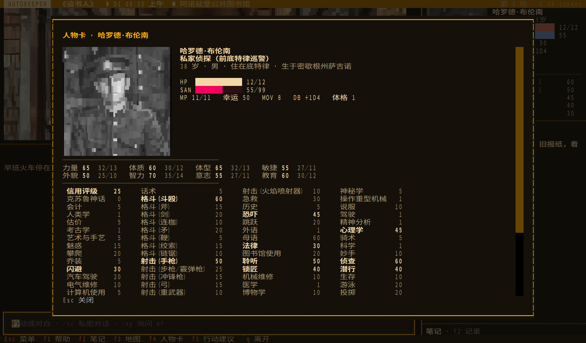</a></td>
  </tr>
  <tr>
    <td align="center"><sub>选模组：故事介绍、人数、时长和场景预览</sub></td>
    <td align="center"><sub>人物卡：背景、属性与完整技能列表</sub></td>
  </tr>
  <tr>
    <td><a href="docs/img/saves.png">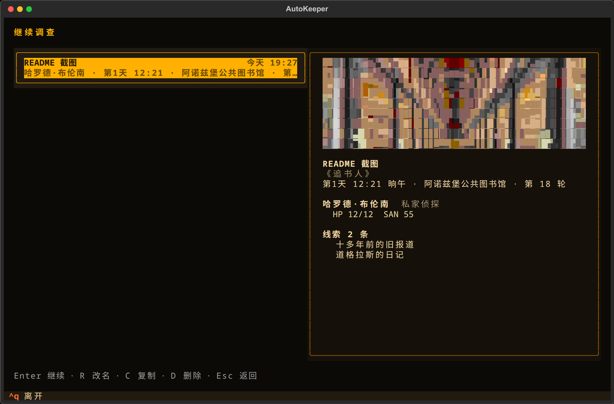</a></td>
    <td><a href="docs/img/models.png">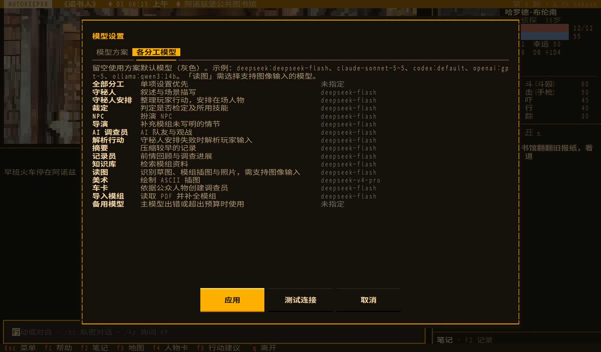</a></td>
  </tr>
  <tr>
    <td align="center"><sub>继续调查：存档的时间、地点与预览</sub></td>
    <td align="center"><sub>模型设置：各分工可以分别指定模型</sub></td>
  </tr>
</table>

</details>

## 安装

当前版本 **0.0.7.2**，支持 Windows（x64）、macOS（Apple 芯片）和 Linux（x86_64）。

```bash
# Linux、macOS、WSL
curl -fsSL https://raw.githubusercontent.com/satoshinji2992/autokeeper/main/install.sh | bash
```

```powershell
# Windows PowerShell
irm https://raw.githubusercontent.com/satoshinji2992/autokeeper/main/install.ps1 | iex
```

安装脚本会准备好 uv、Python 3.12 和 AutoKeeper；掷骰需要 Node.js 22+，Windows 脚本会自动安装。装好后在新终端运行 `autokeeper`，`autokeeper serve` 可以在浏览器里玩。朋友加入你的房间只需要浏览器，不用安装。

更新时先退出游戏，再运行一次安装命令，存档和设置都会保留。联机时房主和玩家要用同一版本。手动安装和各系统的依赖见[游玩指南](docs/playing.md#安装)。

## 第一局

1. 运行 `autokeeper`，在首次配置里选择模型、填写密钥，可以先点「测试连接」。
2. 选「新的调查」，挑一个模组和调查员。
3. 在输入框写下行动或台词。需要检定时按提示掷骰；下次启动从「继续调查」接着玩。

支持 DeepSeek、Claude、Codex、Ollama 和 OpenAI 兼容接口；守秘人、NPC、裁定、读图等分工可以分别指定模型（`F9`）。`Ctrl+B` 查看用量和估算花费；用 Ollama 可以不联网游玩。

| 按键 | 作用 | 按键 | 作用 |
| --- | --- | --- | --- |
| `F1` | 玩法说明 | `F5` | 三个行动建议 |
| `F2` | 笔记与资料 | `F9` | 模型设置 |
| `F3` | 地图 | `Ctrl+A` | 换画法 |
| `F4` | 人物卡 | `Ctrl+L` | 灵感检定 |

联机、规则书、守秘人卡组和全部按键见[游玩指南](docs/playing.md)。

## 文档

- [游玩指南](docs/playing.md)：模型配置、按键、战斗与追逐、规则书与卡组、联机。
- [模组格式](docs/module-format.md)：手写或修改模组，配置大场景。
- [规则插件](docs/plugins.md)：用插件给模组加特殊机制。

反馈问题请提交 [Issue](https://github.com/satoshinji2992/autokeeper/issues)，附上模组名、当轮行动和相关日志。

麻将与诊所会合两张图是玩家提供的实机截图，其余界面图在当前程序里载入固定场景截取。

## 致谢与许可

终端界面基于 [Textual](https://github.com/Textualize/textual) 构建，照片转字符画使用 [chafa](https://hpjansson.org/chafa/)，掷骰与骰娘指令使用 [BCDice](https://github.com/bcdice/BCDice)，智能体编排与原文检索分别基于 [LangGraph](https://github.com/langchain-ai/langgraph)、[LangChain](https://github.com/langchain-ai/langchain) 与 [LightRAG](https://github.com/HKUDS/LightRAG)。

AutoKeeper 程序不开源。本仓库公开玩法文档、项目网页、模组格式与样例、自带模组，授权见 [LICENSE](LICENSE)；[`examples/module/`](examples/module/) 是 CC0 格式样例。自带模组《追书人》（改编自 Chaosium 出版、Bret Kramer 著 *Paper Chase*）、《冬雪之下》与《有些人油盐不进》均为同人改编，原作版权归各自原作者与出版方所有，仓库不含原模组文本与原版插图；模组选用的历史照片均来自 Wikimedia Commons，署名与授权见各模组的 `art/credits.yaml`（[追书人](modules/zhuishuren/art/credits.yaml)、[冬雪之下](modules/dongxuezhixia/art/credits.yaml)、[有些人油盐不进](modules/fallout3-youxierenyouyanbujin/art/credits.yaml)）。「画面跟着故事变」截图中的农舍墙面照片为 A S M Jobaer 的 *Weathered brick wall with peeling plaster 02*（[CC BY-SA 4.0](https://creativecommons.org/licenses/by-sa/4.0/)），其差分图依原照片改画，同样按 CC BY-SA 4.0 提供；主街的差分图依 Steve Shook 的照片（CC BY 2.0）改画。标题画面背景取自 Dominique Signoret 的画作 *Cthulhu and R'lyeh*（[CC BY-SA 3.0](https://creativecommons.org/licenses/by-sa/3.0/)，[Wikimedia Commons](https://commons.wikimedia.org/wiki/File:Cthulhu_and_R%27lyeh.jpg)）。Call of Cthulhu 是 Chaosium Inc. 的注册商标，本项目与 Chaosium 无关。
