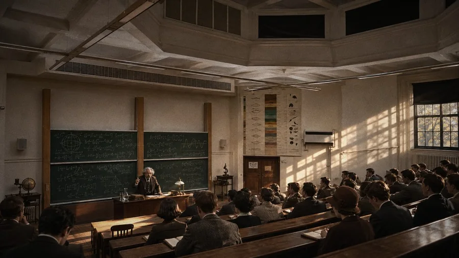
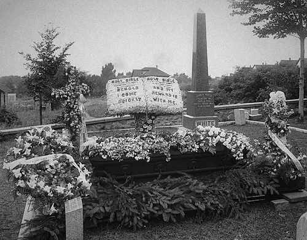
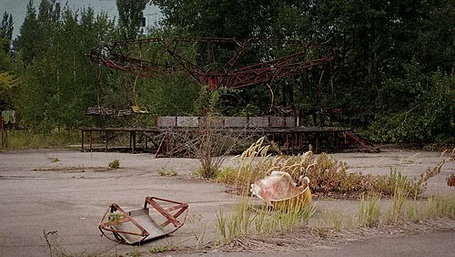

# AutoKeeper 公开模组库

此分支专门存放模组原文件。无需密码；在游戏中打开「导入模组 → 模组库」，或运行 `autokeeper library list`。

下载只取所选模组的文件，并校验发布目录的签名、文件大小和哈希。目录固定到 Git 提交，不会在更新时混入不同版本。

## 浏览模组

[在官网按封面浏览](https://satoshinji2992.github.io/autokeeper/#modules)，或在下方按规则和时代展开。各模组提供玩家简介，主持资料含剧透。下载超时时见[备用下载](https://github.com/satoshinji2992/autokeeper/blob/main/docs/module-library.md#备用下载)。

CoC7

1920 年代

- [《失落的对称》](modules/shiluodeduichen/README.md) · 1-4 人 · 约 3-4 小时
   

1927 年（秋）

- [《向火独行》](modules/xianghuoduxing/README.md) · 1 人 · 约 2 小时
   

1939 年 2 月（纳粹德国）

- [《直到我们灰飞烟灭》](modules/tillwevanish/README.md) · 1-4 人（原作建议单人） · 约 1-2 次跑团
   

2008 年（现代）

- [《失灵》](modules/shiling/README.md) · 1 人 · 约 3–5 次团（原作未写时长，按篇幅估计）
   

2009 年夏（原作融合 00 年代与 10 年代的时代风貌）

- [《鱼！鱼！鱼！》](modules/yuyuyu/README.md) · 2-4 人（原文未写人数） · 约 4-6 小时（原文未写，按各地点时长估算）
   

现代（2025 年春）

- [《鲅鱼？鲅鱼！》](modules/bayu/README.md) · 2-5 人 · 3-5 小时（线上文字团）
   

## 上传与修改

[投稿流程与目录说明](CONTRIBUTING.md) · [模组格式](https://github.com/satoshinji2992/autokeeper/blob/main/docs/module-format.md)

Fork 仓库后向 `mod_library` 分支提交 PR。提交可读的原文件，不需要压缩包、密码或签名密钥。维护者审阅、合并并发布目录后，客户端即可安装新版本。

各模组保留原作者、来源和许可信息；公开浏览不改变其原有授权范围。
