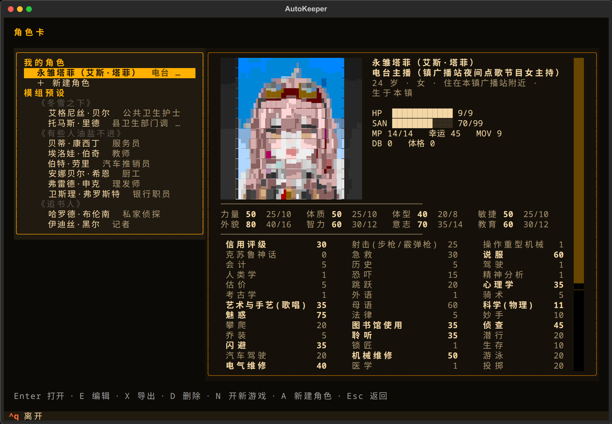

<div align="center">


*Ph'nglui mglw'nafh Cthulhu R'lyeh wgah'nagl fhtagn.*

*我以为，世上最仁慈的事，莫过于人类的心智无法把它所知的一切关联起来。*<br>

<sub><i>H. P. 洛夫克拉夫特，《克苏鲁的呼唤》</i></sub>

<br>

**在终端里玩《克苏鲁的呼唤》第 7 版**

[](https://github.com/satoshinji2992/autokeeper/releases/latest)
[](https://github.com/satoshinji2992/autokeeper/actions/workflows/ci.yml)


[功能](#功能) · [截图](#截图) · [安装](#安装) · [开始游戏](#开始游戏) · [和朋友一起玩](#和朋友一起玩) · [模型与花费](#模型与花费) · [常见问题](#常见问题) · [文档](#文档)

</div>

<p align="center"></p>

AutoKeeper 用 AI 担任守秘人，你用中文输入行动和对话，骰子与状态由程序结算。可以独自调查、带 AI 同伴，也可以和朋友联机，或旁观 AI 调查员跑团。终端和浏览器均可游玩，仓库自带三本模组：入门的《追书人》，以及《冬雪之下》和《有些人油盐不进》。

## 功能

- **调查与即兴**：守秘人描述场景、扮演 NPC，按调查员背景安排开场。可以查案，也可以问路、吃饭、闲聊。选择即兴模式后，模组之外的人物、地点和支线会随本局保存。
- **检定与规则**：检定用 3D 十面骰，点数由物理模拟决定，有六种皮肤；其他骰子和常见骰娘指令走 BCDice。支持孤注一掷、幸运、理智、疯狂与成长。完整战斗和追逐规则尚未实现。
- **人物与记录**：可用描述或参考人物创建调查员，也可导入已有卡片；标题画面的「角色卡」能翻看所有调查员，在那里新建角色，把预设或存档里的调查员复制成自己的，编辑数值以外的内容、导出或删除。人物卡里有「本局经历」：做过的事、检定、线索、理智和伤势。线索本记录发现、约定和物品往来，地图只画已知的地点和路，地点里面的地方可以展开；存档可继续、改名、复制和删除，结局后可复盘。
- **彩色 ASCII**：场景、人物和物件以字符画显示，支持昼夜、天气和人物表情。开场、危机、怪物和结局时整屏放一张大图。模组插图尽量沿用，手稿保留完整文字、ASCII 预览和原图入口；装了 Codex 时，失火、受伤这类变化会照原图重画。
- **叙事调整**：可选篇幅、节奏、恐怖程度及需要略去的细节；F6 重讲最新一段，已结算的骰子和线索不变。F5 提供可修改的行动建议。
- **导入与扩展**：支持 PDF、Word、Markdown、文本及 ZIP 模组，也可从一句设定生成原创模组。编译与即兴时可开发带测试的规则插件，补充疾病、资源消耗、自定义行动和小游戏；游戏里按 Ctrl+K 用一句话加家规，测试通过才生效。见[插件说明](docs/plugins.md)。
- **模型与联机**：支持 Claude、Codex、DeepSeek 和 Ollama，可分别选择游玩、导入和读图模型。画字符画、读图、挑照片用各家最强的模型：Claude 是 Opus 5.5，Codex 是 GPT-6-Astra；DeepSeek 画图用 V4 Pro，读图用 flash（V4 Pro 不能看图）。标题画面就能开房间，朋友用浏览器加入，带自己的角色卡或当场车卡；也可通过 MCP 在 Claude Code / Codex 中主持。

## 截图

| 选模组 | 角色卡 | 场景 | 人物头像 |
|---|---|---|---|
|  |  |  |  |

截图里的《追书人》就附在仓库里，改编自 Chaosium 入门套装里的 *Paper Chase*，装好就能开团。场景和头像取自三本自带模组，都是 Wikimedia Commons 上可自由使用的老照片和画作，转成彩色字符画。

## 安装

需要 Python 3.12+、[uv](https://docs.astral.sh/uv/)、Node.js 18+ 和 [chafa](https://hpjansson.org/chafa/)。chafa 负责把场景和头像照片转成彩色字符画，没装的话画面只剩手绘字符画，启动时会提示；`autokeeper doctor` 也会检查。

```bash
git clone https://github.com/satoshinji2992/autokeeper && cd autokeeper
uv sync --extra claude --extra graphrag
uv run autokeeper setup
uv run autokeeper doctor        # 检查环境，缺什么会告诉你
```

<details>
<summary>各平台的安装方式</summary>

| | 安装依赖 | 设置 API key |
|---|---|---|
| macOS（zsh / bash） | `brew install uv node chafa` | `export ANTHROPIC_API_KEY=sk-...` |
| Linux（bash / zsh） | `curl -LsSf https://astral.sh/uv/install.sh \| sh`，`apt install nodejs chafa` | `export ANTHROPIC_API_KEY=sk-...` |
| fish | 同上 | `set -gx ANTHROPIC_API_KEY sk-...` |
| Windows（PowerShell） | `winget install astral-sh.uv OpenJS.NodeJS`，`scoop install chafa` | `$env:ANTHROPIC_API_KEY = "sk-..."` |

Windows 上请用 Windows Terminal，旧控制台对真彩色和鼠标的支持不完整。

</details>

## 开始游戏

```bash
uv run autokeeper           # 在终端里玩
uv run autokeeper serve     # 在浏览器里玩
```

第一次玩不必先导入模组：

1. 选“新的调查”，选择标有“初次推荐”的《追书人》。
2. 选一名预设调查员，或创建、导入自己的人物卡，再决定是否带 AI 同伴。
3. 读完开场，在底部输入行动，按回车。例如“我向站务员问路”“我先买份早饭”。需要检定时，按弹窗提示掷骰。守秘人还在讲时也可以先打字回车，讲完自动交上。

《追书人》从火车抵达小镇开始。沿途可以停留、交谈，也可以直接去托马斯家赴约。问路、歇脚不会因为没有找到线索就被当成卡关，游戏时间仍照常推进。

标题页的“设置”（F9）可以调整模型、备用模型、自由度、叙事偏好和画面，选择会保存。导入界面可为本次导入另选模型；长文处理和建库沿用导入模型，读图模型可单独设置。

F1 打开“玩法说明”。第一次遇到检定、线索等操作时，会出现简短提示，每种只显示一次，可关闭。即兴配图先显示简图，后台完成后更新；支持联网参考照片，离线时使用字符画。开场、危机、怪物和结局这些时刻会整屏放一张大图（「大场景」）。本机装了 Codex 并登录时可以打开「AI 画图」：地点和人物随剧情变样（失火、受伤）会照原图重画，找不到照片的也由 AI 画，每个模组最多 100 张。用不了时看玩法说明的「遇到问题」页。实现细节见[守秘人体验设计](docs/keeper-experience.md)。

如果模型中断，输入 `/retry`，或在功能菜单中选择“接着讲”。系统会从未完成的阶段继续，保留已结算的骰子和 NPC 回答。

<details>
<summary>导入模组、生成模组和观战</summary>

标题页选择“导入模组”，或使用以下命令：

```bash
uv run autokeeper import 模组.pdf
uv run autokeeper import 模组.pdf --model codex:default --vision-model codex:default
uv run autokeeper generate "1931 年上海，一张没有标签的唱片" --id changpian
uv run autokeeper autoplay modules/local/mymod --party 2
```

第二条命令分别指定导入与读图模型。导入完成后会在 Wikimedia Commons 查找有授权的照片并转成字符画，找不到的场景保留手绘；加 `--no-photos` 跳过，之后可用 `autokeeper art fetch` 补。`generate` 从设定生成模组；`autoplay` 让 AI 调查员游玩指定模组，也可在标题页选“观战”。

</details>

| 操作 | 作用 |
|---|---|
| `.ra 侦查` `.rab 恐吓` | 想在这里用某个技能：守秘人按情境决定掷不掷、多难；同样的尝试失败了不能重掷 |
| `.r 1d6+1` `.coc` `.st` | 掷骰、掷一组属性、看人物卡（不能改） |
| `.en` | 结局后做成长检定，每局一次 |
| F1 · F2 · F3 · F4 · F5 | 帮助 · 线索本与手稿 · 地图 · 人物卡 · 卡住时给三个思路 |
| F6 · F7 · F8 · F9 · F10 | 让守秘人换个讲法重讲最新一段（骰子和线索不变）· 前情回顾 · 手绘 · 换模型 · 结局后复盘 |
| Ctrl+R · Ctrl+S · Ctrl+A · Ctrl+T | 前情回顾 · 存档 · 换画法 · 换配色 |
| Ctrl+O · Ctrl+B · Ctrl+K | 叙事偏好 · 用量与估算花费 · 规则插件 |
| Esc | 菜单：存档、读档、设置、叙事偏好、规则插件、换模型、新手指南、按键说明、回到标题、退出游戏 |
| Ctrl+G · Ctrl+Y | 右栏翻页：经过 · 进展（故事至今，有新进展时更新）· 背景（开场时知道的事）· 现在整理进展 |

## 和朋友一起玩

同一个网络里（比如同一个 Wi-Fi），一个人开房间，其他人用浏览器加入。

房主在标题画面选「开房间」，挑模组，给每位预设调查员定好玩家、AI 或不上场；人比预设多，就「加一个空座位」。也可以接着玩以前的联机存档。开好后进准备房间，房主也在里面入座。准备房间里写着要发给朋友的地址，比如 `http://192.168.1.5:8000`，朋友用浏览器打开，填个名字，挑一个空座。

坐下后按 R「选角色」：可以用自己的角色卡（我的角色）、换一位模组预设，或者当场新建，AI 协助车卡和导入已有的卡都行。车卡用的是房主的模型，朋友不用配模型；用终端加入的朋友，车好的卡也会存进自己的我的角色。选好按 Y「准备好了」，大家都准备好就开局；也可以选“现在开始”，空座交给 AI 调查员。

离开准备房间时房间还开着，标题画面「回到房间」可以回去。在准备房间点「关闭房间」，游戏里从 Esc 菜单选「关闭房间」，或者退出程序，房间才关。

每一轮大家各说一件要做的事，谁先说都行；另外还空着一个位置，谁想多做一件事，谁先说就归谁。说错了输入 /undo 撤回；没别的事了，就在空着的输入框里按回车。大家都说完，守秘人按说的先后一口气讲完，AI 扮演的调查员也跟着行动，然后进入下一轮。守秘人讲的时候也可以先打字，这些话会排到下一轮的最前面。全角括号开头的话是场外聊天，比如“（我去倒杯水）”，所有人都看得到，不算行动。有人掉线，AI 先替他走这一回合，他重新连上、坐回原来的座位就能接着玩。

几点要注意：

- 房主的名字后面标「房主」，可以按 F9 换模型（这一段讲完才换）。用浏览器进来的算普通玩家。
- 朋友不用填 API key，也不用有这本模组。浏览器加入什么都不用装；用终端 `join` 加入的，要装 AutoKeeper 和 chafa，否则图片只显示手绘字符画（图片是在朋友自己的电脑上转成字符画的）。
- 浏览器里 F5 会刷新网页，刷新后要重新入座。出主意、人物卡、线索本、地图、帮助分别是 `/suggest`、`/sheet`、`/notes`、`/map`、`/help`，底栏和 Esc 菜单也能用鼠标点。
- 开局以后只能坐现成的座位，换不了角色；接着玩的存档沿用原来的调查员。

游戏跑在房主的电脑上，用房主的模型和额度，每回合自动存档，下次开房间时选这个存档接着玩（命令行用 `--load`）。模组的真相、NPC 的秘密和还没找到的线索只留在房主那边，朋友的屏幕上只有调查员该看到的东西。

### 用命令行开房间

```bash
uv run autokeeper host                                         # 默认《追书人》：第一位调查员留给玩家，其余交给 AI
uv run autokeeper host modules/local/mymod --seats 玩家,玩家,AI   # 按预设调查员的顺序安排座位
uv run autokeeper join 192.168.1.5                              # 装了 AutoKeeper 的朋友也可以在终端里加入
```

终端会打印要发给朋友的地址。开房间的那个终端不占座位，房主自己要玩就另开一个终端运行 `uv run autokeeper join 127.0.0.1`，从本机进来的是房主。

### 遇到问题

准备房间里点「朋友进不来？」，或者看玩法说明的「联机遇到问题」，按步骤一条条试。最常见的几条：

1. 大家连的是同一个 Wi-Fi 吗？不在一处，就一起装 Radmin VPN 或 ZeroTier，把那边的地址发给朋友。准备房间的「朋友进不来？」列着这台电脑的每个地址，一个不行就换一个。
2. 防火墙要允许 AutoKeeper（Python）联网，手动放行的话端口是 8765 和 8000。
3. 在 WSL 里开房间，要在 Windows 的 `.wslconfig` 里写上 `networkingMode=mirrored`（放在 `[wsl2]` 下），重启 WSL。
4. 大家的版本要一样：`git pull`，再 `uv sync`。
5. 房间开不起来，多半是已经开着一个：看标题画面有没有「回到房间」，命令行开的在那个窗口按 Ctrl+C 关掉。

## 模型与花费

默认使用本机 Claude Code 登录，也可设置 `ANTHROPIC_API_KEY` 使用 API。订阅额度和 API 费用由对应服务计算；使用 DeepSeek 等服务时需配置相应密钥。

```bash
uv run autokeeper --preset deepseek                   # 用 DeepSeek（需要 DEEPSEEK_API_KEY）
AUTOKEEPER_MODEL=ollama:qwen3:14b uv run autokeeper --search none    # 使用已下载的本地模型，关闭搜索
uv run autokeeper --model codex:default import 模组.pdf --id mymod    # 用 Codex 订阅导入模组
uv run autokeeper --preset deepseek --fallback ollama:qwen3:14b      # DeepSeek 连不上时换本地模型接着玩
uv run autokeeper --preset deepseek --budget 5                       # 花费超过 5 美元就停
```

`--mode 高级剧情` 提高叙事相关角色的思考强度，`--mode 经济` 降低思考强度，实际效果和速度取决于模型。游戏中按 F9 可切换。

Ctrl+B 查看用量与估算花费。费用取决于模型、上下文长度和回合数；未标价模型可能没有金额估算。可在 `~/.config/autokeeper/config.toml` 中分别配置各角色的模型，见[配置说明](docs/harness.md#换模型)；历史测试数据见[评测](docs/eval.md)。

## 在 Claude Code / Codex 里玩

仓库本身就是一个 Claude Code 插件：

```text
/plugin marketplace add satoshinji2992/autokeeper
/plugin install autokeeper@autokeeper
/autokeeper:play mymod
```

Codex 用户在 `~/.codex/config.toml` 里加上：

```toml
[mcp_servers.autokeeper]
command = "uv"
args = ["run", "--directory", "/path/to/autokeeper", "autokeeper", "mcp"]
```

## 常见问题

<details>
<summary>手上没有模组怎么办？</summary>

仓库自带《追书人》《冬雪之下》《有些人油盐不进》，开团时直接选，第一次玩建议从《追书人》开始。想玩新的，可以在游戏里导入你手上的模组，或者就用 `autokeeper generate` 给一句灵感，它会查资料、写剧情、画场景，生成一本原创模组。

</details>

<details>
<summary>想严格按模组玩，不要守秘人即兴？</summary>

在标题页“设置”中将自由度改为“严格按模组已有内容”，或启动时加 `--improv 严格`。也可在 `~/.config/autokeeper/config.toml` 中设置 `improv = "严格"`。

</details>

<details>
<summary>导入的文件保存在哪里？会发送给模型吗？</summary>

导入成品保存在本地 `modules/local/`。使用云端模型时，导入与游玩所需的正文、图片会发送给所选服务；需要在本机处理时，应配置本地模型并关闭联网搜索。原文件的 `.gitignore` 规则只防止提交到 Git，不代表文件内容不会发送给模型。CoC 官方模组受版权保护，请只导入你拥有使用权的材料。

</details>

<details>
<summary>没有网能玩吗？</summary>

可以。需提前装好 [Ollama](https://ollama.com/)、下载模型和所需依赖，选择 `ollama:模型名` 并加 `--search none`。确认所有使用的模型都在本机运行；联网搜索、参考照片和云端模型在离线时不可用。

</details>

<details>
<summary>朋友连不上房间？</summary>

见[遇到问题](#遇到问题)。

</details>

<details>
<summary>存档和角色卡存在哪里？</summary>

都在 AutoKeeper 文件夹里的 `data/`：存档在 `data/games/`，自己的调查员在 `data/cards/`，运行记录在 `data/logs/`。`data/cache/` 里是本地模型、知识库和大场景图，删掉也没关系，用到时会重新准备。完整的说明见[文件放在哪里](docs/harness.md#文件放在哪里)。

0.0.1 把这些放在 `saves/`。更新后第一次启动时，本地模型、知识库和自己的调查员会自动挪到 `data/`；旧存档读不了了，`saves/` 可以整个删掉。

</details>

<details>
<summary>画面颜色不对，或者右边一栏不见了？</summary>

不支持真彩的终端（比如 macOS 自带的终端）会自动降到 256 色，换成 iTerm2、WezTerm 或 Windows Terminal 效果最好。终端窄于 96 列时右栏会自动隐藏。默认用块字符画照片，最容易认出内容；Ctrl+A 可切换块字符加轮廓线、更细的六分块（终端字体不支持时会显示成方框）和纯 ASCII，也可以在设置里选择。模组原图仍保留；发现地图、病历或信件后，手稿窗口提供完整文字、ASCII 预览和“查看原图”，F2 可重看。

</details>

## 文档

- [守秘人体验设计](docs/keeper-experience.md)
- [规则插件](docs/plugins.md)
- [模型、上下文与 Agent 设计](docs/harness.md)
- [评测](docs/eval.md)
- [模组格式](docs/module-format.md)
- [世界引擎（开发中）](docs/world.md)
- [更新日志](CHANGELOG.md)

<details>
<summary>全部命令</summary>

| 命令 | 作用 |
|---|---|
| `autokeeper` / `play` / `serve` | 终端界面 / 浏览器 |
| `import FILE --id ID [--pages 8-19]` | 导入模组 |
| `generate "灵感" --id ID` | 生成原创模组 |
| `research DIR` | 联网核实生成模组里的考据 |
| `check DIR` / `compile DIR` | 校验模组 / 编译成 Skill 包 |
| `index DIR` / `ask DIR "问题"` | 建模组知识库 / 向知识库提问 |
| `art color DIR` / `art show DIR NAME` | 给 ASCII 图上色 / 预览 |
| `showcase 模组` | 提前准备模组的大场景图（有 Codex 时生成） |
| `autoplay DIR --party N` | AI 调查员自动跑团 |
| `plugin list DIR` / `plugin test DIR` | 列出模组的规则插件 / 在沙箱里跑插件测试 |
| `host [DIR] [--seats 玩家,AI]` / `join 地址` | 开局域网房间（同标题画面「开房间」）/ 加入房间 |
| `setup` / `doctor [--ping]` | 安装 / 检查环境 |
| `trace` | 查看每个 Agent 的用量和花费 |
| `eval context` / `eval rhetoric` / `eval lore` / `eval style` | 跑评测 |
| `mcp` | 以 MCP 服务运行 |

全局选项有 `--preset`、`--model`、`--fallback`、`--search`、`--budget`、`--improv`。

</details>

## 路线图

- [x] 模组导入与原创生成
- [x] 终端、浏览器、Claude Code、Codex 四种玩法
- [x] Claude、Codex、DeepSeek、本地模型都能当守秘人
- [x] 彩色 ASCII、照片字符画、昼夜与天气
- [ ] 完整的战斗与追逐规则
- [x] 局域网联机，人和 AI 调查员同桌
- [x] 规则插件与一句话家规
- [ ] 会自己运转的世界：NPC 按自己的打算行动
- [ ] QQ / Discord 机器人
- [ ] 语音叙事

## 参与贡献

欢迎提 issue 和 PR，不管是 bug、新模组格式的支持，还是更好看的 ASCII 画。提交前请跑一遍测试：

```bash
uv run ruff check src tests && uv run pytest
```

## 致谢

骰子与规则来自 [BCDice](https://github.com/bcdice/BCDice)；Agent 编排基于 [LangGraph](https://github.com/langchain-ai/langgraph) 与 [LangChain](https://github.com/langchain-ai/langchain)；模组知识库用的是 [LightRAG](https://github.com/HKUDS/LightRAG)；界面基于 [Textual](https://github.com/Textualize/textual)；照片转字符画靠 [chafa](https://hpjansson.org/chafa/)。

## 许可

代码以 [MIT](LICENSE) 协议发布，`src/autokeeper/module/example/` 是 CC0 的格式样例。《追书人》是 *Paper Chase*（Bret Kramer 著，Chaosium 出版）的同人改编，原作版权归 Chaosium，仓库不含原书的 PDF；它的场景照片来自 Wikimedia Commons，作者和授权见 [credits.yaml](modules/zhuishuren/art/credits.yaml)。《冬雪之下》和《有些人油盐不进》同样是同人改编，原作版权归原作者，仓库不含原模组的文字和图片，照片来自 Wikimedia Commons（[冬雪之下](modules/dongxuezhixia/art/credits.yaml)、[有些人油盐不进](modules/fallout3-youxierenyouyanbujin/art/credits.yaml)）。标题画面的克苏鲁是 Dominique Signoret 的画作 *Cthulhu and R'lyeh*（[CC BY-SA 3.0](https://creativecommons.org/licenses/by-sa/3.0/)，来自 [Wikimedia Commons](https://commons.wikimedia.org/wiki/File:Cthulhu_and_R%27lyeh.jpg)），游戏里会裁剪、调暗并做成动画。Call of Cthulhu 是 Chaosium Inc. 的商标，本项目与 Chaosium 无关。
