<div align="center">

<a href="docs/img/title.png">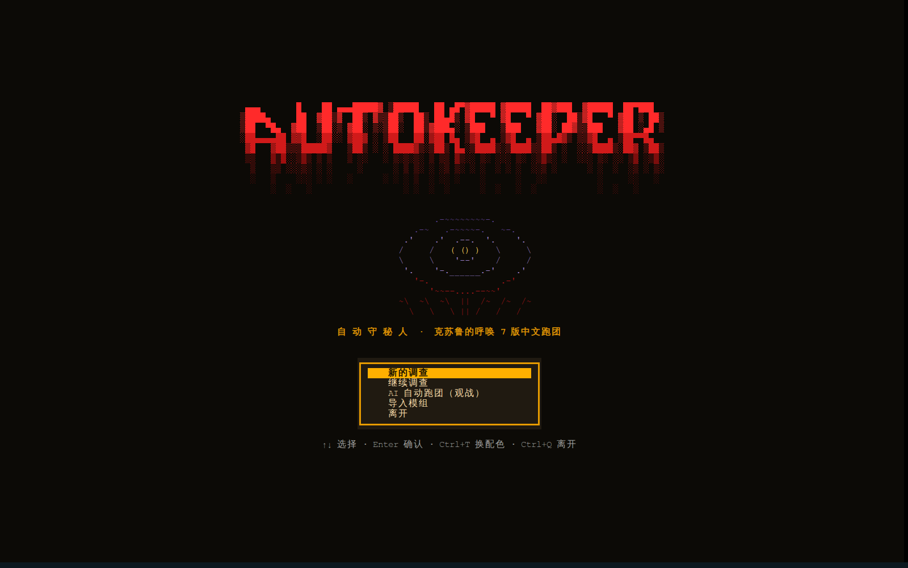</a>

*Ph'nglui mglw'nafh Cthulhu R'lyeh wgah'nagl fhtagn.*

*我以为，世上最仁慈的事，莫过于人类的心智无法把它所知的一切关联起来。*<br>
<sub><i>H. P. 洛夫克拉夫特，《克苏鲁的呼唤》</i></sub>

<br>

**《克苏鲁的呼唤》第 7 版 · AI 守秘人**

真彩字符画 · 实时配乐 · 单人调查 · 好友联机

[官网](https://satoshinji2992.github.io/autokeeper/) · [游戏特色](#游戏特色) · [安装](#安装) · [开局](#开局) · [游玩指南](docs/playing.md)

</div>

AutoKeeper 是一款由 AI 担任守秘人（KP）的中文跑团游戏。你扮演调查员，用自己的话行动、交谈和探索，追查藏在日常生活中的异常。独自调查、带上 AI 同伴，或邀朋友加入同一场故事，都由你选择。

守秘人负责准备模组、扮演人物、裁定检定和推进故事。你可以沿着线索追问，也可以走进原作没有写到的地方，让一次临时起意改变调查的方向。

<p align="center">
  <a href="docs/img/game.png">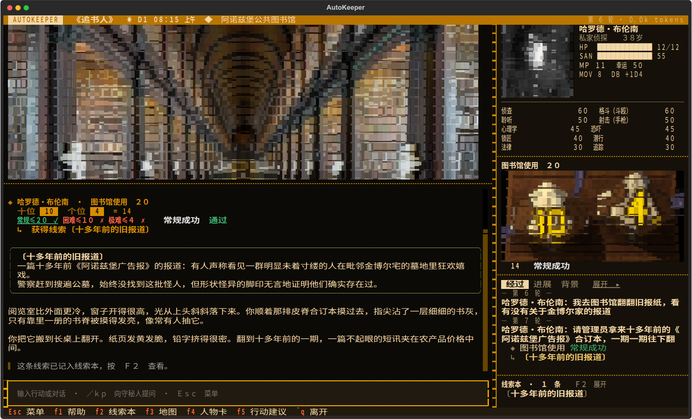</a>
  <br><sub>《追书人》· 图书馆调查</sub>
</p>

## 游戏特色

### 由你开始的调查

早班火车驶入阿诺兹堡。委托人住在小镇尽头的公墓旁，你可以先问路、吃一顿早饭，或者去图书馆翻旧报纸。写下“请管理员拿来十多年前的旧报合订本”，守秘人就会回应你的行动，并在需要时请你掷骰。

闲谈、旅途和人物关系同样值得花时间。你可以调整叙述节奏和恐怖程度，也可以关闭即兴，沿着原作展开调查。

### 有自己打算的人物

NPC 有各自的动机、秘密和牵挂。他们会帮忙、隐瞒、撒谎，也可能被说服或打动。你不在场时，他们仍会行动；等你再次回来，局面可能已经改变。

一次承诺、一件转交的物品、一扇被撞开的门，都可能影响后来的故事。

### 模组之外的故事

在《冬雪之下》的一场游戏中，玩家临时提议打麻将。多琳问起玩法，门廊边的年轻人也加入谈话，一场原作没有安排的消遣，成了结识人物的机会。

<p align="center">
  <a href="docs/img/play-mahjong.png">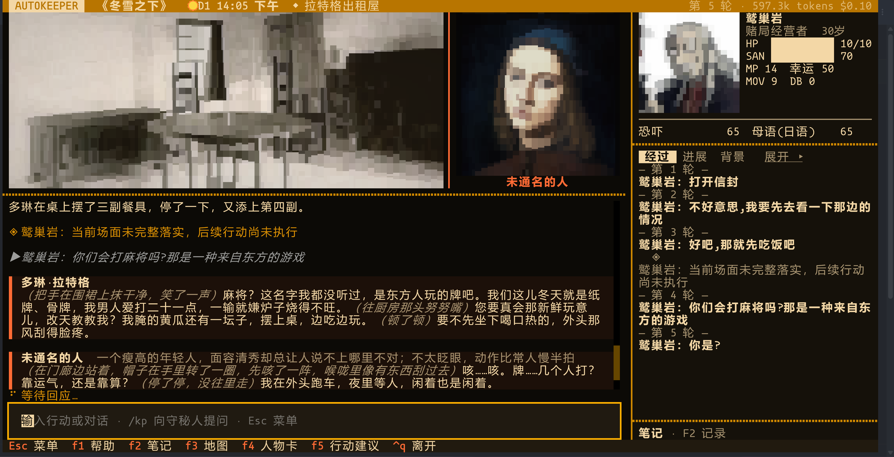</a>
  <br><sub>《冬雪之下》· 临时起意的牌局</sub>
</p>

分头调查的玩家后来在诊所会合。有人认错了贝尔的身份，医生在交谈中澄清；各自带回的见闻，也在这次会面中有了新的联系。

<p align="center">
  <a href="docs/img/play-reunion.png">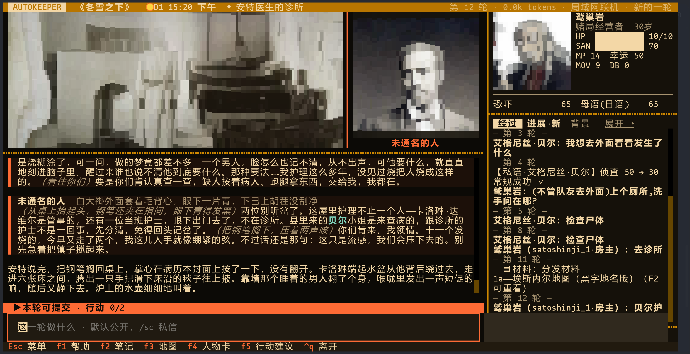</a>
  <br><sub>《冬雪之下》· 诊所会合</sub>
</p>

### 和朋友一起调查

开一间服务器房，把房间号发给朋友，就能在终端同桌。你们可以一起做调查员，也可以让一位朋友担任 KP，给人物写台词，和 AI 私下准备下一幕。单人游玩时，也可以邀请 AI 调查员同行。

你们可以结伴行动，也可以分头探访不同地点。每个人看到自己的现场，收到自己的私信和手稿，再决定把哪些发现告诉队友。启用掉线托管后，AI 会在玩家断线时暂代行动，重连后交还角色。

<p align="center">
  <a href="docs/img/apart.png">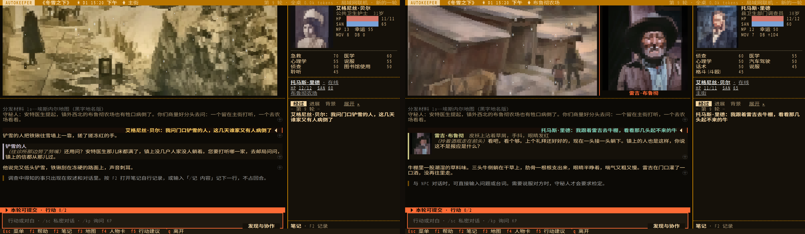</a>
  <br><sub>同一场调查，两个现场</sub>
</p>

### 画面跟着故事变

照片与插图化作真彩字符画，天色、雨雪和雾气随场景变化。你可以在块字符、点阵、速写和纯 ASCII 等画风之间切换，选择自己喜欢的样子。

<p align="center">
  <a href="docs/img/styles.png">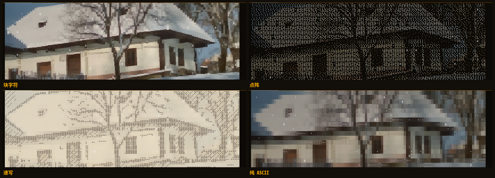</a>
  <br><sub>同一场景，不同画风</sub>
</p>

人物到来、线索显现、危机发生，画面也会留下变化。开启 AI 绘图后，还能为场景生成新的画面与细节特写。

<p align="center">
  <a href="docs/img/variants.png">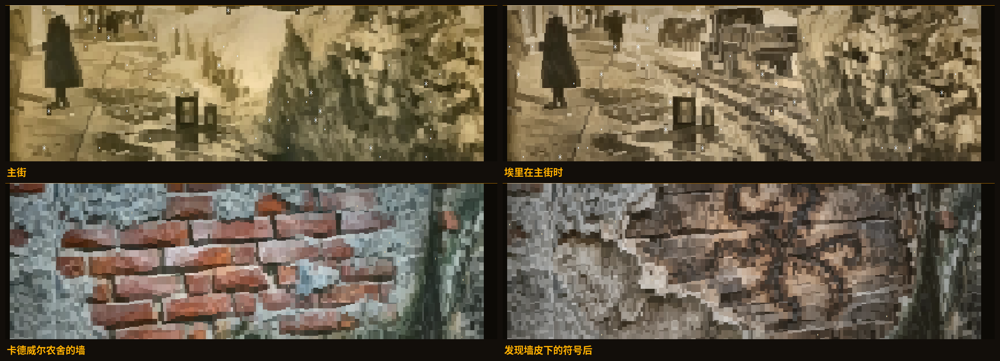</a>
  <br><sub>《冬雪之下》· 场景中的变化</sub>
</p>

<p align="center">
  <a href="docs/img/showcase.png">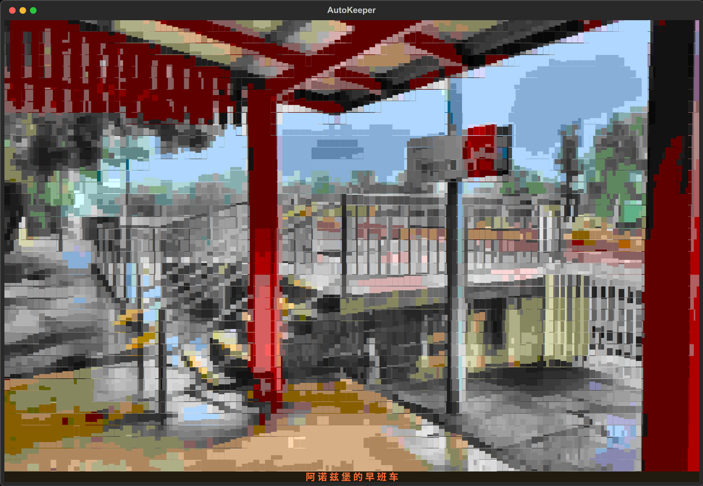</a>
  <br><sub>《追书人》· 早班火车</sub>
</p>

### 随剧情而生的配乐

调查时的钢琴与拨弦、危险逼近时的低沉吟唱、追逐中的铜管，都随故事的气氛变化。配乐在游玩中实时生成，每局有自己的主题，日常、悬疑与恐怖各有声音。

[▶ 悬疑](https://satoshinji2992.github.io/autokeeper/media/music-mystery.mp3) · [▶ 恐怖](https://satoshinji2992.github.io/autokeeper/media/music-dread.mp3) · [▶ 紧迫](https://satoshinji2992.github.io/autokeeper/media/music-action.mp3)

### 手稿与线索板

翻阅信件、日记、剪报和电报，留意文字里没有明说的事。不同材料有各自的纸色与版式，原件扫描也可以放大查看。

<table>
  <tr>
    <td width="50%"><a href="docs/img/paper.png">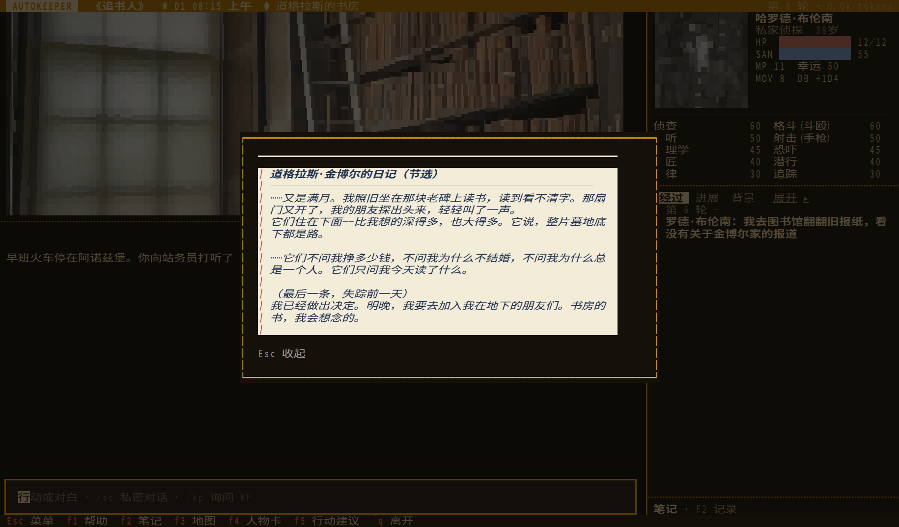</a></td>
    <td width="50%"><a href="docs/img/telegram.png">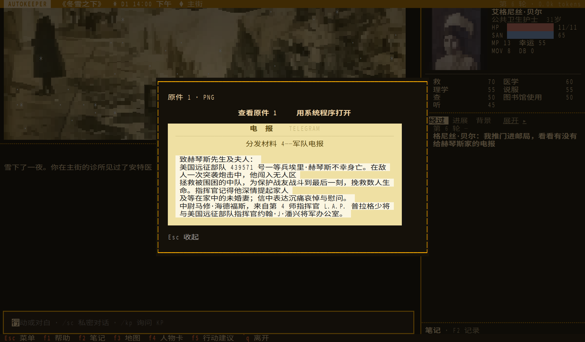</a></td>
  </tr>
  <tr>
    <td align="center"><sub>道格拉斯的日记</sub></td>
    <td align="center"><sub>军队电报</sub></td>
  </tr>
</table>

把人物、地点、手稿和自己的笔记放在线索板上，拖动、连线、批注，整理你对这场调查的理解。你也可以把材料和笔记分享给队友，一起讨论它们之间的联系。

<p align="center">
  <a href="docs/img/board.png">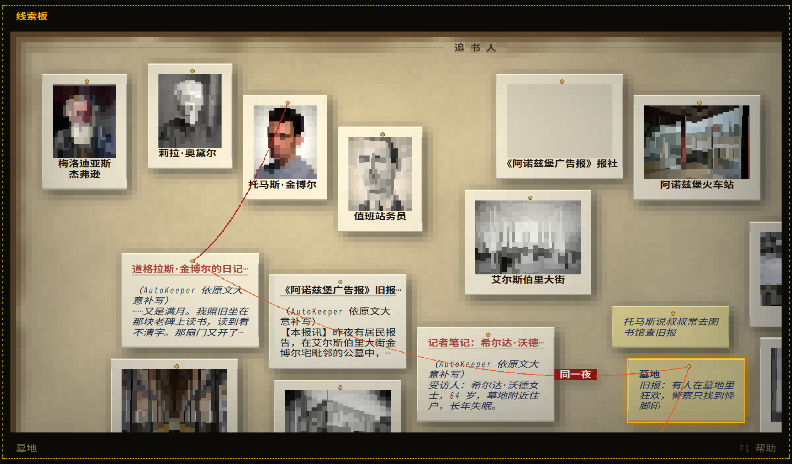</a>
  <br><sub>你的线索板</sub>
</p>

### 照规则书结算

亲手掷出十面骰，面对成功与失败。你可以在规则允许时花费幸运，或换一种做法孤注一掷；战斗、追逐、理智损失与疯狂，都有各自的代价。

<table>
  <tr>
    <td width="50%"><a href="docs/img/fight.png">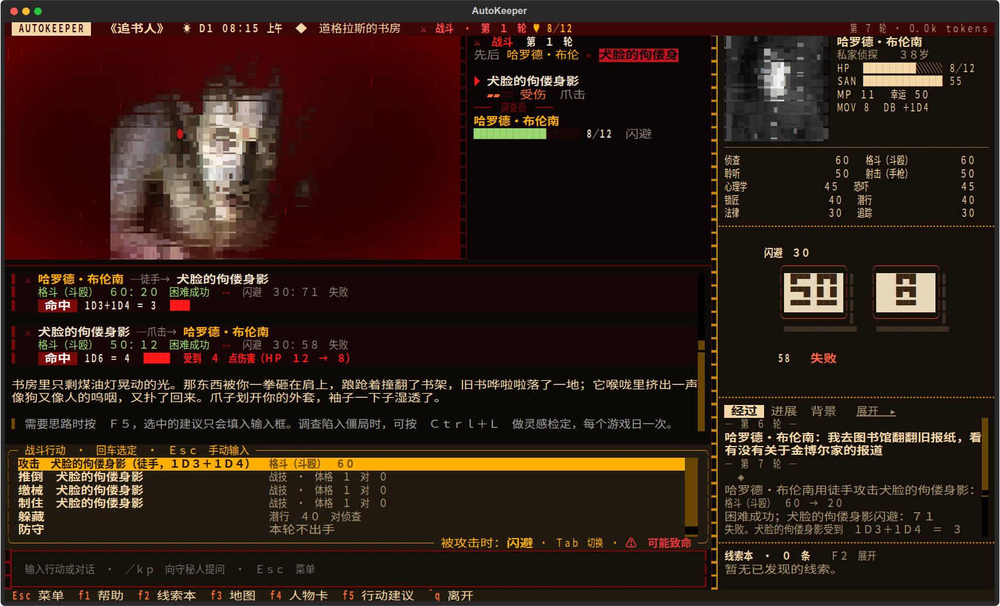</a></td>
    <td width="50%"><a href="docs/img/chase.png">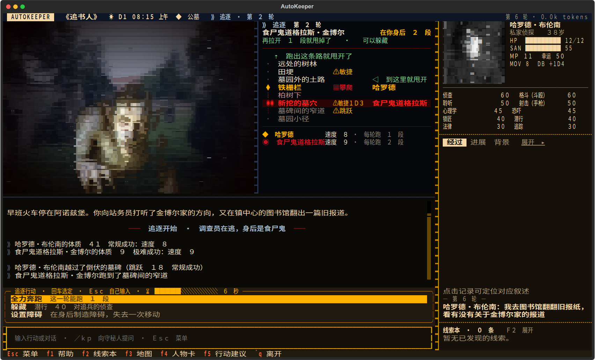</a></td>
  </tr>
  <tr>
    <td align="center"><sub>书房里的战斗</sub></td>
    <td align="center"><sub>墓园里的追逐</sub></td>
  </tr>
  <tr>
    <td><a href="docs/img/sanity.png">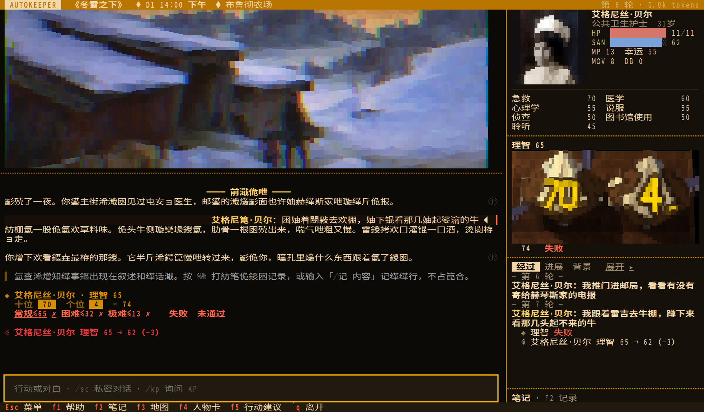</a></td>
    <td><a href="docs/img/madness.png">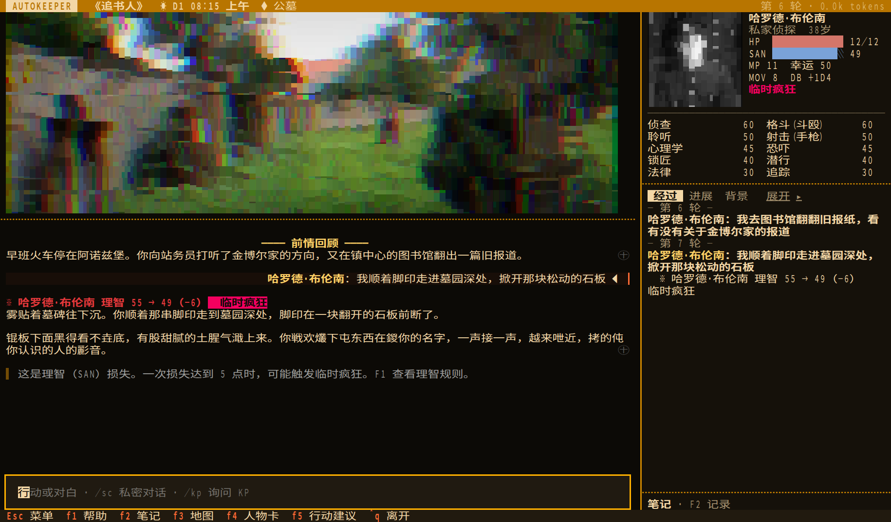</a></td>
  </tr>
  <tr>
    <td align="center"><sub>失去理智</sub></td>
    <td align="center"><sub>临时疯狂</sub></td>
  </tr>
</table>

游戏以《克苏鲁的呼唤》第 7 版为基础，也提供绿色三角洲规则包。你可以导入手上的规则书，查阅原文，或为自己的团加入家规。

### 选择下一场故事

游戏自带《追书人》《冬雪之下》《有些人油盐不进》。第一次游玩，可以从适合单人入门的《追书人》开始，也可以去[模组库](https://github.com/satoshinji2992/autokeeper/tree/mod_library)寻找下一场调查。

想玩自己的故事，可以导入 PDF、Word 等格式的模组，也可以用一句设定生成原创模组，例如“1931 年上海，一张没有标签的唱片”。从小镇街道到建筑内部，地图会随着调查展开。

<table>
  <tr>
    <td width="50%"><a href="docs/img/map.png">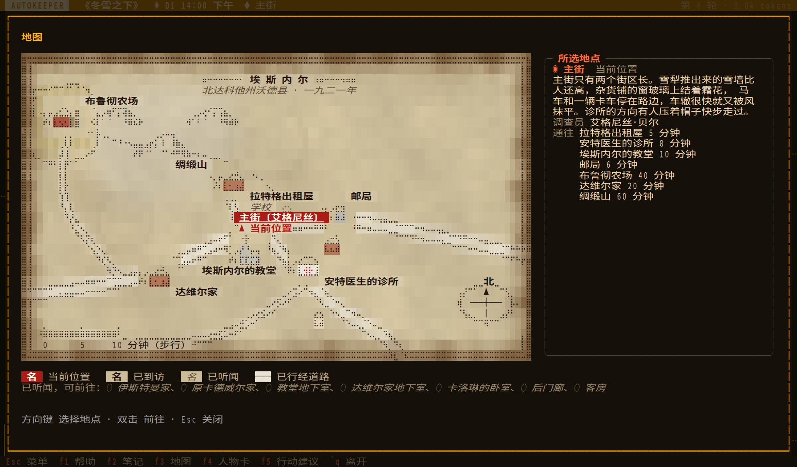</a></td>
    <td width="50%"><a href="docs/img/plan.png">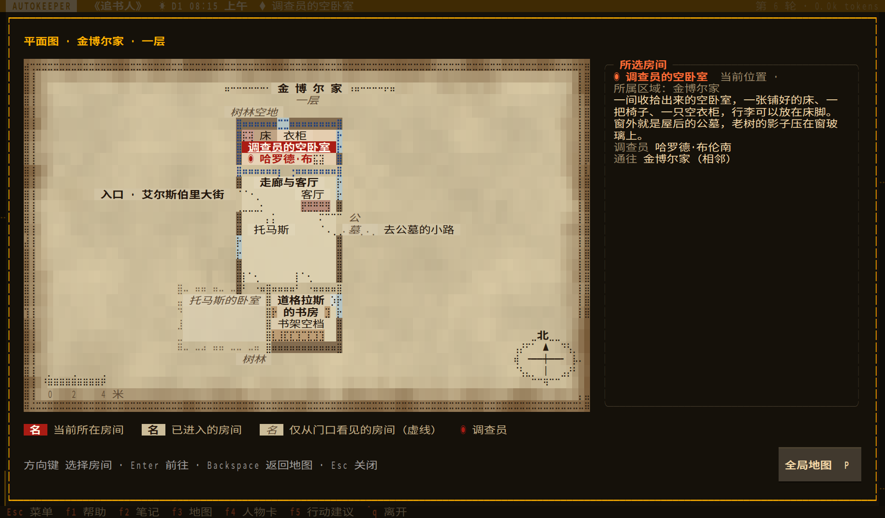</a></td>
  </tr>
  <tr>
    <td align="center"><sub>小镇地图</sub></td>
    <td align="center"><sub>楼内平面图</sub></td>
  </tr>
</table>

### 成为你的调查员

选一位预设调查员，或从自己的设想开始建卡。写下“落魄的禁酒令私家侦探”，AI 会协助你准备背景、肖像、属性和技能；你也可以手动分配点数，导入已有的人物卡，把熟悉的角色带进新的调查。

<p align="center">
  <a href="docs/img/cards.png">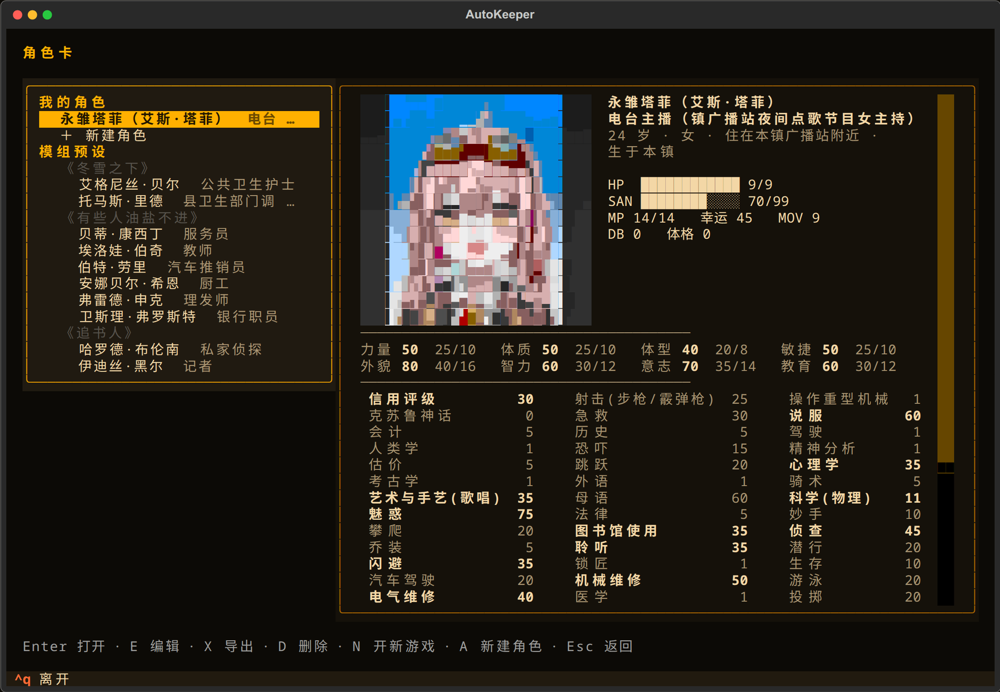</a>
  <br><sub>准备下一次出发</sub>
</p>

### ……这是什么？

屏幕一角掠过一抹虹彩。

<p align="center">
  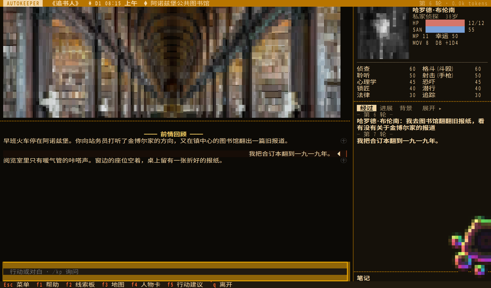
</p>

## 存档与回放

每回合自动存档，随时继续调查。结束后，可以重看整局经过，切换调查员视角，看看队友当时经历了什么。回放无需连接模型。

## 安装

当前版本 **0.0.10.3**。支持 Windows x64 和 Linux x86_64（不支持 mac 系统）。

**Windows PowerShell**

```powershell
irm https://raw.githubusercontent.com/satoshinji2992/autokeeper/main/install.ps1 | iex
```

**Linux / WSL**

```bash
curl -fsSL https://raw.githubusercontent.com/satoshinji2992/autokeeper/main/install.sh | bash
```

## 开局

1. 运行 `autokeeper`，选择模型并填写密钥。
2. 选择「新的调查」，挑选模组与调查员。
3. 写下你的第一步行动。

支持 DeepSeek、Claude、Codex、Ollama 和 OpenAI 兼容接口。朋友加入房间只需浏览器，无需单独配置模型。

## 文档

[游玩指南](docs/playing.md) · [模组库](https://github.com/satoshinji2992/autokeeper/tree/mod_library) · [模组创作](docs/module-format.md) · [反馈问题](https://github.com/satoshinji2992/autokeeper/issues)

## 致谢与许可

感谢模组作者与素材创作者。完整署名和使用许可见[致谢与许可](docs/credits.md)。

使用许可见 [LICENSE](LICENSE)。Call of Cthulhu 是 Chaosium Inc. 的注册商标，本项目与 Chaosium 无关。
