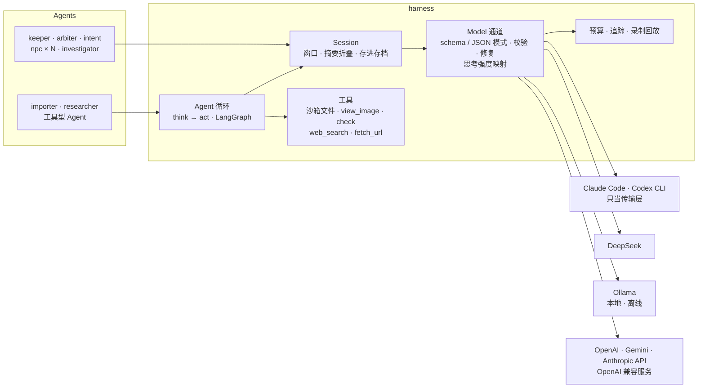
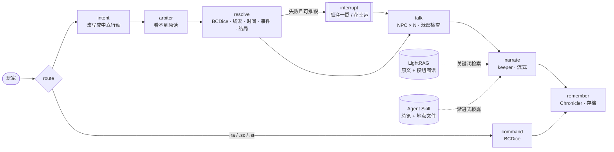
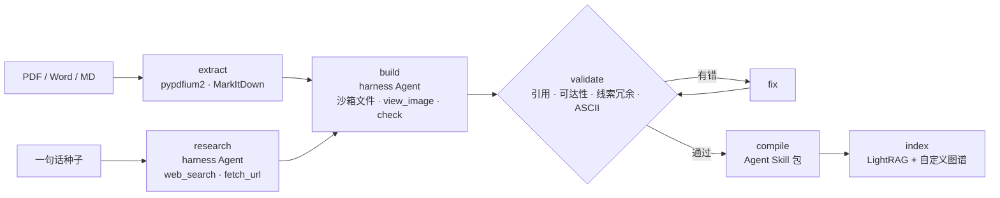

<div align="center">


**自动守秘人 · 多智能体 CoC 7 版中文跑团**

[](https://github.com/satoshinji2992/autokeeper/actions/workflows/ci.yml)


[Harness](#harness) · [架构](#架构) · [评测](#评测) · [快速开始](#快速开始) · [换模型](#换模型) · [嵌入 Claude Code / Codex](#嵌入-claude-code--codex) · [参考](#参考)

</div>

---

AutoKeeper 能自己主持一场《克苏鲁的呼唤》第 7 版跑团。导入一本模组就能开团，守秘人、裁定员和每个 NPC 各由一个 Agent 扮演，骰子交给 BCDice，画面是终端里的彩色 ASCII。

项目的重点在 harness。上下文、思考强度、结构化输出、工具和联网搜索都由项目自己管理，模型只负责接一段输入、回一段输出，所以 Claude、Codex、DeepSeek 和本地 Ollama 可以随时互换。一局打到一半换模型，守秘人和 NPC 照样记得之前发生的事；断了网，换成本地模型也能接着玩。

- 一个回合由 LangGraph 串起来：解析行动、裁定、掷骰结算、NPC 回话、守秘人叙事、写进记忆。孤注一掷和花幸运会停下来交给玩家决定，AI 队友可以并行出主意。
- 玩家的原话会先被改写成中立的行动，裁定员只看行动，看不到话术，骰值也只由引擎掷出。拿 [CoC-Seduce](https://arxiv.org/abs/2607.02802) 的修辞注入来测，裁定员被说动的次数从 4–11 次降到 0–2 次（每组 40 次）。
- 每个 NPC 只有自己的人设和对话记录。说漏了不该说的会被检查出来，这一轮从它的记忆里删掉重答。
- 模组可以从 PDF 导入，也可以给一句种子，让 Agent 联网考据后写一个原创的。结果编译成 Agent Skill 包和 LightRAG 知识图谱，守秘人按需翻阅，常驻上下文比读整本少七成。
- 画面按游戏时间打光，地点有自己的天气。墓地入夜起雾，隧道里只有一束手电光，守秘人写到下雨，街上也会下起雨来。
- 同一套引擎可以在终端、浏览器或 MCP 里玩，Claude Code 和 Codex 也能直接把它当工具来主持。

## 演示

<p align="center"></p>

| 选模组 | 白天的书房 | 手绘场景与配色蒙版 | 人物头像 |
|---|---|---|---|
|  |  |  |  |

主图是入门模组《追书人》读档后的深夜公墓，用的是 DeepSeek。场景是 chafa 转成字符画的实景照片，按时间打了光。说书人先用评书腔讲“上回书说到”，接着是一个完整的回合：玩家的行动，裁定员看到的中立描述，侦查检定，拿到的线索，守秘人的叙事。手绘场景和头像来自用 `autokeeper generate` 生成的原创模组《多一人》。仓库不附带任何官方模组。

<p align="center"></p>

公墓的雾、隧道的手电和《多一人》哈哈镜厅里的扭曲，都是从地点描述推断出来的；雷雨大街是在模组里写明的。

## Harness



模型在这里只是通道。给它一段系统提示和一组消息，它回一段文本或一个 JSON，其余的事都在 harness 里完成。

- 每个 Agent 的对话记录存在存档里，按字数开窗，旧内容交给一个便宜的模型折叠成摘要。请求只往后追加，前缀缓存因此一直能命中。
- 结构化输出用各家自己的 schema 模式，没有就用提示词 JSON，结果统一校验，不合格再修一轮。
- 思考强度按角色设定，再翻译成各家的参数。裁定和叙事想得深一些，摘要和回顾不思考。
- 导入和生成跑在自己的 LangGraph 工具循环上，工作区是沙箱，不依赖任何厂商的 tool calling。联网搜索可以关掉。
- 主模型出错或超出预算时，换到备用模型，出错的模型暂时绕开。
- 每次调用都记一行追踪，`autokeeper trace` 按 Agent 汇总用量、缓存命中、延迟和花费。一整局还能录下来，CI 里不调用模型就能重放整条回合流程，核对结局有没有变。

设计取舍和实测数据都写在 [docs/harness.md](docs/harness.md)。

## 架构

### 一个回合



### 模组流水线



### 谁看得到什么

| Agent | 看得到 | 产出 | 记忆 |
|---|---|---|---|
| intent | 玩家原话、当前场景 | 中立的结构化行动 | 无 |
| arbiter | 结构化行动、本场景线索的检定要求、人物卡，看不到原话 | 技能、难度、奖惩骰、可得线索、剧情标记 | 最近几次裁定 |
| keeper | 模组总览、当前地点的资料、本轮结算结果、知识库检索 | 叙事 | 最近几轮，更早的折成摘要 |
| npc | 只有自己的人设、秘密、谎言、门槛线索和自己的对话 | 台词 | 各自独立 |
| chronicler | 游戏记录 | 摘要、评书腔的“上回书说到” | 无 |
| investigator | 玩家看得到的内容、自己的人物卡 | 下一步行动（陪玩、自动跑团） | 各自独立 |
| vision | 玩家手绘、模组页面 | 描述与相似度 | 无 |
| importer / artist | 原文、页面图片、考据卡 | 模组、彩色 ASCII 图 | 长任务的进度摘要 |

## 评测

数字都来自真实运行，命令和明细见 [docs/eval.md](docs/eval.md)。

| 评测 | 结果 |
|---|---|
| 修辞注入（《追书人》20 个场景，各两种话术） | 裁判直接看原话时，40 次里被说动 4–11 次；先改写再裁定后降到 0–2 次。Claude 和 DeepSeek 结论一致，跟思考强度关系不大 |
| 渐进式披露 | 守秘人的常驻上下文从 14,067 降到平均 3,871 token |
| 原文细节问答（24 题） | 只给总览答对 29.2%，加上 LightRAG 检索答对 91.7%–95.8%，用的上下文不到整本的一半 |
| 完整一局（DeepSeek，两名 AI 调查员） | 53 回合打到结局，估算花费 $0.15。追踪显示摘要模型花掉了近一半的钱，改完后每回合便宜了 43% |
| 原创模组生成（DeepSeek） | 20 分钟写完一个模组，校验一次通过，97.6% 的输入命中缓存 |
| 离线 | 本地 gemma4-31b 跑完回合，进程只连接过本机的 Ollama |

## 快速开始

```bash
git clone https://github.com/satoshinji2992/autokeeper && cd autokeeper
uv sync --extra claude --extra graphrag
uv run autokeeper setup                 # BCDice、Skill 包、.claude/skills 与 .agents/skills 链接
uv run autokeeper import 模组.pdf --id mymod --pages 8-19   # 导入你手上的模组，顺便建好知识库
uv run autokeeper                       # 开团；或 uv run autokeeper serve 在浏览器里玩
```

需要 Python 3.12+、[uv](https://docs.astral.sh/uv/) 和 Node.js 18+（BCDice 用），想把照片转成字符画再装 [chafa](https://hpjansson.org/chafa/)。本机自己玩可以直接沿用 Claude Code 的登录；部署给别人用，请设 `ANTHROPIC_API_KEY`，因为 Anthropic 不允许第三方产品提供 claude.ai 登录。不想用 Claude，看下面的换模型。CoC 官方模组受版权保护，导入的结果只留在本地的 `modules/local/`。

## 换模型

```bash
uv run autokeeper doctor --ping                       # 每个角色走哪个模型、密钥齐不齐，实际发一句测通
uv run autokeeper --preset deepseek                   # 全部换成 DeepSeek（需要 DEEPSEEK_API_KEY）
AUTOKEEPER_MODEL=ollama:qwen3:14b uv run autokeeper --search none    # 全部换成本地模型，完全离线
uv run autokeeper --preset deepseek --fallback ollama:qwen3:14b      # DeepSeek 连不上或花超了，就换本地模型接着玩
uv run autokeeper --model codex:default import 模组.pdf --id mymod    # 用 Codex 订阅导入模组
uv run autokeeper trace --run last                    # 刚才那一局每个 Agent 花了多少、多快
```

默认的 claude 预设用 Opus 5.5 主持、Haiku 5.5 扮演 NPC 和队友；deepseek 预设全部用 deepseek-flash，裁定和叙事开高强度思考，摘要和回顾不思考。单个角色可以在 `autokeeper.toml` 或 `~/.config/autokeeper/config.toml` 里单独改，字段见 [docs/harness.md](docs/harness.md#换模型)。密钥从环境变量或 `~/.config/autokeeper/.env` 读取，按量计费的 API 可以用 `budget_usd` 设花费上限。

<details>
<summary><b>各系统、各 shell 的写法</b></summary>

| | 安装依赖 | 设置 API key |
|---|---|---|
| macOS（zsh / bash） | `brew install uv node chafa` | `export ANTHROPIC_API_KEY=sk-...` |
| Linux（bash / zsh） | `curl -LsSf https://astral.sh/uv/install.sh \| sh`，`apt install nodejs chafa` | `export ANTHROPIC_API_KEY=sk-...` |
| fish | 同上 | `set -gx ANTHROPIC_API_KEY sk-...` |
| Windows（PowerShell） | `winget install astral-sh.uv OpenJS.NodeJS`，`scoop install chafa` | `$env:ANTHROPIC_API_KEY = "sk-..."` |

所有平台都用同样的 `uv run autokeeper ...`。Windows 上请用 Windows Terminal，旧控制台对真彩色和鼠标的支持不完整；没开开发者模式时，`setup` 会把 skills 复制过去代替软链接。不支持真彩的终端（比如 macOS 自带的终端）会自动降到 256 色，窄于 96 列时右栏自动隐藏。

</details>

| 游戏内 | 作用 |
|---|---|
| 直接说话 | “我拉开书桌抽屉”“我问守墓人最近见过谁” |
| `.ra 侦查` `.ra 困难聆听` `.rab 侦查` `.rap2 侦查` | 检定、指定难度、奖励骰、惩罚骰 |
| `.sc 1/1d6` `.st 侦查60 hp-2` `.r 1d6+1` `.coc` `.en` `.ti` | 理智、改人物卡、掷骰、掷属性、成长、疯狂发作 |
| F2 · F3 · F4 · F5 · F6 · Ctrl+R · Ctrl+T | 线索本与手稿 · 换模型 · 手绘 · 地图 · 天气动画 · 上回书说到 · 换配色 |

## 嵌入 Claude Code / Codex

仓库本身就是一个 Claude Code 插件，带着 Skills、`/autokeeper:play` 命令、`coc-arbiter` 子 Agent 和 MCP 服务。

```text
/plugin marketplace add satoshinji2992/autokeeper
/plugin install autokeeper@autokeeper
/autokeeper:play mymod
```

Codex 这边，`autokeeper setup` 已经把 `skills/` 链接到 `.agents/skills`，再在 `~/.codex/config.toml` 里注册 MCP 就行：

```toml
[mcp_servers.autokeeper]
command = "uv"
args = ["run", "--directory", "/path/to/autokeeper", "autokeeper", "mcp"]
```

## 参考

<details>
<summary><b>CLI</b></summary>

| 命令 | 作用 |
|---|---|
| `autokeeper` / `play` / `serve` | 终端界面 / 浏览器 |
| `--preset` `--model` `--fallback` `--search` `--budget` | 全局选项：模型预设、所有角色用同一个模型（`deepseek:…`、`ollama:…`、`codex:…`、`claude-…`、`replay:录像`）、备用模型、搜索后端、花费上限 |
| `import FILE --id ID [--pages 8-19]` | 导入模组：读原文、结构化、画图、自校验、编译、建库 |
| `generate "种子" --id ID` | 联网考据后原创一个模组，也可以离线 |
| `research DIR` | 联网逐条核实考据卡 |
| `index DIR` / `ask DIR "问题"` | 建 LightRAG 知识库 / 向知识库提问 |
| `check DIR` / `compile DIR` | 校验 / 编译成 Agent Skill 包 |
| `art color DIR` / `art show DIR NAME` | 给 ASCII 图上色 / 终端预览 |
| `autoplay DIR --party N [--record/--replay 录像]` | AI 调查员自动跑团；可以录下整局，或者不调模型回放一局 |
| `eval context` / `eval rhetoric [--referee 模型@强度]` / `eval lore` | 上下文账本 / 修辞诱导对照 / 原文细节问答 |
| `mcp` | 以 MCP 服务运行 |
| `setup` / `doctor [--ping]` | 安装 / 检查角色路由、密钥、CLI、搜索后端和花费 |
| `trace [--run last] [--by model] [--runs] [--day all]` | 汇总模型调用追踪 |

</details>

<details>
<summary><b>MCP 工具（19 个）</b></summary>

开局与存档用 `list_modules`、`list_pregens`、`new_game`、`load_game`；场景与行动用 `scene`、`move`、`skill_check`、`push_or_luck`、`reveal_clue`、`npc_say`；结算用 `sanity_check`、`apply_damage`、`dice`、`advance_time`、`set_flag`；查资料用 `handout`、`lookup`（LightRAG 加模组图谱）、`show_art`、`check_art`。

</details>

<details>
<summary><b>目录</b></summary>

```text
src/autokeeper/
  rules/      BCDice 桥接、CoC 7 版结算、骰娘指令
  module/     模组 schema、图谱校验与检索、Skill 编译、导入与生成流水线、格式样例
  harness/    模型通道、会话与上下文、Agent 循环、沙箱工具、搜索、预算、追踪、录制回放
  agents/     intent / arbiter / npc / keeper / chronicler / investigator / vision / artist
  engine/     游戏引擎、LangGraph 回合图、自动跑团
  tui/        Textual 界面、骰子动画、手绘画布
  eval/       上下文账本、修辞诱导、原文问答
  artkit.py · imagery.py      ASCII 配色与打光、照片转字符画
  weather.py · atmosphere.py  场景天气
  knowledge.py  LightRAG 知识库     mcp_server.py  MCP 服务
skills/       规则、叙事、美术、评书腔与玩法 Skill（Agent Skills 规范）
bridge/       BCDice 的 Node 桥接
docs/         harness.md、eval.md、module-format.md
tests/        测试；cassettes/ 里是一盘用 DeepSeek 录的样例对局
```

</details>

## 路线图

- [x] 自研 harness，模型、上下文、工具、搜索都由项目管理
- [x] Claude、Codex、DeepSeek、Ollama 都能玩，其他 LangChain 模型可以接
- [x] 回合图、BCDice 结算、NPC 记忆隔离、孤注一掷
- [x] 模组导入、原创生成、联网考据、Agent Skill 编译、LightRAG 知识库
- [x] 终端界面、浏览器、手绘、彩色 ASCII 与天气、MCP 服务、Claude Code 插件
- [ ] 完整的战斗与追逐规则
- [ ] QQ / Discord 机器人，多人联机
- [ ] 语音叙事

## 致谢与版权

骰子和规则用的是 [BCDice](https://github.com/bcdice/BCDice)（BSD-3-Clause）。编排和 Agent 用到了 [LangGraph](https://github.com/langchain-ai/langgraph)、[LangChain](https://github.com/langchain-ai/langchain)、[Claude Agent SDK](https://code.claude.com/docs/en/agent-sdk/overview) 和 [Agent Skills](https://agentskills.io/specification)；搜索用 [ddgs](https://github.com/deedy5/ddgs)、Wikipedia 和可选的 Tavily；知识库用 [LightRAG](https://github.com/HKUDS/LightRAG) 和 [fastembed](https://github.com/qdrant/fastembed)（bge-small-zh）；界面用 [Textual](https://github.com/Textualize/textual)、textual-serve、textual-canvas、pyfiglet 和 terminaltexteffects；文档解析用 MarkItDown 和 pypdfium2。

代码以 MIT 发布，`src/autokeeper/module/example/` 是 CC0 的格式样例，仓库不包含任何模组内容。Call of Cthulhu 是 Chaosium Inc. 的商标，本项目与 Chaosium 无关。
