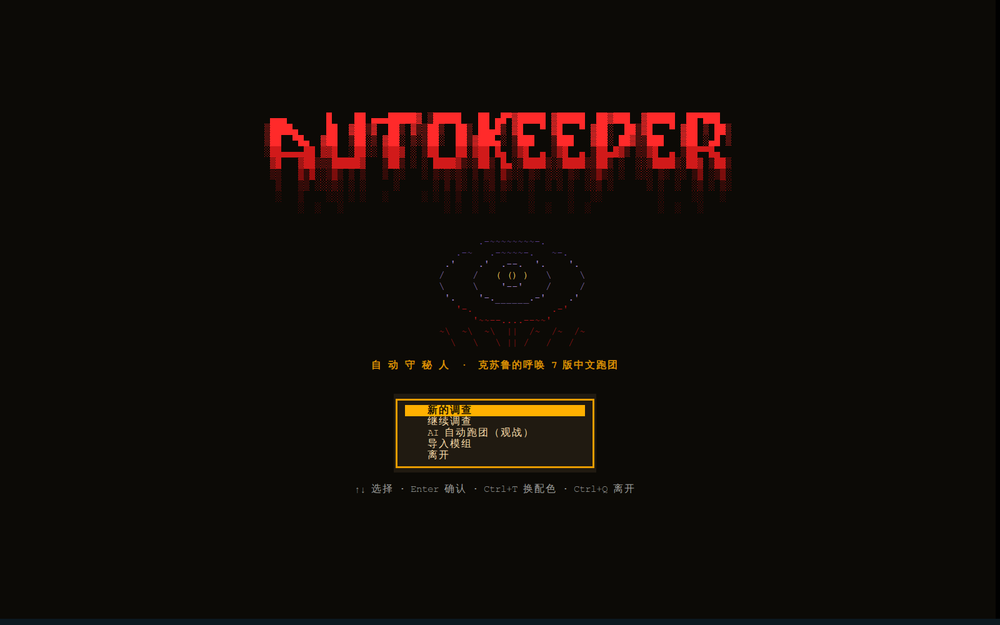
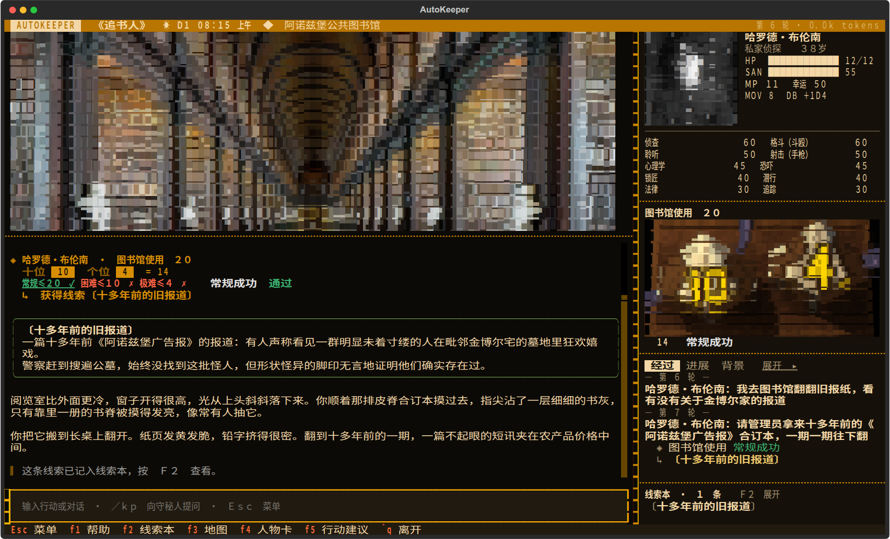
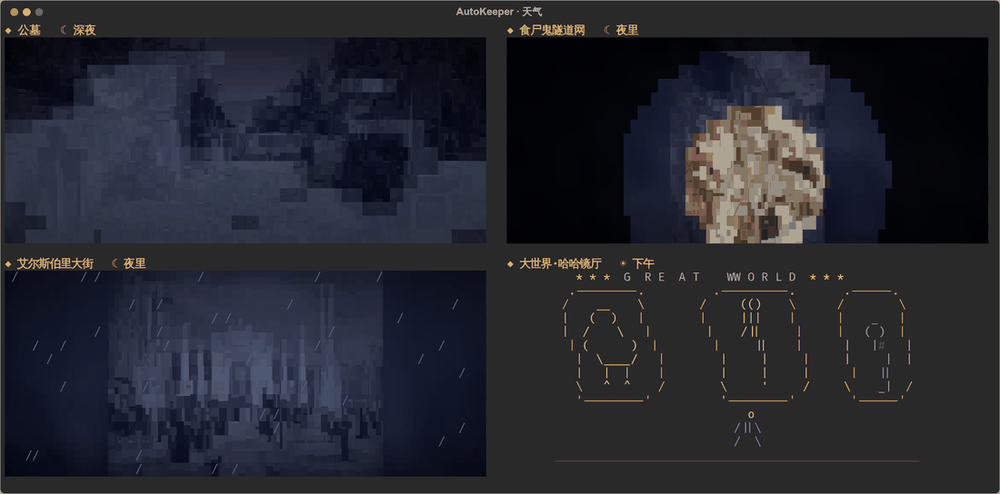
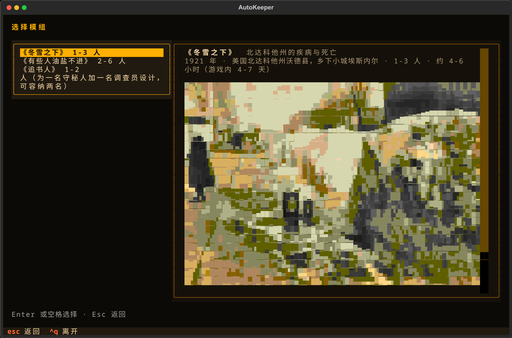
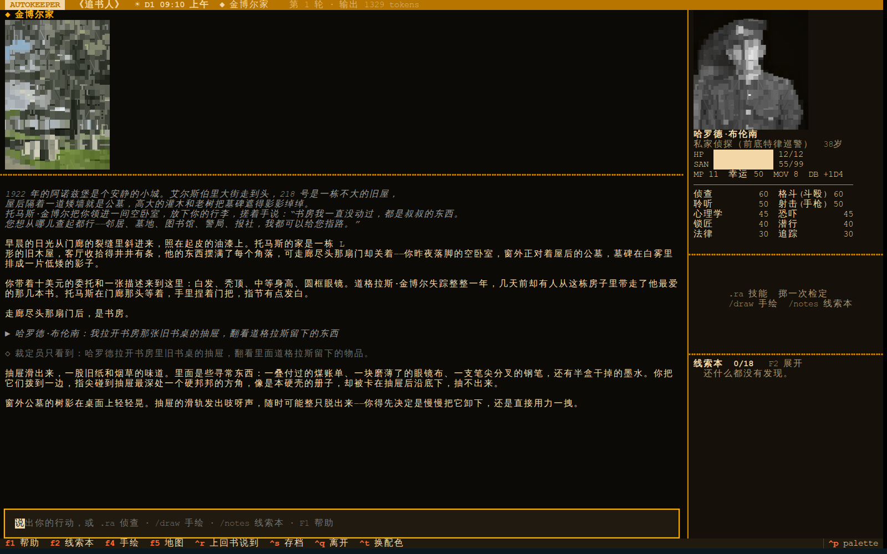
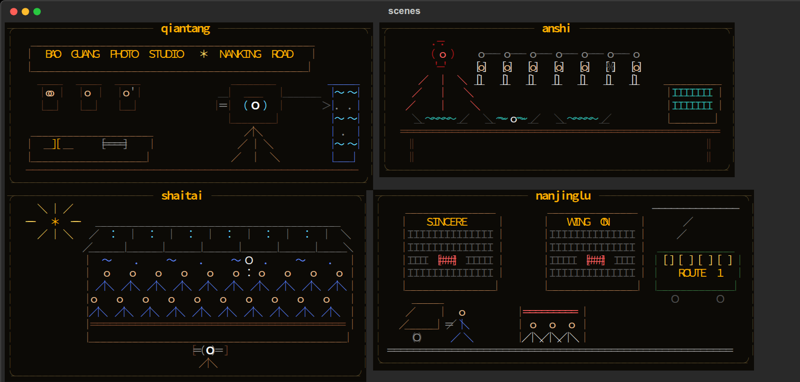
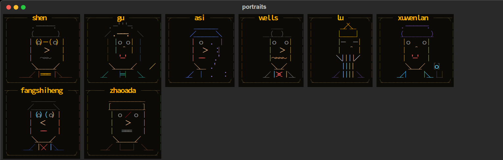

<div align="center">



*Ph'nglui mglw'nafh Cthulhu R'lyeh wgah'nagl fhtagn.*

*我以为，世上最仁慈的事，莫过于人类的心智无法把它所知的一切关联起来。*<br>

<sub><i>H. P. 洛夫克拉夫特，《克苏鲁的呼唤》</i></sub>

<br>

**在终端里玩《克苏鲁的呼唤》第 7 版**

[](https://github.com/satoshinji2992/autokeeper/actions/workflows/ci.yml)


[功能](#功能) · [截图](#截图) · [安装](#安装) · [开始游戏](#开始游戏) · [和朋友一起玩](#和朋友一起玩) · [模型与花费](#模型与花费) · [常见问题](#常见问题) · [文档](#文档)

</div>

<p align="center"></p>

AutoKeeper 用 AI 担任守秘人，你用中文输入行动和对话，骰子与状态由程序结算。可以独自调查、带 AI 同伴，也可以和朋友联机，或旁观 AI 调查员跑团。终端和浏览器均可游玩，仓库自带入门模组《追书人》。

## 功能

- **调查与即兴**：守秘人描述场景、扮演 NPC，按调查员背景安排开场。可以查案，也可以问路、吃饭、闲聊。选择即兴模式后，模组之外的人物、地点和支线会随本局保存。
- **检定与规则**：使用 BCDice 掷骰，支持常见骰娘指令、孤注一掷、幸运、理智、疯狂与成长。完整战斗和追逐规则尚未实现。
- **人物与记录**：可用描述或参考人物创建调查员，也可导入已有卡片。线索本记录发现、约定和物品往来，地图只展示已知地点；存档可继续，结局后可复盘。
- **彩色 ASCII**：场景、人物和物件以字符画显示，支持昼夜、天气和人物表情。模组插图尽量沿用，手稿保留完整文字、ASCII 预览和原图入口。
- **叙事调整**：可选篇幅、节奏、恐怖程度及需要略去的细节；F6 重讲最新一段，已结算的骰子和线索不变。F5 提供可修改的行动建议。
- **导入与扩展**：支持 PDF、Word、Markdown、文本及 ZIP 模组，也可从一句设定生成原创模组。编译与即兴时可开发带测试的规则插件，补充疾病、资源消耗和自定义行动。见[插件说明](docs/plugins.md)。
- **模型与联机**：支持 Claude、Codex、DeepSeek 和 Ollama，可分别选择游玩、导入和读图模型。画字符画、读图、挑照片用各家最强的模型：Claude 是 Opus 5.5，Codex 是 GPT-6-Astra；DeepSeek 画图用 V4 Pro，读图用 flash（V4 Pro 不能看图）。朋友可通过浏览器加入房间，也可通过 MCP 在 Claude Code / Codex 中主持。

## 截图

<p align="center"></p>

| 选模组 | 白天的书房 | 手绘场景 | 人物头像 |
|---|---|---|---|
|  |  |  |  |

截图里的《追书人》就附在仓库里，改编自 Chaosium 入门套装里的 *Paper Chase*，装好就能开团。手绘场景和头像来自用 AutoKeeper 生成的原创模组《多一人》。

## 安装

需要 Python 3.12+、[uv](https://docs.astral.sh/uv/) 和 Node.js 18+。想把照片转成字符画，再装上 [chafa](https://hpjansson.org/chafa/)。

```bash
git clone https://github.com/satoshinji2992/autokeeper && cd autokeeper
uv sync --extra claude --extra graphrag
uv run autokeeper setup
uv run autokeeper doctor        # 检查环境，缺什么会告诉你
```

<details>
<summary>各平台的安装方式</summary>

| | 安装依赖 | 设置 API key |
|---|---|---|
| macOS（zsh / bash） | `brew install uv node chafa` | `export ANTHROPIC_API_KEY=sk-...` |
| Linux（bash / zsh） | `curl -LsSf https://astral.sh/uv/install.sh \| sh`，`apt install nodejs chafa` | `export ANTHROPIC_API_KEY=sk-...` |
| fish | 同上 | `set -gx ANTHROPIC_API_KEY sk-...` |
| Windows（PowerShell） | `winget install astral-sh.uv OpenJS.NodeJS`，`scoop install chafa` | `$env:ANTHROPIC_API_KEY = "sk-..."` |

Windows 上请用 Windows Terminal，旧控制台对真彩色和鼠标的支持不完整。

</details>

## 开始游戏

```bash
uv run autokeeper           # 在终端里玩
uv run autokeeper serve     # 在浏览器里玩
```

第一次玩不必先导入模组：

1. 选“新的调查”，选择标有“初次推荐”的《追书人》。
2. 选一名预设调查员，或创建、导入自己的人物卡，再决定是否带 AI 同伴。
3. 读完开场，在底部输入行动，按回车。例如“我向站务员问路”“我先买份早饭”。需要检定时，按弹窗提示掷骰。

《追书人》从火车抵达小镇开始。沿途可以停留、交谈，也可以直接去托马斯家赴约。问路、歇脚不会因为没有找到线索就被当成卡关，游戏时间仍照常推进。

标题页的“设置”（F9）可以调整模型、备用模型、自由度、叙事偏好和画面，选择会保存。导入界面可为本次导入另选模型；长文处理和建库沿用导入模型，读图模型可单独设置。

F1 打开“玩法说明”。第一次遇到检定、线索等操作时，会出现简短提示，每种只显示一次，可关闭。即兴配图先显示简图，后台完成后更新；支持联网参考照片，离线时使用字符画。实现细节见[守秘人体验设计](docs/keeper-experience.md)。

如果模型中断，输入 `/retry`，或在功能菜单中选择“接着讲”。系统会从未完成的阶段继续，保留已结算的骰子和 NPC 回答。

<details>
<summary>导入模组、生成模组和观战</summary>

标题页选择“导入模组”，或使用以下命令：

```bash
uv run autokeeper import 模组.pdf
uv run autokeeper import 模组.pdf --model codex:default --vision-model codex:default
uv run autokeeper generate "1931 年上海，一张没有标签的唱片" --id changpian
uv run autokeeper autoplay modules/local/mymod --party 2
```

第二条命令分别指定导入与读图模型。导入完成后会在 Wikimedia Commons 查找有授权的照片并转成字符画，找不到的场景保留手绘；加 `--no-photos` 跳过，之后可用 `autokeeper art fetch` 补。`generate` 从设定生成模组；`autoplay` 让 AI 调查员游玩指定模组，也可在标题页选“观战”。

</details>

| 操作 | 作用 |
|---|---|
| `.ra 侦查` `.rab 恐吓` | 想在这里用某个技能：守秘人按情境决定掷不掷、多难；同样的尝试失败了不能重掷 |
| `.r 1d6+1` `.coc` `.st` | 掷骰、掷一组属性、看人物卡（不能改） |
| `.en` | 结局后做成长检定，每局一次 |
| F1 · F2 · F3 · F4 · F5 | 帮助 · 线索本与手稿 · 地图 · 人物卡 · 卡住时给三个思路 |
| F6 · F7 · F8 · F9 · F10 | 让守秘人换个讲法重讲最新一段（骰子和线索不变）· 前情回顾 · 手绘 · 换模型 · 结局后复盘 |
| Ctrl+R · Ctrl+S · Ctrl+A · Ctrl+T | 前情回顾 · 存档 · 换画法 · 换配色 |
| Ctrl+O · Ctrl+B · Ctrl+K · Ctrl+P | 叙事偏好 · 用量与估算花费 · 规则插件 · 全部操作 |

## 和朋友一起玩

同一个网络里（比如同一个 Wi-Fi），一个人开房间，其他人用浏览器加入，什么都不用装。

```bash
uv run autokeeper host                                         # 默认《追书人》：第一位调查员留给玩家，其余交给 AI
uv run autokeeper host modules/local/mymod --seats 玩家,玩家,AI   # 按预设调查员的顺序安排座位
uv run autokeeper join 192.168.1.5                              # 装了 AutoKeeper 的朋友也可以在终端里加入
```

开好房间后，终端会打印一个地址，比如 `http://192.168.1.5:8000`。把它发给朋友，打开后填个名字，挑一个空座。人齐了自动开局，也可以选“现在开始”，空着的座位交给 AI 调查员。

大家按座位轮流行动，轮到你时输入框才算数。全角括号开头的话是场外聊天，比如“（我去倒杯水）”，所有人都看得到，不算行动。有人掉线，AI 先替他走这一回合，他重新连上、坐回原来的座位就能接着玩。

游戏跑在房主的电脑上，用房主的模型和额度，每回合自动存档，下次用 `--load` 接着玩。模组的真相、NPC 的秘密和还没找到的线索只留在房主那边，朋友的屏幕上只有调查员该看到的东西。

## 模型与花费

默认使用本机 Claude Code 登录，也可设置 `ANTHROPIC_API_KEY` 使用 API。订阅额度和 API 费用由对应服务计算；使用 DeepSeek 等服务时需配置相应密钥。

```bash
uv run autokeeper --preset deepseek                   # 用 DeepSeek（需要 DEEPSEEK_API_KEY）
AUTOKEEPER_MODEL=ollama:qwen3:14b uv run autokeeper --search none    # 使用已下载的本地模型，关闭搜索
uv run autokeeper --model codex:default import 模组.pdf --id mymod    # 用 Codex 订阅导入模组
uv run autokeeper --preset deepseek --fallback ollama:qwen3:14b      # DeepSeek 连不上时换本地模型接着玩
uv run autokeeper --preset deepseek --budget 5                       # 花费超过 5 美元就停
```

`--mode 高级剧情` 提高叙事相关角色的思考强度，`--mode 经济` 降低思考强度，实际效果和速度取决于模型。游戏中按 F9 可切换。

Ctrl+B 查看用量与估算花费。费用取决于模型、上下文长度和回合数；未标价模型可能没有金额估算。可在 `~/.config/autokeeper/config.toml` 中分别配置各角色的模型，见[配置说明](docs/harness.md#换模型)；历史测试数据见[评测](docs/eval.md)。

## 在 Claude Code / Codex 里玩

仓库本身就是一个 Claude Code 插件：

```text
/plugin marketplace add satoshinji2992/autokeeper
/plugin install autokeeper@autokeeper
/autokeeper:play mymod
```

Codex 用户在 `~/.codex/config.toml` 里加上：

```toml
[mcp_servers.autokeeper]
command = "uv"
args = ["run", "--directory", "/path/to/autokeeper", "autokeeper", "mcp"]
```

## 常见问题

<details>
<summary>手上没有模组怎么办？</summary>

仓库自带《追书人》，开团时直接选，第一次玩也建议从它开始。想玩新的，可以在游戏里导入你手上的模组，或者就用 `autokeeper generate` 给一句灵感，它会查资料、写剧情、画场景，生成一本原创模组。

</details>

<details>
<summary>想严格按模组玩，不要守秘人即兴？</summary>

在标题页“设置”中将自由度改为“严格按模组已有内容”，或启动时加 `--improv 严格`。也可在 `~/.config/autokeeper/config.toml` 中设置 `improv = "严格"`。

</details>

<details>
<summary>导入的文件保存在哪里？会发送给模型吗？</summary>

导入成品保存在本地 `modules/local/`。使用云端模型时，导入与游玩所需的正文、图片会发送给所选服务；需要在本机处理时，应配置本地模型并关闭联网搜索。原文件的 `.gitignore` 规则只防止提交到 Git，不代表文件内容不会发送给模型。CoC 官方模组受版权保护，请只导入你拥有使用权的材料。

</details>

<details>
<summary>没有网能玩吗？</summary>

可以。需提前装好 [Ollama](https://ollama.com/)、下载模型和所需依赖，选择 `ollama:模型名` 并加 `--search none`。确认所有使用的模型都在本机运行；联网搜索、参考照片和云端模型在离线时不可用。

</details>

<details>
<summary>朋友连不上房间？</summary>

先确认大家在同一个网络里，再看房主电脑的防火墙有没有放行 8000（网页）和 8765（终端加入）这两个端口。在 WSL2 里开房间，需要在 Windows 的 `.wslconfig` 里打开镜像网络（`[wsl2]` 下写 `networkingMode=mirrored`），否则别的电脑连不进 WSL。

</details>

<details>
<summary>画面颜色不对，或者右边一栏不见了？</summary>

不支持真彩的终端（比如 macOS 自带的终端）会自动降到 256 色，换成 iTerm2、WezTerm 或 Windows Terminal 效果最好。终端窄于 96 列时右栏会自动隐藏。默认使用彩色纯 ASCII；Ctrl+A 可切换块字符加轮廓线、更细的六分块（终端字体不支持时会显示成方框）、不描轮廓的照片和纯 ASCII，也可以在设置里选择。模组原图仍保留；发现地图、病历或信件后，手稿窗口提供完整文字、ASCII 预览和“查看原图”，F2 可重看。

</details>

## 文档

- [守秘人体验设计](docs/keeper-experience.md)
- [规则插件](docs/plugins.md)
- [模型、上下文与 Agent 设计](docs/harness.md)
- [评测](docs/eval.md)
- [模组格式](docs/module-format.md)
- [更新日志](CHANGELOG.md)

<details>
<summary>全部命令</summary>

| 命令 | 作用 |
|---|---|
| `autokeeper` / `play` / `serve` | 终端界面 / 浏览器 |
| `import FILE --id ID [--pages 8-19]` | 导入模组 |
| `generate "灵感" --id ID` | 生成原创模组 |
| `research DIR` | 联网核实生成模组里的考据 |
| `check DIR` / `compile DIR` | 校验模组 / 编译成 Skill 包 |
| `index DIR` / `ask DIR "问题"` | 建模组知识库 / 向知识库提问 |
| `art color DIR` / `art show DIR NAME` | 给 ASCII 图上色 / 预览 |
| `autoplay DIR --party N` | AI 调查员自动跑团 |
| `host [DIR] [--seats 玩家,AI]` / `join 地址` | 开局域网房间 / 加入房间 |
| `setup` / `doctor [--ping]` | 安装 / 检查环境 |
| `trace` | 查看每个 Agent 的用量和花费 |
| `eval context` / `eval rhetoric` / `eval lore` | 跑评测 |
| `mcp` | 以 MCP 服务运行 |

全局选项有 `--preset`、`--model`、`--fallback`、`--search`、`--budget`、`--improv`。

</details>

## 路线图

- [x] 模组导入与原创生成
- [x] 终端、浏览器、Claude Code、Codex 四种玩法
- [x] Claude、Codex、DeepSeek、本地模型都能当守秘人
- [x] 彩色 ASCII、照片字符画、昼夜与天气
- [ ] 完整的战斗与追逐规则
- [x] 局域网联机，人和 AI 调查员同桌
- [ ] QQ / Discord 机器人
- [ ] 语音叙事

## 参与贡献

欢迎提 issue 和 PR，不管是 bug、新模组格式的支持，还是更好看的 ASCII 画。提交前请跑一遍测试：

```bash
uv run ruff check src tests && uv run pytest
```

## 致谢

骰子与规则来自 [BCDice](https://github.com/bcdice/BCDice)；Agent 编排基于 [LangGraph](https://github.com/langchain-ai/langgraph) 与 [LangChain](https://github.com/langchain-ai/langchain)；模组知识库用的是 [LightRAG](https://github.com/HKUDS/LightRAG)；界面基于 [Textual](https://github.com/Textualize/textual)；照片转字符画靠 [chafa](https://hpjansson.org/chafa/)。

## 许可

代码以 [MIT](LICENSE) 协议发布，`src/autokeeper/module/example/` 是 CC0 的格式样例。《追书人》是 *Paper Chase*（Bret Kramer 著，Chaosium 出版）的同人改编，原作版权归 Chaosium，仓库不含原书的 PDF；它的场景照片来自 Wikimedia Commons，作者和授权见 [CREDITS](modules/zhuishuren/art/CREDITS.md)。Call of Cthulhu 是 Chaosium Inc. 的商标，本项目与 Chaosium 无关。
