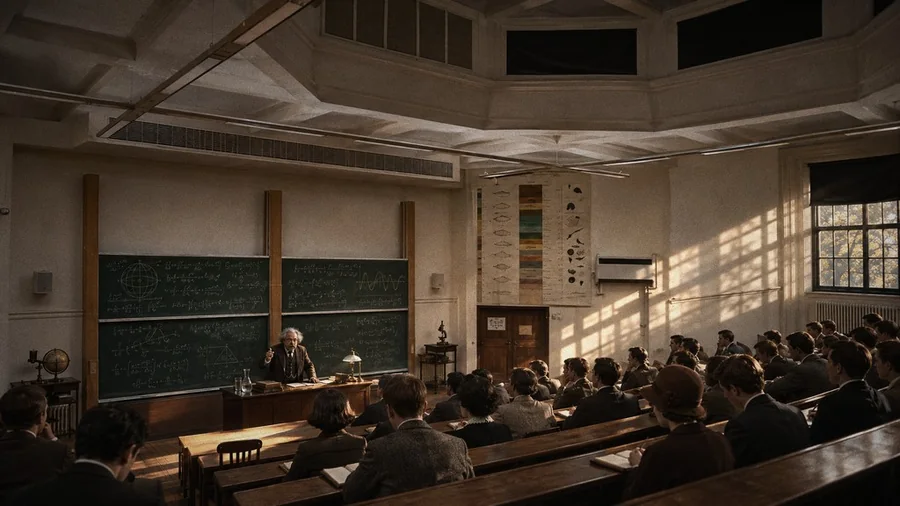
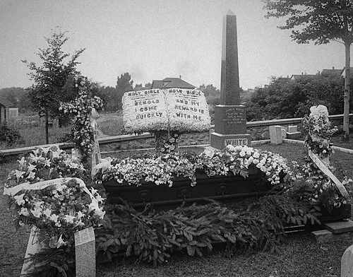
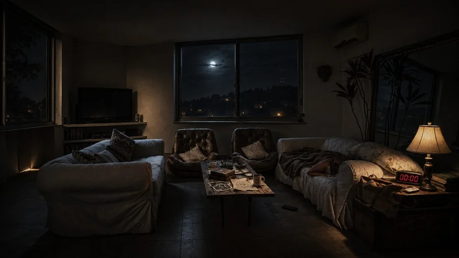
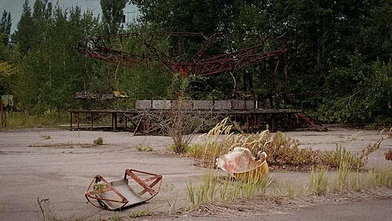

# CoC7

[返回模组库](../../README.md)

| 封面 | 模组 | 时代 | 人数 | 时长 |
| --- | --- | --- | --- | --- |
|  | [《失落的对称》](../../modules/shiluodeduichen/README.md) | 1920 年代 | 1-4 人 | 约 3-4 小时 |
|  | [《向火独行》](../../modules/xianghuoduxing/README.md) | 1927 年（秋） | 1 人 | 约 2 小时 |
|  | [《直到我们灰飞烟灭》](../../modules/tillwevanish/README.md) | 1939 年 2 月（纳粹德国） | 1-4 人（原作建议单人） | 约 1-2 次跑团 |
|  | [《失灵》](../../modules/shiling/README.md) | 2008 年（现代） | 1 人 | 约 3–5 次团（原作未写时长，按篇幅估计） |
|  | [《鱼！鱼！鱼！》](../../modules/yuyuyu/README.md) | 2009 年夏（原作融合 00 年代与 10 年代的时代风貌） | 2-4 人（原文未写人数） | 约 4-6 小时（原文未写，按各地点时长估算） |
|  | [《鲅鱼？鲅鱼！》](../../modules/bayu/README.md) | 现代（2025 年春） | 2-5 人 | 3-5 小时（线上文字团） |
