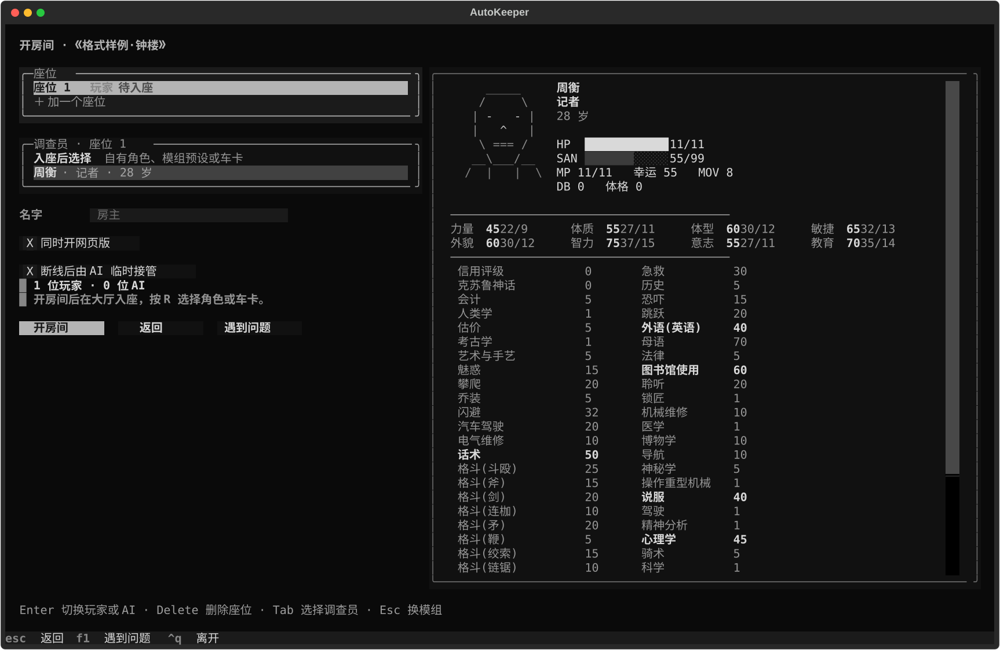

# 断线后的 AI 临时接管

2026-10-23。已合入 0.0.5 主线，随本版发行。

## 使用

开房页面提供“断线后由 AI 临时接管”，默认开启并记住本机上次选择。

命令行 `autokeeper host` 默认开启；`--no-disconnect-ai` 关闭。直接使用 `Hub` 的调用方以 `disconnect_ai=True` 启用。

房主确认断线后保留一分钟重连宽限期。期间仍保留原声明和未答选择；超时后由现有调查员 AI 临时代管。座位显示“AI 临时代管”，人物仍属于原来的真人座位。未启用时沿用等待玩家重连的行为。

## 行动与交还

- 接管优先延续已有声明；新行动使用角色自己的见闻、原有性格和约定，不读取其他玩家的私人经历。
- 已在等待的掷骰继续原检定；应对沿用原有默认选择；原声明重新确认时优先保留。待选的幸运或孤注一掷默认接受失败，不代替离线玩家另行支付幸运或编造推骰做法。
- 玩家重连后交还控制权，保留代管期间实际完成的行动、骰点和后果。AI 尚未执行的提议在返回时失效；已开始的行动不通过取消任务倒改。
- 所有真人离线时暂停，即使还有观战者也不持续调用模型。原本没有真人座位的纯 AI 房间在有人观战时运行，观战者全部离开后暂停。只有 AI 代管者的分支按真人活动或其他现场真实待办的时间需求继续，避免空转生成。

接管复用现有主持与调查员接口，不增加常驻角色，也不更改 `GameState.human` 的座位归属。断线计时器和当前代管标记属于本次房间；重开房间按实际连接重新判断，进行中的行动仍由现有存档凭据恢复。只有代管者的现场若没有实际时间进展，同一待办不会反复触发模型；有新真人活动或追赶时间变化后再继续。

## 验收

回归覆盖异地断线后双方继续推进、宽限期重连保留原选择、待选骰与应对、全员离线暂停、AI 准备期间玩家返回，以及真实战斗恢复不重掷。UI 检查覆盖开房选项和本机偏好。合入后补测零进展节流与继续追赶，接管及遭遇断线共 30 项通过，Ruff 与差异检查通过；最终全量结果见[发布验收](release-0.0.5-verification.md)。接管验证使用脚本模型与假骰，未调用付费模型。

这项工作只处理断线接管；到达忙碌现场后的 KP 合并属于另一个待办。
