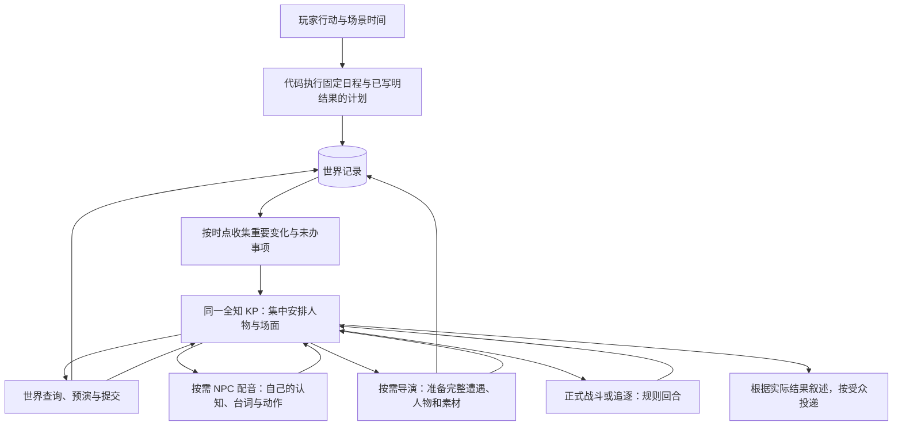

# 幕后安排并入 KP

基线 `d5c9735`，承接[世界工具接入](harness-keeper-tools-2026-10-24.md)。这批撤掉独立 NPC 幕后模型和导演周期复查，保留人物资料、配音、日程与即兴备场。代码在开发工作区修改，不发布、不替换安装；用户反馈相关的实际存档只读取证。

## 现在由谁决定

KP 仍能直接改目标、安排计划、移动人物、登记物件和改写未公开设定。眼前人物是否帮忙、隐瞒、慌乱或改变打算，由它结合完整场面判断。NPC 的身份、秘密、目标、关系和记忆继续保存；重要人物需要独立演出时，配音只拿自己的资料。普通反应不要求额外调用。

导演保留创作能力，但不再每次长时间跳过都复查 KP 的判断。KP 可用 `director` 请求完整备场，原有图片与插件准备机制继续工作。日常物件或简短人物行动可直接登记，不必请导演重新编一场戏。备场耗时不增加游戏时间；准备出新地点也不代表调查员已经前往。

## 日程与备忘分开

`world.scheduler.advance` 不再接收模型、调用配额或 NPC 决策器。它按到期边界执行准备好的操作，并保留日程游标；已经成功的移动、交物与事件不会在恢复时重做。影响眼前场面的固定安排仍经现有呈现入口承接。

需要临场判断的计划、受阻安排、到期约定、重要亲历和相关改写成为 `record.backstage` 备忘。它们是 KP 的工作笔记，不是另一套智能体、待审批队列，也不自动成为新行动。KP 可以决定暂时不动；考虑过某件事不等于目标或计划已经完成。

一次主持调用保存所收备忘的编号和版本。只有有效场面成立后才标记为已考虑；模型失败、草稿被退回或中途断开，事项仍在。旧回复不能清掉之后新增或更新的事项。相关资料随初始主持上下文进入同一会话，工具之间只追加实际回执。

分队不能共用一个“看到的最后事件序号”：较晚场景可能先提交，较早场景随后才产生新事件。日程进度与注意事项收集分开，落后场景仍能处理当时的新变化；未来事件不能提前送入较早场景的备忘。对事件逐项去重和按发生时点筛选，避免以提交先后替代游戏内时间。

## 遭遇与恢复

新增 `encounter_schema` 与 `encounter` 工具，完整遭遇格式按需取得，不塞进每次普通回复。它们复用现有战斗、追逐、首次目击 SAN 和保存记录。KP 能让反派主动发难，但不能用开场文字替调查员花掉一轮行动；伤害与反应仍按正式规则轮转。

导演和遭遇请求同世界工具一样，保存于 `pending_turn.keeper.calls`。请求、准备产物、实际提交、后果与最终呈现各有原回执；恢复沿已成立结果继续，不重新请导演写一次或重复开战。幕后备场摘要不再作为公开事件字段发送，界面只收到内容更新通知，显式分发的素材保留原受众。

## 插图与正文分别显示

实际游玩又发现《冬雪之下》开场把同一肖像的照片和备用 ASCII 脸并排弹出。回查开场输出，KP 请求的是已有的 `portrait:doreen_ratger`，没有新增人物或临时绘图。问题在界面把备用字符图作为手稿正文：照片显示成功后仍继续画一张纸。

插图现在只显示标题与图像，无法渲染或无原图时才使用备用 ASCII；信件、日记等真正材料继续保留完整正文和扫描图。保存的媒体数据与个人受众不变。提示词也说明普通人物登场沿用人物栏，必要特写由 KP 决定。前后界面快照在本地 `dev/output/media-illustration-2026-10-24/`，回归在 `tests/test_media_illustration.py`。

## 删除与保留

删除 `CastBrain`、独立 `Scene/Decision` 协议、周期 `Review`、`minds` 配额、`roles.world` 路由，以及在正文之后再启动的世界工作链。开发排查页改为显示 KP 未处理事项，不再显示不存在的 NPC 调用预算。

固定 `Plan → 裁定 → Telling` 协议仍在，开场和正式遭遇仍有专门流程；这批没有把它们冒称为已合并的自由主持循环。后续还需减少固定调用、统一资料装配，并用真实模型验证节奏与 NPC 表现。脚本测试不能证明恐怖感、创造力或实际 token 费用已经改善。

联机实局随后暴露的公共叙述人称、跨地点未完场面、旧背景图覆盖和错误重试另记于[存档审阅](multiplayer-save-review-2026-10-24.md)。普通分队现按各自场景推进，不仅因分钟不同就互等；真正会合及共同人物、物品才进入衔接。KP 保留叙事时间的协调权，正式战斗、追逐与日程照常结算。试玩预算独立于正常游玩，移除了误入共用配置的测试上限。

撤并后继续查出并修复了一处旧时间漏洞：先在第 960 分钟立标记，再回放第 840 分钟的计划，原先会提前执行。现在 `world/conditions.py` 为标记、归属、知情、承诺和人物状态保存紧凑的有效时间记录；位置判断复用实际移动区间。条件不再把共享的最新状态当成过去状态，对尚未出现的对象求否定也不会变成成立。

条件和移动的实际变化时刻进入日程边界，计划不会等到整段赶路结束才执行。过去操作若会覆盖已提交的未来状态，整条退回 KP，保留原记录；失败过程产生的临时图片登记一并恢复。条件历史随原操作撤销、保存和恢复，不依赖可能已被折叠的事件与撤销文本。正式事件立标记和结局门槛也接入这条记录，拒绝的标记不再发成功通知。

这是一层条件值的时间记录，不是所有模组资料和任意查询的完整历史快照。相关回归见 `tests/test_world_condition_time.py`、`tests/test_condition_time_audit.py`、`tests/test_engine_flag_time.py`；原复现保留在本地输出，现以这些正式测试验收。

存档格式升为 **4**。不维护旧后台工作结构的适配；旧文件会被明确拒绝，不迁移、不覆盖。当前格式的保存、恢复、重连和多人一致性继续验收。

## 离线验收

测试使用脚本模型、临时存档和本地连接，覆盖跨夜日程、NPC 主动协助、私有知识、分队时点、过时备忘、请求恢复、导演备场、正式遭遇及重复投递。幕后撤并与插图修复的首次完整回归为 **3541 通过、13 跳过**。

后续完整回归跑完 **3598 项**：3583 通过、13 跳过，另两项仍要求独立分队强制对时和失败后手动 retry。更新这两项旧预期、保留声明与结算不重复的检查后，两份相关文件 **17 项复验通过**；复验未再修改业务代码。当前合计验收覆盖 **3585 项通过、13 项跳过**。全量原始日志为本地 `dev/output/harness-backstage-2026-10-24/full-suite-final-confirmed.txt`。

Ruff、差异检查、`keeper-craft` 技能校验通过；格式示例为 0 项必修、2 条已有提示。本批未调用付费模型。
