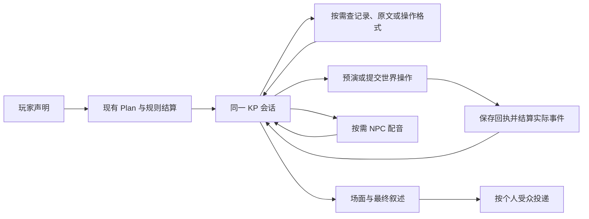

# KP 世界工具接入记录

基线 `7da2fcc`。本批接通同一 KP 会话的世界查询与操作，作为撤并后台判断的前置；没有发布、修改真实存档或调用付费模型。

## 实际执行路径

普通场面仍可直接提交最终叙述。没有 NPC 在场时也能使用世界工具，不要求先召唤人物配音。查询不会向玩家或 NPC 披露后台资料；实际对白、事件和最终呈现仍各自使用既有收件范围。

新增入口为 `world_query`、`world_schema`、`world_preview`、`world_commit` 和 `lore`。世界操作复用原 Gateway，包括人物移动、同行、目标、计划、日程、物件、承诺、见闻和设定改写，不新增第二个模型解释或审批操作。原文检索附带本局改写，静态资料不能覆盖新事实。

## 保存与并发

工具请求和结果存在已有的 `pending_turn.keeper.calls` 中。宿主生成执行身份、稳定编号与依赖版本；模型不填写这些字段。提交前保存请求，提交后先保存实际结果，再结算其事件和结局条件，最后把后果交还原 KP。中途恢复不重新安排玩家行动、掷骰或重复世界操作。

版本在模型请求前捕获，只检查本次操作涉及的记录。另一场景改了同一目标，就返回过时原因；远处无关人物改变计划不会使整份提案失效。查询结果作为当时的观察保存，读档后不悄悄换成新查询。

## 规则边界

即时移动使用现有场景时间、路程、人物可用时刻与遭遇约束；不能在较早场景覆盖人物的未来行动。同一建筑的房间和原位置未登记的人按原场景语义处理。未来动作可登记日程或计划，预演不提前执行。

通用世界工具不修改骰点、HP、调查员规则状态或直接向调查员分发模组线索；这些须经过已有规则入口，避免只写“得知”却漏算理智、神话和手稿。NPC 私下获知资料仍可记录；未来公开分发也不能绕过正式结算。KP 仍决定故事与透露时机。这是执行完整性检查，不审核叙述文字，也不保证模组可解。

成功提交后核对所有实际事件条件，包括移动与持物条件，不只处理新标记；隐秘标记的含义不额外广播。按标记触发的配图仍向实际见证者展示，幕后标记不消耗玩家尚未见到的配图。后果在原工具回执下恢复，同一 KP 根据已经发生的事交最终稿。

## 上下文与尚未撤并的部分

操作格式按需索取，可限定种类；精确查询不再附上一整份导演资料，提交回执也不重复整份操作。后续调用仅追加尚未确认的工具结果，完整回执保留供重述和排查。这里没有用字符数推算真实 token 节省。

本批提交时，固定 Plan／裁定／Telling 次序、NPC 后台模型和导演周期 review 仍在。后续已完成[幕后撤并](harness-backstage-2026-10-24.md)：移除后两者，并接入按需导演和正式遭遇工具。固定主持次序与开场专用流程尚在，不称为已完成的自由主持循环。

剩余开销已按实际调用路径核对：普通有效行动通常仍有 `Cast.plan → Game.rule / Cast.arbiter → Cast.keeper` 三次调用；元交谈、部分日常与正式遭遇有绕过路径，不能算成每轮固定三次。裁定阶段的 `_private_lore` 仍会预取原文，有知识索引时产生检索；检索本身不一定再调用一个模型。

本批观察到长时间跳过可能先由 `CastBrain` 安排人物，再由导演 `review` 判断一次，现已撤并。日志累计仍会触发 `chronicle`、`progress` 与各会话摘要，它们用途不同，应分别记录触发和输入，不能混成一个“记忆费用”。下一步继续处理固定主持调用、资料装配与摘要消费；不通过省略规则条件换取较短输入。

后续已让 KP 在换场景、时间跳过、承诺到期及重要变化时集中安排人物，并接通正式战斗、追逐与备场入口。代码继续执行日程与确定计划，删除独立 NPC 推演和重复 review。具体行为和恢复边界见幕后实施记录。

## 验证

离线回归覆盖同一会话的幕后操作、私有信息不提前投递、目标并发改写、预演与提交、工具与事件结算断线、草稿过时后更正、个人 SAN、路程、交物和分队时点。见证者到场用例补上真实经过的游戏时间，不能只填写 elapsed 而忽略人物刚刚发生的移动。

最终冻结代码全量 **3471 项通过、13 项跳过**；Ruff 与差异检查通过。日志保存在 `dev/output/harness-keeper-tools-2026-10-24/full-suite.txt`。测试使用脚本模型和临时存档，没有付费模型调用；不据此声称真实叙事质量、token 或费用已经改善。
