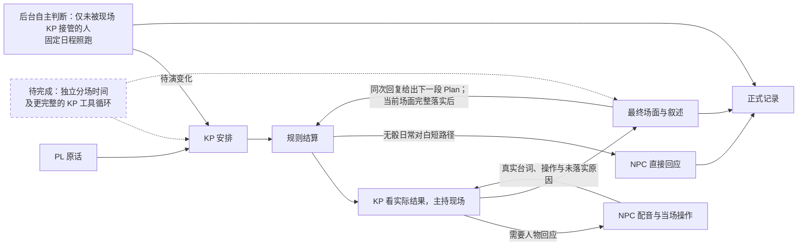

# 连续试玩后的 harness 职责决策

本轮依据三模组真实 DeepSeek 主持、BCDice 掷骰和子代理逐轮选择行动的记录，优先修复共用合同。具体经历、版本与证据见[连续试玩记录](playtest-three-modules-2026-10-23.md)。修复没有替玩家补成功、退还幸运或倒改旧局；《追书人》fix4 的自然结局属于 `62a24d6`，不能归到后来加载的补丁。成功后移动、NPC 输出读者约定及完成顺序已在后两批实现，实际长局只覆盖末段，不能替代最终版完整重跑。

本轮反复出现的是同一个动作在不同层有不同含义：幸运已扣、配音仍收到失败；真相说完、结构字段却被丢掉；NPC 尚未答应，裁定已把交付写成历史；旁白说放回，归属仍在背包。这些都不是把某个 NPC 改得温顺就能解决的问题。保留拒绝、欺骗、失败和死亡，修复的是决定如何进入记录、如何被下一位执行者使用。

修复选择先问三件事：模型是否拿到完整且有效的上下文，同一件事是否被多个角色重复决定，决定是否正确写入并交接。资料缺失修上下文，判断与演出修提示和职责；位置、物品、时间、投递范围与恢复由代码保证。只有旧接口确实无法表达已授权行动时才扩展结构，不为一次台词另加审批、阈值或角色。

目前采用以下职责边界，接口集中于 [Cast](../src/autokeeper/agents/cast.py)、[Game](../src/autokeeper/engine/game.py) 和[场面提交](../src/autokeeper/world/scene.py)。

| 执行者 | 决定与限制 |
| --- | --- |
| 主 KP | 理解原话，安排现场和即兴发展；叙述已经成立的结果，以 scene 提交人物、归属、见闻及完成事实。不能用旁白撤销骰后成功，也不能代玩家接受新条件。 |
| 裁定与规则 | 裁定员确定实际尝试、技能、难度和后果；规则代码掷骰、结算数值及恢复。私有依据供 KP 使用，公开检定目标与其分开；不预演 NPC 的交付。 |
| NPC 配音 | 从自己的知识、目标和当次有效结果出发回应，可求助、隐瞒或提出新请求；实际交物、同行及目标变化随同次结构提交。不能给调查员代答，也不能另判同一请求的成败。 |
| 后台与导演 | 固定日程由代码执行；场外人物需要判断时集中推演。导演准备未写的场景、人物与规则，不把候选线索的门槛直接拼成玩家检定。 |

实线表示已实现的普通主干，关键阶段各自保存，并非只在最后存档；出发前确认和抢先回应仍沿既有准备流程。普通KP安排与叙述现已共用历史、摘要和压缩，但仍分次调用。虚线是下一步建议，尚未合成完整工具循环，图中不表示重复决定已经消除。

已修的共用合同有几组。状态型 `Dialogue` 必须保留完整结构，不能把纯台词当作成功回复，或截取第一个 JSON 后丢掉尾字段。主行动由 `Turn.primary` 明确引用最终检定；幸运修改同一次骰，push 指向实际第二骰，事件自己的同名检定不能覆盖它。提交、通知和后续事件沿现有回合凭据恢复，不重新掷骰或发奖。

场面中的 `scene.flags` 只能登记已发生的声明事实，不能把意向算成完成；场面没有完整落实时不提交依赖它的标记。物件操作使用本地实际编号与唯一名称：放下、归还走归属操作，消耗才改数量，状态文字不代替转交。新即兴材料引入新对象或门槛时，交回同一 KP 理解剩余行动，再裁定，不能只补一个通用检定理由。

普通分场先保留每人的实际位置，独行只移动行动者；切换角色只是重锚定现场，不耗时、不触发到访。目击和现场理智按真实受众结算。有效 KP 安排接管本轮焦点现场，后台不再为每次站位变化另作决定；固定日程照跑，未读见闻不清空，离场后仍可处理。为此，[主持简报](../src/autokeeper/world/context.py)完整交接未完成、受阻和执行失败的事项。它会更长，不能预先宣称费用已经下降。

分场的信息投递仍需完善。一个无模型、独立状态的离线探针确认：广场调查员的普通侦查骰没有受众标记，异地调查员的公开日志也能读到该骰。现有显式私信、私有见闻和材料各有范围，普通分场尚未覆盖整轮的默认受众。后续须一起明确行动提示、骰、结果、正文与日志的投递约定，并保留全桌公开掷骰的选择；原始探针保存在忽略目录 `ordinary-split-dice-scope.json`，没有据此改动在玩存档或宣称完成联机验证。

移动顺序补上 `arrival_after_success`：进入或穿越本身是尝试时，成功前仍在出发点；前置努力与成功路程分别计时，成功沿 `_success` 到达。字段不强制掷骰，普通移动仍免额外裁定，目的地搜索仍先走再查。这解决一类顺序，尚未解决一般复合行动。《冬雪》T131 要先与房主签借据、交租取钥匙，再看房、回诊所，却直接走到诊所，配音把签单交给司机问车费，钥匙已取而字据、看房未完成。《油盐》T112–113“交谈后等到20:35”只交谈，T114 单独等待才推进时钟。后续应保留原请求和已完成步骤，由同一 KP 续办剩余部分，遇新事件或需要玩家选择时停下；不按时间关键词盲目补钟，不要求玩家反复拆句，也不急建完整执行队列。

NPC 与 KP 的双重决定也未消失。骰前的主动安排可能在骰后已经过时，配音和叙述又各选一种后果。下一步应让两者共同读取已经结算的场面，区分新提议与原请求；不能仅靠调整提示先后顺序，或新增在线审核员逐句批准。

密谈同样要区分意图、实际交流和玩家所知。《油盐》T117 的双胞胎把“只有两人听见”的话写入公开 `text`，随后又被记成全场见闻。现明确每次回复的实际收件调查员：`text` 只写其可感知内容，私有心境、计划及欺骗沿用 `mood`、`intentions`、`deceptions`。双胞胎共用一个实体，秘密跟踪打算无需新增投递层。若两个独立 NPC 确实交换了消息，KP 可用现有 `scene.observations` 列出真正听见者，记录私有亲历；不生成物证，不向后来到场者广播，也不把未来计划当已交流。提示约定不是严格防泄密的证明。

成本按实际调用归因。《冬雪》fix1 截至 T85 共 602 次调用，其中 mind 120 次、约 $0.5428，导演只有 4 次，已有同伴站位互相唤醒的证据。[《追书人》fix4](playtest-2026-10-23-zhuishuren-fix4.md)封存用量共 129 次、约 $0.2853：mind 12 次约 $0.0253，摘要 8 次约 $0.0145，导演 1 次约 $0.0085；KP 共 38 次，需结合场面修正和后续叙述逐项解释，不能把超出轮数的调用统称导演开销。两组版本与流程不同，不能据此算节省比例。完整诊断和角色用量是分析依据，摘要只是索引，不能替代正式事实。

下一轮优先顺序：

1. 先验证已成立结果是否完整交付，覆盖具体文字、物件、主检定与回应窗口；保留自然失败和各版本证据，不用测试数量评价叙事体验。
2. 再收敛复合行动与骰后配音交接，复用已有 Action、同次结构输出和恢复凭据，减少互相重判。
3. 用同版本片段及长局逐角色统计等待、修复、mind 和摘要成本，再决定合并哪些重复工作；不靠截规则、冷却或低预算掩盖遗漏。
4. 将已确认的前置、地点、时间和完成语义同步到模组编译与复核合同；仅修原规则执行缺口，不为个别角色或通关率调参。

补测成本窗口为 UTC 21:15 左右各局载入 d5b1a87 空补丁之后，至 21:30 已完成的各八轮：冬雪 T130–137 共 66 次、约 $0.2842，其中 mind 7 次/$0.0348、摘要 10 次/$0.0312；油盐 T117–124 共 62 次、约 $0.2087，其中 mind 8 次/$0.0208、摘要 5 次/$0.0285。两窗导演均未调用，格式修复分别 9 次和 8 次；这是完整逻辑调用内的修复计数。核到的 mind 人物都在主持焦点之外，未见现场接管漏挡；油盐八次却反复卡在同一“步骤无执行记录”：模型先标完成，后写实际操作，整组在首项被拒，不能靠冷却遮住。逐调用、角色用量及证据保存在忽略目录 `dev/output/parallel-playtest-2026-10-23/post-d5-cost-audit.json`。两窗场面不同，也未覆盖本批后续移动与私语补丁，不能据此计算节省比例。

另一个待办是《油盐》T124 的结果范围交接：公开检定目标包含“不暴露地观察”，侦查成功后，配音仍照骰前主动安排追出叫住调查员；私有依据只谈观察，非社交主检定目标与结果没有完整交到这一主动回应。应让同一 KP 与配音引用已结算的有效范围，重新核对尚未演出的安排；只给 NPC 它能感知的后果，不能向所有 NPC 公开调查员的隐蔽计划，也不能为该人物调低警觉。

这一轮后续补上两条共用合同。后台完成确认与实际操作仍放在同次决策中，由宿主在同一计划版本内先执行作用、再核对完成；替换新计划保留旧步骤完成的顺序。原输入编号、权限、完成条件、原子回滚、预览与待演一致，未加调度队列或调用。真实油盐T117的冻结状态与原决策离线重放已解除原首项拒绝：一人的实际行动与完成都入账，另一人的到场仍正确等待KP；没有改正在玩的存档。KP报告也补上所有主行动的公开目标与最终主检定，不将隐蔽计划广播给NPC。这是输入和执行合同的修复，尚未让骰后配音与KP合用一个场面决定，后者继续列为未完成项。

收尾还确认临时状态缺少持续时间合同：《冬雪》临时疯狂15小时后仍留卡，当前规则只添加条件，没有起止和恢复。截止后的离线修复已补临时疯狂的实际起止时间及已完成安全休息确认，区分发作文本与潜在状态；恢复不退还SAN，疾病与伤势仍按各自规则结算。没有以新添一句“记得恢复”代替持久时钟，也不为单个旧局强制清除标签；修后尚未重跑真实长局。

最终版本也暴露了完成证据本身的设计负担。Walter的后生待办是整理工资冒领账面，创建时没有 `achieved` 或操作；只交完成与说明被拒，下一轮又尝试将账面当自己的装备整理而被权限检查拒绝。要求同一模型另造一条 `Occur`，没有增加独立证据。后续计划创建应明确区分需要验证位置、交物等实际状态的步骤，以及可作为私有工作报告记录的定性任务；后者不能凭完成报告自动改变物件、位置或剧情标记。分类须显式声明，不能按文字关键词猜，也不能将所有空条件一律放行。当前拒绝符合代码，仍需审查这份合同是否必要。

最后两局已在UTC22:09:31前于完整回合安全关闭，均无pending，《追书人》保留自然结局。下一轮实施前先按上述根因分组选跨场景反例，再检查原存档问题是否消失；不要将每个问题各配一段专用提示或一条特殊规则。连续试玩末段的源码为 `c307dab`，该批全量2292项通过；随后追加的激进分叉仍使用相同运行码。时间截止后的离线修复另列，不能算进已完成的实测，详细范围及费用见总报告。

截止后的输入修复只把当前目标、变化依据、心境、同行和有效约定交给裁定员，取代初始goal。原有提示已经规定日常免检，不叠加同义禁令，也不按承诺自动放行；人物可能说谎、违约或真正改变主意。清空目标不回退，完成或违约约定不冒充有效事项。此摘要不带整套历史记忆、没有额外模型调用。普通联络仍可能被过度裁定，输入对齐不能冒称判断必然正确。

激进公开曝光短测还触发了风险与结果混淆：`pending.risk`是掷前告知的风险，并非押送完成的证据。离线修复将实际结构化结算与须由KP演出的失败代价分开交接，不因后者未演完而取消代价，也不替玩家接受尚待回应的选择；实际推进分钟取同一步骤保存的结果，不再次计算多人重叠。它修的是执行语义，不需要在线审稿角色。

普通分场的同步旁路已用无模型探针复现：两名human分处广场、钟楼，经真实Game.resolve生成首骰失败及pending_push；异地席的Hub._view、sync、welcome收到action、risk与value，实时骰、历史和Deed也缺受众。探针使用隔离路径、TableCast/FakeDice及真实投影方法，没有真实双机websocket；“1 passed”只表示探针成功确认泄漏，不表示修复通过。证据保存在忽略目录 `offline-push-scope-probe/`。后续应在结果生成时冻结名单，和既有Said及事件witnesses一样供日志与投递复用；同步中的pending_push也要按名单裁剪。不能在全局emit用当前active猜范围，且公开骰值不等于公开行动全文与私有风险。

三项离线修复的最终全量2320项通过（373.87秒），Ruff、差异及格式样例验证通过；修后真实模型复测仍未进行。付费试玩停在原五小时内，共享账本$9.712521，时间范围是否延长已请求澄清，未用等待代替同意。

## 后续离线修复：记录与权限的共同来源

这一批继续修共用接口，不修改人物难度、模组结果、导演冷却或调用名额，也没有增加在线审稿角色。

- **完成语义。** 既有 `Step` 显式区分 `state` 和 `report`。移动、交物等状态步骤保留真实条件与操作核验；人物自己的整理、回顾等定性工作可选择 `report`，由本人带说明提交，主持沿既有最高权限可代记，普通NPC不能改他人的报告。它只留下私有的“报告完成”，不能产生外部事实、位置、物品、剧情标记或玩家线索，也不能替别的状态步骤提供完成证明。报告内容回到本人后续上下文，明确为未经外部证实的工作判断；类型随计划交接，不靠关键词分类，不要求再造一条事件自证。
- **检定受众。** 普通行动产生检定时保存原现场名单，首骰、幸运、push、放弃、重复尝试及恢复沿用；实时结果、日志、完整检定记录、`pending_push`、sync和welcome读取同一范围。`public_rolls` 只允许向全桌公开普通骰值与技能，不扩大行动全文、风险或旧记录的读者。原始PL输入、默认KP正文、其他类别的骰仍未全部接入，不能宣称整个分场已经隔离。
- **本人休息。** 沿现有行动凭据保存本人实际休息的起止和中断情况，合并叙述可以确认真正参与者，不能顺带清除守夜或异地办事者的状态。并行休息没有新增全局分钟，仍保留个人完成时段；恢复不清除休息途中新发的疯狂。普通轮不注入整段休息提示。
- **当前线索来源。** 运行中的裁定、NPC资料、口述许可和KP简报共读世界记录里的实际知情者，撤回知情后不会由静态名单补回。原载体的发现条件与人物自己的透露条件分开，新证人不会继承他人的私人门槛，也不因已经知道内容而被要求再次查同一原载体。普通口述须满足实际在场、线索前置、自己的明确门槛和本次实际告知；知道摘要不代表持有或已经交出原手稿全文，材料走现有呈现与取得路径。规则明示的失败所得仍结算摘要、理智等后果；本次是否接触原载体的权限保存在原结算凭据中，不能因取得摘要自动发原文、解原人物门槛，也不靠伪造NPC已开口来补记录。

私有欺骗意图的五字相似度否决也已撤掉：独立人物产生相似打算，不构成知道对方秘密的证据。角色仍只读取自己的资料，依据引用、实际台词、身份、归属与操作权限继续核验；保密判断放在提示和离线评测中，不在运行时按文本相似度打回意图。

这批的程序回归与修后真实模型表现分开记录。旧三局和激进分叉保持原样，不能将后续接口测试计作修后通关或费用下降；复合行动续办、骰后场面决定统一和完整分场投递仍是剩余主项。

最终新增75项回归，全量2395项通过（380.07秒），Ruff、差异及格式样例检查通过；源码在完整测试前后保持一致。无新增产品模型调用，共享账本仍为$9.712521。此前一次测试因交叉审阅补齐失败材料旁路而主动中止，不计作完整通过。所有这些结果是程序验证，不替代修后真实长局。

## 复合请求：由同一 KP 根据实际结果续办

本轮继续按用户要求修共享接口和提示职责，不针对日记、托马斯或某个模组加规则。离线检查确认，《油盐》“交谈后等到20:35”既有模型漏读，也有计划保留了等待、执行链却没有续办出口的情况；《冬雪》签借据、取钥匙、看房再返回，则被单个目的地提前带走。只补一句“理解完整指令”，不能使剩余行动真正执行。

现在 `Plan.action` 只安排眼前能执行的一段，`remaining` 保留未办意图及条件。原来的 KP 叙述回复同时提供 `continuation`：继续一个即时行动、把决定交还玩家，或确认原请求办完。不是预先生成整串成功结果，也没有新增规划角色。普通单段仍用原回复结构；需要续办的纯对白段才补主持判断，不复述 NPC 已说过的话。

每段沿原有准备、裁定、掷骰、交谈及场面提交路径运行，保存独立行动编号。当前场面、到访及标记触发的后续事件处理完后，才采用最后一次有效的下一步安排。场面未完整落实、回复结构失效、进入遭遇或需要玩家选择时停止自动续办。已完成段保留实际骰与世界操作，不能重新算成未执行；原始玩家发言只记一次。

暂停的内容是本人私有的未办意图，不是自动任务队列，也不占据只能 `/retry` 的执行锁。下一次 KP 同时读它和新输入，采用的新计划替代旧安排；仍成立的尾段显式留在 `remaining`。这份笔记中的原话、未办条件和完成记录不随联机状态发给其他座位或旁观者，尚不表示整轮原始发言与正文已经私密。多人共享窗口仍按每人实际耗时累计，整条请求最后才消费原行动编号。

提示还统一了职责：KP 可决定并提交现场细节与人物反应，导演准备持续性资料；NPC 的披露许可与愿意透露分开。抢先反应的可感知描述只用可观察动作和公开讲话，不再用玩家行动摘要回填，摘要可能含隐蔽目的。这关闭了一个输入旁路，尚未证明所有主持安排都已正确隔离私人依据。

这些改动没有解决另一处已复现的断点：骰前的 NPC 安排在骰后可能过时，而非社交主检定的有效范围未完整交给配音。下一阶段应收敛同场决定及其实际交接；不能给所有 NPC 广播完整裁定理由，也不能再加逐句审稿、角色名特例或“成功率”调参。完整 KP 工具循环、整轮私密叙述和真实双机体验仍未完成。

本轮未调用付费模型，原五小时试玩与 $9.712521 账本保持封存。离线回归用于验证执行与恢复合同，不能据此宣称恐怖、创造力或整局体验已经达标。

本批新增58项回归，最终全量2453项通过（384.78秒），仍有4项既有fork弃用警告；Ruff、差异、技能与格式样例检查通过。完整测试前后源码、测试及本批技能文件一致。覆盖真正借物后续等候、原骰令仅作用首段、手掷／push／幸运之间读档、后续事件撤回旧计划、场面部分或失效时保留尾段、联机私有笔记与多人耗时；不据此替代真实模型复测。

交叉审阅另用原模组路线复现了并行场面的既有时间缺口：B先执行20分钟，A随后两段分别实际执行5、10分钟，个人累计正确为15分钟，全局增量均为0；场面预算仍按全局差值给0分钟，因而拒绝原需5分钟的NPC抵达。隔离对照仅用真实个人区间就能通过，未落地或修改旧档。可重复探针与结果保存在忽略目录 `parallel-playtest-2026-10-23/parallel-personal-scene-probe.*`。后续应统一个人行动区间、各处场面与共享事件的因果顺序，不能简单放宽路程或拿模型填写的 `ruling.minutes` 替代实际时间。当前多人耗时测试通过，不表示这个场面预算问题已修复。

## 骰后现场由 KP 主持，配音作为同会话工具

下一批继续处理已复现的共性断点。过去 `Plan.initiative` 的骰前预测在骰后直接交给 NPC；KP 看见完整结果时，NPC 可能已经公开演了相反的结果。原记录中已给过明确的“不完成失败请求”等提示，仍有冲突，不能再用某个角色的性格、警觉或合作概率补洞。

现在保留裁定前的 `first` 抢先反应，以及无骰日常对白的短路径。骰后参与意图只交给 KP 参考；有主检定或重复检定的对象回应，也由 KP 结合实际结果安排。需要人物回应时，同一 `keeper` 会话返回一个 NPC 工具请求，宿主沿已有 `_reply/Said` 执行私有角色配音、实际操作、披露和事件；真实回执回来后，KP 才给最终场面、正文与续办。它可以撤销旧的“发现并质问”，换一个人物主动帮忙，或让场面自然结束，不必逐项批准旧安排。

NPC 不再接收旧 cue 和整份裁定依据。工具只传 KP 选定的可感知情境与演出范围，人物保留知识、目标、心境及有意说谎的能力；主 KP 据实际交物、同行或未落实原因继续主持。私下回应复用原有 `private` 权限，仅向当前行动调查员投递，实际台词、材料、日志和重连沿用同一范围。模型仍可能写错演出指令，程序回归不能证明主 KP 永不泄密。

请求先存，再执行；恢复沿同一工具编号和 `Said` 继续。工具结果进入 KP 的正式会话记录，下一步刷新世界与场面资料，不继续使用交物前的持有人或离场前的人物清单。每个工具只存实际回复摘要，当前行动报告统一渲染，避免每次复制一份越来越长的完整报告。最终正文只有在合法结构与场面成立后展示；主协议的终稿需等完整结构，普通无工具协议仍保留原实时流。终稿续办无效时保留已完成正文与场面，交还未办意图，不能升级成工具失败并锁住新输入。

终端事件也随职责分开：配音先显示，最终正文开始时才发 `keeper_start`，避免先开一个空旁白框再插入 NPC。真实 Textual `StoryLog` 已验证空正文、无配音和有配音的显示顺序。结局仍须兑现本轮 NPC 回复及私人观察、材料，不因不能再提交新场面就丢掉交付字段；表演原话同样完整进入 KP 报告，注明实际听见者。

这不是新增常驻角色或在线语义审稿，也还不是完整的通用 KP 工具循环。骰前规划与主持仍各有会话，本批只接入现场 NPC 配音工具，任意检索、世界修改和新人物准备仍沿各自既有入口。无骰日常保留短路；实际调用配音的复杂回合会增加 KP 往返，不能宣称调用数或费用已经下降。需要同版本真实模型复测，比较结果一致性、等待与角色用量。

## 后台变化先交接，再接受下一行动

另一个真实引擎探针确认：KP 在20:25准备继续等待，后台却让 NPC 到场求救；原路径只在下一次解析时等后台结束，仍把旧等待执行到20:35。异地私人核账对照没有现场变化。因此本批在接受自动续办前完成已有世界工作，将实际可知变化交回同一 KP 决定，再读取最后的 `continuation`，不按全局记录版本变化一律暂停。

屏障在异步工作启动前保存区间、起点、实际工作收据与未呈现内容；本地 `Turn` 和执行阶段沿现有结算凭据恢复。即使在后台已移除 `npc_work`、尚未返回可见结果的间隙断线，也能从保存的事件起点恢复。更早的“正文已存、remember尚未启动”断线也已复现：内存 owed/task 丢失时，按持久世界进度与到期反应补回同一区间；`world_later=false` 不因此新增后台推演。

现场求救先演出并可改为 pending；异地私事不增加主持调用、不向玩家泄露。后台耗时不增加游戏分钟，没有重做原主骰、NPC 配音或原始输入。该修复使用旧世界执行器和最后叙述凭据，不新增世界审查智能体或待审批队列。个人时间与共享场面的预算问题仍按前节记录保留，尚未解决。

旧离线评测也须遵守新的职责边界。回放夹具只迁移协议与调用阶段，原八条玩家输入、三次骰、NPC台词与最终结果不变，没有付费重录。风格评测则明确提供固定计划与人物回答，先用真实回复流程落实，再比较文风；修正的是多出一段旁白的实验条件，没有调高预期次数，也不能拿它证明生产KP工具选择正确。

本批新增51项回归，最终全量2504项通过（381.90秒），4项既有fork弃用警告；Ruff、差异与模组格式样例检查通过。样例保留两项既有提醒、0项需修错误。完整测试前后源码、测试、技能与录像校验一致；旧封存档未修改，无新增付费调用，共享账本仍为$9.712521。新工具协议、真实操作回执、私有材料、终端日志、自动续办与后台交接的多个断线点均有覆盖，不据此宣称真实模型体验已经达标。

## 下一批：共同记忆、回执去重与实际时间

本节保留上批提出的设计依据。共同记忆与回执去重已由下节实现；实际时间区间仍未完成。

只读审阅确认，骰前 `plan` 不只是另一份会话，其 `memory=0`，每次主要靠本轮资料重建；主持则保留历史与摘要。后续应先统一普通安排、多人安排、主持及配音工具的记忆归属，继续复用现有图与恢复收据。不能只让 `_plan()` 返回 `_keeper()`：`_send()`仍会按阶段重新绑定历史；各次schema也须明确指定，避免默认Plan污染结局等调用。记忆键与阶段计费、追踪分开；现有plan模型和思考配置的含义须明确处理，不能暗中改变。裁定员继续隔离玩家原话，NPC继续读自己的知识，不将整个主持历史下发给它们。

免费真实引擎夹具还量到一次侦查、两次NPC回应的三个主持输入为13,755、14,493、15,269个Unicode字符，合计43,517；第一人的原话随后出现两份、四份。它同时进入当前报告、累计工具回执与历史。优先复用`Session.send(remember=...)`：仍提供实时完整现场，历史只追加新回执；统一原话来源，保留真实听众、披露、失败及实际操作。记忆确认与断线恢复须共用已有工具编号，不能漏存或重投。普通／续办结构本例分别为6,093／10,888字符且已compact，不以删能力或另加小判断调用换取表面缩短。这些是字符统计，尚无修后token、缓存与费用结论，去重实现也尚未完成。

分场时间须记录真正执行的起止区间，不能拿全局增量、`ruling.minutes`或个人累计量替代。共享窗口保留固定起点，尝试、推骰、失败、休息与路程沿现有阶段保存实际区间；同场重叠取并集，远处时段不借给眼前场面。共享NPC的实际操作还须按区间标时，尊重已经发生的移动和交付，避免两个现场重复使用同一段路程。独行从本人进度出发，真正同行才等待参与者后共同出发。该设计尚未实现；不为旧版结构增加兼容层，新版自身的保存恢复和因果一致性仍须完整验证。

## 共同主持记忆与增量回执已接通

本批让普通`plan`、`party_plan`、叙述和NPC工具真正使用同一个keeper Session。调用阶段与记忆归属分开：阶段仍以plan计费和追踪，使用原计划模型、effort及输入硬限；历史、摘要、窗口和后台折叠只归keeper。传输通过本次调用参数选择，不临时替换会话模型；Plan、PartyPlan与主持结构逐次指定，不污染后续纯文本、复盘或结局输出。裁定员仍不读取玩家修辞与主持历史，NPC仍只读取自己的知识。

安排只长期保存原话、行动者、地点／编号与未执行草案，实际查询保存问题和结果，重交保存未落实原因。首次现场报告保留行动结算，后续只追加新NPC回执；当前调用仍带完整最新报告和现场。工具原话按已有回复编号只写一份，回执附实际听众、已披露线索、成功操作及失败；世界日志中的“答应”“声称”“真实意图”保留各自语义，不能当成已完成交付。

记忆进度沿原叙述收据保存，并从同一编号的实际会话交换确认，不能仅凭调用次数前进。场面被拒绝后撤回的交换不算已记，最终固定场面收束仍会保留新回执。改讲法保存最终完整报告和对应增量记忆：前者重绘，后者准确替换最后一段，不删除后来已产生的Plan，也不重做人物、物件和检定。终稿展示期间断线仍可能重新生成并再次展示未确认正文；测试明确这一限制，不能据NPC通知不重复宣称所有界面通知恰好一次。

同一免费真实引擎夹具（一次侦查、两名NPC，调用数保持Plan1／Ruling1／Dialogue2／Hosted3）对照如下，基线为`bfb1e80`，不是两场不同剧情的费用比较：

| 已知文本量 | 上批 | 本批 |
| --- | ---: | ---: |
| 三次主持输入字符 | 43,517 | 44,209 |
| 最终主持历史字符 | 1,775 | 1,181 |
| 首位NPC原话在三次完整窗口的份数 | 0／2／4 | 0／1／2 |

新增共享计划记忆与真实操作元数据后，本例总输入增加692字符（1.59%），历史减少594字符（33.5%）。这些是Unicode字符，不能当成token、缓存收益或费用。已经消除了重复长期保存，但未证明每次请求更便宜；不为获得下降数字裁掉实际回执或改成另一场景。原付费窗口与$9.712521账本未变，修后真实模型表现与长局费用仍未复核。个人时间区间、完整通用工具及整轮私密投递继续未完成。

本批新增43项回归，最终全量2547项通过（387.83秒），仍有4项既有fork弃用警告；Ruff、差异与模组格式样例检查通过，样例两项提醒、0项需修错误。完整测试前后相关源码、测试、技能与录像校验一致。另有只读交叉审阅核对模型限额、阶段记忆、已提交操作、草案语义及恢复路径，未发现本批新增的阻塞问题；这仍不代替修后真实模型试玩。
