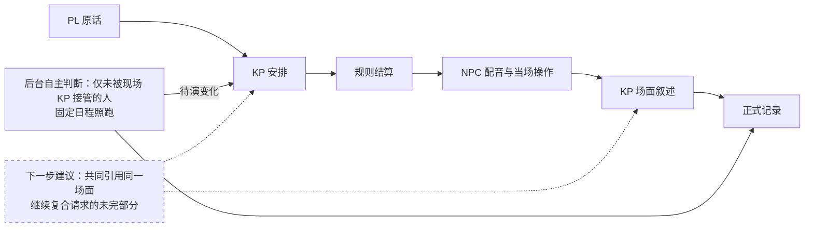

# 连续试玩后的 harness 职责决策

本轮依据三模组真实 DeepSeek 主持、BCDice 掷骰和子代理逐轮选择行动的记录，优先修复共用合同。具体经历、版本与证据见[连续试玩记录](playtest-three-modules-2026-10-23.md)。修复没有替玩家补成功、退还幸运或倒改旧局；《追书人》fix4 的自然结局属于 `62a24d6`，不能归到后来加载的补丁。当前成功后移动、NPC 输出读者约定是后续实现，须按各局实际载入版本继续验证。

本轮反复出现的是同一个动作在不同层有不同含义：幸运已扣、配音仍收到失败；真相说完、结构字段却被丢掉；NPC 尚未答应，裁定已把交付写成历史；旁白说放回，归属仍在背包。这些都不是把某个 NPC 改得温顺就能解决的问题。保留拒绝、欺骗、失败和死亡，修复的是决定如何进入记录、如何被下一位执行者使用。

目前采用以下职责边界，接口集中于 [Cast](../src/autokeeper/agents/cast.py)、[Game](../src/autokeeper/engine/game.py) 和[场面提交](../src/autokeeper/world/scene.py)。

| 执行者 | 决定与限制 |
| --- | --- |
| 主 KP | 理解原话，安排现场和即兴发展；叙述已经成立的结果，以 scene 提交人物、归属、见闻及完成事实。不能用旁白撤销骰后成功，也不能代玩家接受新条件。 |
| 裁定与规则 | 裁定员确定实际尝试、技能、难度和后果；规则代码掷骰、结算数值及恢复。私有依据供 KP 使用，公开检定目标与其分开；不预演 NPC 的交付。 |
| NPC 配音 | 从自己的知识、目标和当次有效结果出发回应，可求助、隐瞒或提出新请求；实际交物、同行及目标变化随同次结构提交。不能给调查员代答，也不能另判同一请求的成败。 |
| 后台与导演 | 固定日程由代码执行；场外人物需要判断时集中推演。导演准备未写的场景、人物与规则，不把候选线索的门槛直接拼成玩家检定。 |

实线表示已实现的普通主干，关键阶段各自保存，并非只在最后存档；出发前确认和抢先回应仍沿既有准备流程。虚线是下一步建议。**KP 规划与叙述仍分次调用，尚未合成完整工具循环**，图中不表示重复决定已经消除。

已修的共用合同有几组。状态型 `Dialogue` 必须保留完整结构，不能把纯台词当作成功回复，或截取第一个 JSON 后丢掉尾字段。主行动由 `Turn.primary` 明确引用最终检定；幸运修改同一次骰，push 指向实际第二骰，事件自己的同名检定不能覆盖它。提交、通知和后续事件沿现有回合凭据恢复，不重新掷骰或发奖。

场面中的 `scene.flags` 只能登记已发生的声明事实，不能把意向算成完成；场面没有完整落实时不提交依赖它的标记。物件操作使用本地实际编号与唯一名称：放下、归还走归属操作，消耗才改数量，状态文字不代替转交。新即兴材料引入新对象或门槛时，交回同一 KP 理解剩余行动，再裁定，不能只补一个通用检定理由。

普通分场先保留每人的实际位置，独行只移动行动者；切换角色只是重锚定现场，不耗时、不触发到访。目击和现场理智按真实受众结算。有效 KP 安排接管本轮焦点现场，后台不再为每次站位变化另作决定；固定日程照跑，未读见闻不清空，离场后仍可处理。为此，[主持简报](../src/autokeeper/world/context.py)完整交接未完成、受阻和执行失败的事项。它会更长，不能预先宣称费用已经下降。

移动顺序补上 `arrival_after_success`：进入或穿越本身是尝试时，成功前仍在出发点；前置努力与成功路程分别计时，成功沿 `_success` 到达。字段不强制掷骰，普通移动仍免额外裁定，目的地搜索仍先走再查。这解决一类顺序，尚未解决一般复合行动。《冬雪》T131 要先与房主签借据、交租取钥匙，再看房、回诊所，却直接走到诊所，配音把签单交给司机问车费，钥匙已取而字据、看房未完成。《油盐》T112–113“交谈后等到20:35”只交谈，T114 单独等待才推进时钟。后续应保留原请求和已完成步骤，由同一 KP 续办剩余部分，遇新事件或需要玩家选择时停下；不按时间关键词盲目补钟，不要求玩家反复拆句，也不急建完整执行队列。

NPC 与 KP 的双重决定也未消失。骰前的主动安排可能在骰后已经过时，配音和叙述又各选一种后果。下一步应让两者共同读取已经结算的场面，区分新提议与原请求；不能仅靠调整提示先后顺序，或新增在线审核员逐句批准。

密谈同样要区分意图、实际交流和玩家所知。《油盐》T117 的双胞胎把“只有两人听见”的话写入公开 `text`，随后又被记成全场见闻。现明确每次回复的实际收件调查员：`text` 只写其可感知内容，私有心境、计划及欺骗沿用 `mood`、`intentions`、`deceptions`。双胞胎共用一个实体，秘密跟踪打算无需新增投递层。若两个独立 NPC 确实交换了消息，KP 可用现有 `scene.observations` 列出真正听见者，记录私有亲历；不生成物证，不向后来到场者广播，也不把未来计划当已交流。提示约定不是严格防泄密的证明。

成本按实际调用归因。《冬雪》fix1 截至 T85 共 602 次调用，其中 mind 120 次、约 $0.5428，导演只有 4 次，已有同伴站位互相唤醒的证据。[《追书人》fix4](playtest-2026-10-23-zhuishuren-fix4.md)封存用量共 129 次、约 $0.2853：mind 12 次约 $0.0253，摘要 8 次约 $0.0145，导演 1 次约 $0.0085；KP 共 38 次，需结合场面修正和后续叙述逐项解释，不能把超出轮数的调用统称导演开销。两组版本与流程不同，不能据此算节省比例。完整诊断和角色用量是分析依据，摘要只是索引，不能替代正式事实。

下一轮优先顺序：

1. 先验证已成立结果是否完整交付，覆盖具体文字、物件、主检定与回应窗口；保留自然失败和各版本证据，不用测试数量评价叙事体验。
2. 再收敛复合行动与骰后配音交接，复用已有 Action、同次结构输出和恢复凭据，减少互相重判。
3. 用同版本片段及长局逐角色统计等待、修复、mind 和摘要成本，再决定合并哪些重复工作；不靠截规则、冷却或低预算掩盖遗漏。
4. 将已确认的前置、地点、时间和完成语义同步到模组编译与复核合同；仅修原规则执行缺口，不为个别角色或通关率调参。

补测成本窗口为 UTC 21:15 左右各局载入 d5b1a87 空补丁之后，至 21:30 已完成的各八轮：冬雪 T130–137 共 66 次、约 $0.2842，其中 mind 7 次/$0.0348、摘要 10 次/$0.0312；油盐 T117–124 共 62 次、约 $0.2087，其中 mind 8 次/$0.0208、摘要 5 次/$0.0285。两窗导演均未调用，格式修复分别 9 次和 8 次；这是完整逻辑调用内的修复计数。核到的 mind 人物都在主持焦点之外，未见现场接管漏挡；油盐八次却反复卡在同一“步骤无执行记录”：模型先标完成，后写实际操作，整组在首项被拒，不能靠冷却遮住。逐调用、角色用量及证据保存在忽略目录 `dev/output/parallel-playtest-2026-10-23/post-d5-cost-audit.json`。两窗场面不同，也未覆盖本批后续移动与私语补丁，不能据此计算节省比例。

另一个待办是《油盐》T124 的结果范围交接：公开检定目标包含“不暴露地观察”，侦查成功后，配音仍照骰前主动安排追出叫住调查员；私有依据只谈观察，非社交主检定目标与结果没有完整交到这一主动回应。应让同一 KP 与配音引用已结算的有效范围，重新核对尚未演出的安排；只给 NPC 它能感知的后果，不能向所有 NPC 公开调查员的隐蔽计划，也不能为该人物调低警觉。
