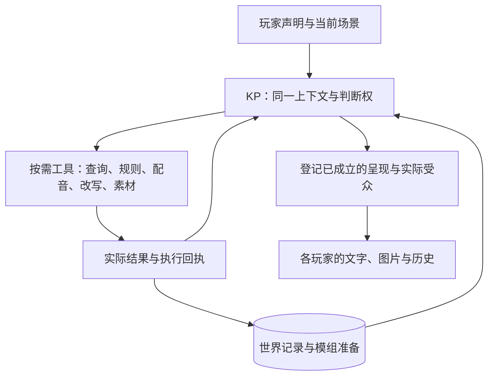

# 轻量主持架构

2026-10-24。基于 `9b19bfd` 的实际调用路径审阅。本文给出后续迁移方案；本轮只简化通用文件工具执行器，**尚未替换游戏主循环**。不发布、不修改真实存档、不调用付费模型。

## 目标与判断

推荐收敛为：**一个逻辑上的 KP，按需调用工具，共用一套持久执行记录。** KP 掌握全部资料、解释玩家意图、扮演人物、安排幕后与节奏；程序处理规则、事实提交和个人投递。独立场景可以并行主持，人物持久身份和个人画面不要求常驻模型。

这套边界能统一处理许多现有问题，不能保证模型不会误解、泄密或写出平淡的场面。编译资料缺少条件，仍要修编译；人物性格、冲突与恐怖节奏需要提示词和实际游玩验证。把这些问题全部变成运行时关卡，只会重新堆出当前的复杂度。

## 当前的重量在哪里

`Cast.plan` 已经使用同一个 keeper Session；问题不是规划和叙述彼此没有记忆，而是同一 KP 仍被要求先交 `Plan`、经过固定阶段，再交 `Telling`。

| 当前实现 | 应收敛的方向 |
| --- | --- |
| `engine/graph.py` 固定 parse、prepare、rule、resolve、talk、narrate | KP 自行决定下一步，按需查资料、检定、交谈与呈现 |
| `Dialogue.changes/items/accompany/leave/acts/intentions` 等多个操作入口，另有 `Plan.people/present` 与 `Telling.scene` | 一套有类型的世界操作与一个提交入口；角色工具返回台词及提案 |
| NPC scheduler 唤醒、reaction/ripple 与导演长时间 review 并存 | 确定日程由代码执行；重要变化和时间跳过由 KP 集中判断，导演只按需制作大块素材 |
| Hub 的 pool/phase、保存状态的 pending/round_plan、图节点各记一份进度 | 一份持久执行状态；网络与界面只读取它 |
| `SceneTable.__dict__.update(root.__dict__)` 后手工替换大量字段 | 显式场景会话，连接与广播留在房间层 |
| 规划、配音、主持包装、场面各有自己的修复循环 | 工具返回具体失败；KP 处理未完成部分，不重新生成全部经过 |

对应入口为 `agents/cast.py`、`engine/game.py`、`engine/graph.py`、`world/scheduler.py` 和 `net/scenes.py`。不能只删队列而保留异步改变场面的生产者，也不能只卸载图框架就声称完成轻量化。

## 主持循环

普通场面可以一次 KP 回复完成。需要检定、重要 NPC 配音或新遭遇时才调用对应工具，再根据真实结果继续。调用次数由任务决定，不要求每个节点走一遍，也不承诺复杂场面一轮只调用一次。

工具按任务提供明确参数，不让每次回复携带所有规则和全部场面字段。查询只读；规则工具复用现有骰点、伤害、SAN、战斗和追逐实现；人物配音返回台词与操作提案；世界操作仍有明确类型。重要 NPC 的私有知识可通过配音工具隔离，普通人物由 KP 直接演。保留裁定员作为按需规则助手，是否进一步合并须先验证话术诱导与规则正确性。

KP 的世界权限不变。即兴出场、交物、改变目标与通名都能直接提交；需要改变原设定时明确改写，不能只靠正文让记录自行猜测。检验位置和归属不等于规定剧情必须可解，也不构成对隐藏真相改写的独立审批。

## 一份执行状态，不是整轮一次事务

每条玩家声明只有一个稳定编号，原文、接收时刻和作者只存一次。场景会话持有成员、场景时钟、遭遇及 KP 上下文；一次执行只引用声明编号，保存版本、状态、已执行工具回执、等待的玩家选择和待投递内容。

生命周期为：收集声明 → 构思 → 执行工具／等待选择 → 呈现 → 完成。工具结果可以让 KP 继续构思，但新输入或技术失败不自动回滚已提交结果；主动撤销和设定改写仍须明确登记。

多人在构思期间补交有资格的行动，可使旧草案过期，携全部原声明和新声明继续判断。本段在首次执行有副作用的工具或开始呈现前封存声明；查询资料不封存。封存后的新行动进入下一段，工具结果返回后的再次构思不重新开放本段资格。**已掷骰、已转交物品、已经播出的台词都保留**；后续判断接着这些结果处理。战斗和追逐继续按规则轮转，不用普通场面的打断取代行动权。

工具按自己的稳定编号幂等执行；相互依赖的一组世界操作可原子提交，整轮不能因为最后一次模型失败就全部重来。呈现先保存正文、受众和投递编号，再发送；重连重发同一内容并去重，不重新问模型，也不承诺网络只发送一次。

## 多人、后台与时间

一个逻辑 KP 表示统一职责与世界权限，并不要求所有分队串行等待。每个独立现场运行同一种主持循环；同处者一起判断，不为每个座位维护另一个 KP。共享 NPC、物品和事件在提交时核对相关版本与有效时刻。不能因为乙场景先完成下午的调用，就让上午的甲读到未来；按时点查询仍需要补齐，不能由“最新快照”替代。

合流或长时间等待由 KP 决定时间衔接。确定日程照规则执行；需要判断的幕后变化在有意义的触发点集中处理，不给每个 NPC 定期问一次“下一步做什么”。

导演、图片、插件编写作为有任务编号的后台工作，准备与生效分开。眼前必须使用的内容未准备好，保留行动并等待或由 KP 接管；无关图片不阻塞全局。素材准备耗时不自动增加游戏时间；新内容仍通过同一世界提交与个人投递入口生效。

## 上下文与费用

保留稳定的主持原则、相关场景的完整准备、近期原对话、人物当前动机及未办事项。旧原文、原始工具结果与模组全文保存在可查询记录中；会话压缩不删除出处，也不让摘要改写实际事件。每次工具完成只追加该回执与相关变化，避免反复抄写累计报告。

优先减少固定调用、重复字段和重复历史；规则与发现条件不靠截断节省。不要每轮挂载全套插件与遭遇 schema，也不要另加一个模型决定该查什么、该给谁看。最终比较供应方上报的 token、缓存、等待和修复次数，字符缩短不能当作费用下降。

## 迁移顺序与本轮进度

1. **已做：** 通用 `harness.Agent` 的无 checkpoint 图包装改为普通异步工具循环，保留工具、会话、错误反馈、步数和取消行为。这主要用于导入及文件工具任务，不减少普通游玩的模型调用，也未移除项目的 LangGraph 依赖。
2. **待做：** 在保留现有规则和操作实现的前提下，统一声明编号及持久执行状态；单人、开场与联机使用同一入口，删除重复进度权威。
3. **待做：** 将固定 Plan／Telling 流水线合并为 KP 工具循环；移除旧入口，不并列维护两套生产路径。
4. **待做：** 取消重复的 NPC 后台判断，显式场景会话替代 Hub 状态复制；后台素材按同一任务接口衔接。

每步保留八组验收：指代与完整意图、NPC 主动协助、思考期间补交行动、掷骰／对白后断线、抢同一 NPC 或物品、私人别名重连、战斗追逐反应、分队与会合时间。用相同输入比较质量、调用、输入 token、等待和恢复；没有真实模型结果前不宣称费用或叙事质量改善。

本轮通用执行器与实际调用者的相关离线回归 **118 项通过**，Ruff 和差异检查通过。新增取消、工具报错后继续及重复运行的边界回归；验证范围包括模组导入与世界工具，未重跑游戏全量测试。

## 外部参考

Anthropic 2026 年的 [Managed Agents 架构说明](https://www.anthropic.com/research/managed-agents)将持久会话、模型循环与执行环境分开，并强调旧模型需要的补救措施可能随模型升级失效。这里借鉴的是可替换的接口与独立记录，不引入其托管服务。

[上下文工程说明](https://www.anthropic.com/research/effective-context-engineering-for-ai-agents)讨论了相关资料预置、按需查询、压缩与持久笔记。AutoKeeper 的场景、规则、个人观察与提交边界是本项目据此提出的设计，不能当成该文章对跑团效果的实证。
