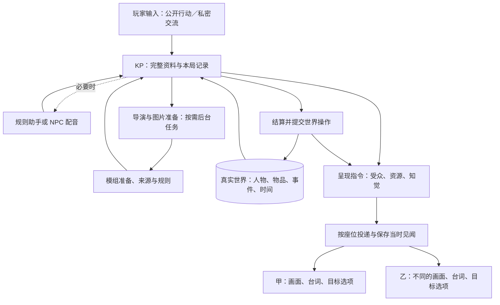

# 主持、个人知觉与呈现：0.0.5 运行架构

2026-10-22。本文区分已经接入的代码与后续分场设计。当前允许直接修改存档、协议及内部接口，不维护旧版适配。

## 核心分工

KP 读取完整模组和本局记录，决定人物反应、场面与节奏。程序负责掷骰、位置、物品归属、提交和受众投递。NPC 配音与规则助手按需调用；导演负责需要提前准备的扩展和跨时间安排。个人视角不需要一个常驻智能体，重要人物的持久记录也不等于一个持续运行的模型。

一轮主持产生两类结果：**世界操作**改变实际发生的事情，**呈现操作**决定谁在何时收到哪些文字、图片或材料。它们沿用一次模型判断和已有结算记录，不另加语义审批员。

这里的两个输出是职责划分，不要求每轮额外调用模型。规则助手保留对玩家原话的隔离，普通闲聊不因此增加一次裁定。

## 四种记录不能混写

| 记录 | 例子 | 用途 |
| --- | --- | --- |
| 真实状态 | 钥匙由乙携带，乙受到三点伤害 | 位置、归属、伤害与时间的唯一依据 |
| 知情与消息来源 | 甲看过钥匙；丙听说钥匙丢了 | NPC、AI 队友的上下文与可查询资料 |
| 对外说法 | 乙说“钥匙不在我这里” | 台词与谎言，不自动修改归属和真实目标 |
| 个人见闻与知觉 | 甲把乙看成怪物，只收到一张纸条 | 本人的画面、选项与历史，不改变真实身体 |

KP 可以改写尚未揭示的真相，也能制造新路线；这需要明确的设定操作。一次幻觉或一句谎话不属于设定改写。

## 让 KP 自己决定给图

KP 的同次输出可以携带少量呈现指令：`show` 展示，`clear` 清除当前画面，省略则保持。指定 `to` 为调查员名单；公开呈现另行明确标记。

资源引用使用 `scene:地点id`、`portrait:人物id`、`handout:材料id`、`image:资源key`。模型不提交本地路径或网址。程序只解析当前模组或本局已经落实的资源，仍使用原有彩图转字符和终端绘制。

- **场景图**持续显示，直到换图或清除。
- **插图与手稿**在合适时刻打开；已经交付的材料留在收件人的资料页。
- **私人画面**只发送给指定座位，恢复时也按该范围投递；不能先广播再靠客户端隐藏。
- **原模组图片优先**。没有合适资源时，通过已有导演与图片准备任务生成，再由 KP 选择呈现；私聊本身不偷偷启动另一条生成链。

资源生成、选择展示、调查员获知是三个阶段。准备好的暗室图片不表示玩家去过暗室，后台画像完成也不表示全桌已经见到人物。清除图片不撤销人物已经读过的材料。

KP 上下文只给当前相关资源的简短索引，避免每轮注入全库图片说明。模型只需要发引用，图片内容由投递层处理，不把图像或重复材料正文塞回每个角色的历史。

## 秘密联系与不同知觉

PL→KP 私密交流独立于公开的 `/kp` 提问。服务器从连接座位确认身份，输入、回复、资料及恢复记录按受众保存。普通私信用于交谈，不绕过检定偷偷完成物理行动；秘密行动仍需进入同一世界结算。

“甲以为在攻击怪物，实际攻击乙”沿用一个乙的真实实体。甲收到自己的称呼、画像和可操作目标句柄，服务器把句柄解析为乙，按真实规则结算。乙收到遭到甲攻击的反馈，可以正常应对。真实阵营与伤害不为了幻觉复制一份。

不能只改旁白：目标按钮、战斗表、画像、角色卡、伤害反馈和重连都须遵循个人投影。也不能用当前幻觉重写昨天的历史，或在恢复清醒后倒改当时收到的见闻。客观原始记录供 KP 与明确开启的开发者模式查询，玩家回放保留当时的投递结果。

## NPC 改变目标与完整遭遇

NPC 回复可以附带自己的真实目标变化和新的未完计划，说明依据。程序复用已有世界操作一次提交，保留撤回旧计划的原因。普通人物建立一份被动记录即可，不因此新增后台模型工人。真心改变与嘴上敷衍分别记录；没有真实变化时不改目标。

即兴遭遇应在呈现前准备必要资料：人物身份与在场位置、动机、数值与攻击、场地及路线、触发条件、规则和可结算后果。新增事件的人物出场必须进入实际记录；不能只把名字写进朗读文字。编译与导演复用相同模组结构，现有引擎结算，不另造一套即兴规则系统。

同样，孤注一掷和幸运是对原行动的继续。成功后不仅发线索，还要落实原裁定的转交、装备、日常物件、汇合、通路与插件动作；选择和结果保存后，重连不重掷、不重复付款。

## 后台任务与并行现场

可以并行准备未共享资源的场景和图片；NPC、物品与时间产生交集时才协调提交。准备耗时不等于游戏时间流逝。眼前剧情必需的资料尚未落实时保留行动并等待；非必需图片可以稍后补上，完成后仍遵守原收件人范围。

**完整分场主持仍需进一步实现。** 当前同窗多人预规划不等于各组拥有独立现场。后续统一为 `SceneState`：现场人物、地点、时刻、近期对话、未完行动、遭遇及模型会话。每个独立现场可由短期主持任务并行处理，只在提交共享世界时占用短事务；不继续用一个全局现场配上多套旁路。

跨场消息、NPC 移动、物品交接和时钟事件必须带发生时间，避免先推进到下午的现场让仍在中午的玩家读到未来。协调处理真实资源冲突，不检查文学风格，也不要求每人每轮发言。

## 本轮交付与验收

本轮代码以私密交流、资源投递、个人知觉、NPC 目标改变、即兴遭遇缺失字段及普通检定继续结算为范围。具体通过项和未覆盖路径见本轮实施记录；不能把接口存在当作所有游玩路径已经完成。

验证采用脚本模型和预设骰，检查两人不同画面、私信不外传、真实受伤、目标变化沿用、第四个大场景不被截断，以及中断后的恢复。未调用付费模型，不能据此宣布真实主持表现或 token 费用已经改善。图像费用设置与生成限制单独保留，不拿它们决定人物能否拥有记录。
