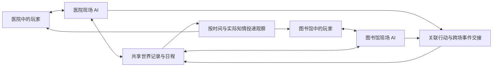

# 0.0.5：多个现场并行主持

2026-10-22 起草，2026-10-23 更新。0.0.5 已接入独立现场执行、个人时间、会话恢复和共同资源交接；发布验收见[验收记录](release-0.0.5-verification.md)。下文保留设计依据和实施前的限制。

## 分场粒度：只为大的调查分支分配 KP（2026-10-23 确认）

用户确认：按大场景与大的调查分支分配主持上下文。楼层、房间、具体位置和个人见闻分别记录，不因此增加一个 KP。

- 所有人都在医院，一人去二楼、一人留在一楼，仍由同一个 KP 统筹医院内的局势、声音、碰面与相互影响。
- 一组继续调查医院，另一组前往图书馆形成独立调查分支，才分配两个 KP。
- 私聊、单独搜查房间、同一大场景内与不同 NPC 交谈，都不单独拆出 KP。各人的实际位置、可见信息和收到的叙述仍分别维护。
- 具体地点 ID 不同或行动耗时不同，不能单独作为拆分 KP 的理由。分配应依据地点所属的大场景，避免每间房、每层楼各建一套主持会话。

实现沿 `Location.within` 向上找到所属大地点：同区成员共用主持，实际房间、知情和个人时间分别保存。离线回归已覆盖同一建筑内不同房间共用 KP，以及独立地区分开主持；真实主持质量另行验收。

### 会合与时间衔接（2026-10-23 用户确认）

位置相同即可视为会合，接入同一个 KP，由它统筹双方的行动和时间进度。同一大场景内原本就共用 KP，实际能否面对面交谈仍按各人所在房间判断。

用户随后明确：**会合时跳到合理的共同时间是正常处理，不必补演各人的等待，也不把时钟自动对齐本身当作缺陷。** 例如甲于 12:30 抵达图书馆，乙正在查档、到 14:00 告一段落，就可以略过甲的等待，在 14:00 会合。KP按实际日程交代这段时间的变化；已有原始记录保留，不为对齐新增一套等待确认或逐分钟推演机制。

时间衔接仍不代替检定和玩家选择：查档尚有未答骰子就先结算，不能仅凭预计结束时间宣布找到东西；会合也不自动共享此前的私人见闻。玩家明确想中途找同伴、协助或打断时，再按当时情境处理，不要求普通会合都实现完整的中途插入系统。

本次代码核对的完成范围：`SceneRuntime.reconcile()` 已按所属大场景合组，不要求个人时间相等，并保留 `member_at`；已有回归验证不同个人时刻合组后仍保留各自时间。

当前实现边界：

- 有 `busy`、`pending_turn`、`encounter` 或 `reservation` 的现场仍被固定，暂不参与重新合组，因此到达正在进行长行动的另一组，还不能保证立即接入同一个 KP。
- 合组后的现场时间取共同进度，下一轮也从该时刻开始；按用户的新确认，这种会合时间衔接可以保留。`member_at`继续记录各人原来的经过，不要求每个人再补齐一轮等待。
- 后续验收应覆盖“12:30 抵达，14:00 会合”：原工作先实际结算、未答选择由本人回答，KP再在共同时间接续。中途协助或打断另测，不作为普通会合的前置条件。

尚未完成的是忙碌现场的及时接入与中途打断，不是“禁止会合时跳时间”。不以当前合组测试宣称所有中途交互已经实现。

### 普通分场的时间衔接

KP 可以自主判断何时略过空白时间，不限于会合或玩家明确等待。发生跨场时间阻塞时，较慢一场的 KP 读取自己的完整主持上下文，判断能否推进到所需时刻；关键决定、进行中的行动和未答检定继续保留。已合入 0.0.5，当前实现与验证范围见[跨场时间衔接](cross-scene-time-handoff.md)。

## 目标

AI 多人跑团应当利用并行能力。A 组和医生交谈时，B 组可以同时向图书管理员追问；有人独自听见异响，也可以立即得到只属于自己的回应。一份世界记录可以由多个 AI 共同使用，并不要求所有内容只由一个 AI 串行主持。

模型可以按需承担一个现场、一段个人经历或一次幕后准备。相邻任务继承该现场的记录、关系与未完成事项，合流时共享已经发生的事。无需给每位玩家永久配一个 KP，也无需为每个现场复制一份可独立修改的世界。

主持权与工具应支持多个并行主持者；事实只有一次有效提交。调查员继续掌握自己的行动，KP 可以看到全部底牌，各 NPC 和 AI 队友只使用自己知道的事。

当前运行结构如下：

医院的交谈不因图书馆仍在生成叙述而等待。两组需要同一位医生、抢同一件东西或打电话时，才处理共同的时刻和行动；交接由掌握相关上下文的主持任务完成，不建立另一模型的常驻批准关卡。

## 实施前的基础与限制（2026-10-22）

| 当前代码 | 能做什么 | 还缺什么 |
| --- | --- | --- |
| `GameState.location`、`active` | 表示当前主要现场和正在结算的人 | 并行任务不能靠轮流改这两个共享字段获得独立现场 |
| `apart` | 记住离队者的位置，支持有限移动和会合 | `_straggle` 明确没有该处自己的场景或事件；不是完整分头调查 |
| `round_spent`、`round_elapsed`、`Game._overlap` | 同人连续动作累计、不同人取最长耗时，未完成窗口保留时间账 | 无法表示两组分别调查十分钟和两小时，还各自继续行动 |
| `Hub._settle`、`party_plan` | 先读同窗声明，理解协作、阻拦与先后，再走既有结算 | 仍依次运行行动并汇总叙述，尚未建立独立现场任务 |
| `Game._resolution_lock`、`pending_turn` | 避免同一结算被并发执行，支持中断恢复 | 锁包住整段结算，日志和当前结算游标也只有一份；不能直接同时运行两个 `resolve` |
| `audience`、个人历史、按座位投递 | 私语和 KP 个人信息能保留收件范围，公共资料不从私有日志取证 | 分组叙述、个人地图与手稿、远程通信和感知仍须贯通来源与范围 |
| 世界操作的版本与凭据 | 检查读取是否过时、提交是否重复、物品与人物是否真实存在 | 还没有按现场时间读取的完整世界视图，不能安全地任由一组把世界推进到另一组的未来 |

本批整窗预规划不会自动提供真实的玩家间竞逐规则，也不代表已完成异步分头。两人抢钥匙仍需相应裁定，不能把模型排列的顺序当成获胜结果。

## 最小现场状态

先补一类可以存档、恢复的 `SceneState`，让主现场与分头现场使用同一结构：

| 字段 | 用途 |
| --- | --- |
| `id` | 稳定现场标识，供任务、日志与恢复凭据引用 |
| `members` | 参与的调查员；一次普通行动只有一个所属现场 |
| `place` | 地点与必要的近旁区域，人物位置仍引用世界中的真实实体 |
| `at` | 现场已经演到的游戏时间，不使用模型实际耗时 |
| `ongoing` | 眼前尚未结束的局势，例如问诊、搜索、对峙 |
| `pending` | 本现场未完成行动、检定选择及恢复阶段；含稳定行动编号和读取版本 |
| `encounter` | 本现场正在进行的战斗或追逐，可为空；不能长期只保留一个全局遭遇 |

现场自己的对话与摘要按 `scene_id` 保存。公共世界保留人物、物品、事实、关系、日程与事件；现场只引用它们。日志增加来源现场和实际发生时间，受众仍使用已有 `audience`，不能仅凭当前所在地点倒推过去谁听过什么。

合流时处理成员、位置、游戏时间和未完成事项；记录不会因现场关闭而消失。之前发生的私语继续只属于原来收到的人，玩家需要在游戏中转述，其他角色才因此获知。

## 并行的范围

可以并行的工作：

- 医院和图书馆中互不依赖的交谈、观察、查阅与场景构思；
- 同场各人的个人感知、不同幻觉、NPC 对特定人物的私下回应；
- 不互相影响的裁定请求和素材检索；
- 后续图片、人物资料和即将使用的遭遇准备，按已提交内容与受众展示。

每个任务获得完整的相关主持资料和明确的现场身份。独立主持者有自己的调用上下文，同一个可变模型会话不能被多个任务同时写入。无需把每个判断步骤再拆成一个 agent，也无需让普通队友 RP 每句话都调用模型。

以下情况需要交接或合并处理：共享 NPC、争抢同一物品、能影响另一组的危险、实时通话、互相追赶，以及依赖同一项世界变更的行动。程序识别实际资源与版本冲突；具体选择与剧情含义交给掌握相关场面的 KP。双方正在同一个冲突中时，可以临时使用一次共同安排；不增加常驻的全局模型审批者。

## 执行与恢复

现有全局结算锁不能直接拆掉。首先把当前隐含的 `active`、地点、任务日志和结算游标移入显式的现场上下文，避免 A 的模型调用返回时，读到 B 刚改过的当前调查员。

建议分为三个阶段：

1. **并行准备。** 各现场在只读视图上理解意图、查询资料、组织裁定与尝试操作；带上现场、时间、行动编号和相关读取版本。
2. **短事务提交。** 在短暂的世界提交锁内检查实体、物品、规则结果和读取版本，写入事件及恢复凭据。锁内不等待模型、玩家选择或图片。掷过的骰和支付过的资源按原行动编号恢复。
3. **按现场呈现。** 只有提交成立的结果进入叙述。各现场可同时展示，各玩家收到自己的观察；共享变化向实际能感知的人产生后续事件。

事务可以使用短生命周期的校验副本，不能把它当成独立推进的第二个世界。无关实体的改动不应让整个现场全部重做；真正读到的前提变了，才重新准备受影响部分。已显示、已提交的经历不随取消任务撤回。

## 游戏时间与跨现场交接

每个现场记录自己的进度，共享世界按已成立的时间和因果处理日程。接入初期应限制跨越尚未解决的共同事件；现有世界投影没有完整的历史时间查询，不能把全局时间直接改为各组最大值，再让落后的组继续读取“现在”。

例如，两组都从 12:00 开始：

- A 在医院问诊十分钟，推进到 12:10，可以继续作出决定。
- B 声明查阅两小时的档案，先登记正在查阅及预计结束时间；中途可被电话、闭馆或突发事件打断。
- B 的最终发现发生在 14:00。A 没有因此自动等待到 14:00；两组时长也不相加为两小时十分钟。
- 12:10 的来电不能读取 B 在 14:00 才找到的结论。B 若正在需要掷骰的关键操作中，按实际情况接听、中断或未接。

多现场的短交谈可以在同一时间范围内并行完成。长行动按可被打断的节点推进；如果需要允许一个现场大幅提前演到未来，必须先补按时间读取、事件交接与受影响结果作废机制。这个后续能力不能靠把较早的场景继续接在全局最新状态上解决。

模型慢、玩家离线和浏览器切换都不自动消耗游戏时间。只在存在实际因果依赖时等待相关现场，无关个人对话不等待另一组演完整段。

## 共享 NPC 与物品

同一位医生在 12:10 的医院，B 在图书馆不能同时与他当面交谈。电话可以把两个现场临时连接，双方拥有的是同一位医生、同一段已经发生的对话。需要他赶路时，登记路线和时间，在实际抵达后加入另一现场。

NPC 不必因此常驻一个自主智能体。谁正在主持该 NPC 的这次交流、依据哪一刻的记录，应由任务和行动标识确定。另一现场提出相关要求时，只交接必要信息与操作。NPC 的真实计划、对双方说过的话与知道的事实分别保留，允许撒谎，也能被玩家揭穿。

钥匙等重要物品始终只有一个实际归属。两条动作确实竞争时，先确认双方尝试和相关规则，再结算；网络先收到消息不等于角色先拿到。已经成立的移动、交物或掷骰不会被另一个过时任务重复执行。与该物品无关的场景可继续。

## 个人信息与恐怖表现

医院中的 A 可以独自听见柜中敲击，图书馆中的 B 可以看见书页上的字随名字改变。两段体验可以同时生成和呈现，并分别影响角色自己的认知；公共叙述不能把两者自动拼成真相，也不能让 AI 队友从全局摘要读到这些内容。

普通分场叙述按该现场成员发送。电话、喊叫与转述另外记录收件人和消息来源；说话者明确点名某人不自动使谈话保密。已有私聊提供的是投递范围，偷听、隔音、窃听和秘密行动仍需现场条件与裁定支持。

个人文字、手稿和图片应使用相同范围。重连、进展回顾、地图、NPC 记忆和素材缓存也要延续这一范围；不能仅在聊天列表上隐藏一条消息。KP 可读全部主持资料，普通房主画面按自己的角色显示，完整后台另由开发者模式提供。

## AI 应当带来的提升

- 分头后各组都能持续交谈，安静玩家不必等待最健谈的一组结束。
- 个人秘密、恐惧和错误理解可以同时展开，不挤占整桌的叙述空间。
- NPC 面对不同角色的态度、承诺与口供能持续记录；主持者交接不丢人物经历。
- 每个人可以按需回顾自己确实知道的内容，避免为了照顾多人而主动公布答案。
- 图片和遭遇可以提前准备，真正撞上内容时再交付；计算尚未完成时明确等待相关任务，不演出尚未落实的事实。

衡量效果要同时看个人等待时间、场景承接、事实兑现、信息范围和调用成本。并行调用数增加本身不算体验提升，单轮模型耗时降低也不能证明时间和因果正确。

## 推进与验收

第一步将同场和分头统一到现场状态、局部恢复日志与明确的调用上下文，直接替换旧的全局当前现场通路；第二步并行准备两个独立现场，再缩短提交锁；第三步补通信、共享人物和重要物品交接；最后扩大到现场内个人表现与独立遭遇。多人同场继续使用 `party_plan` 的共同声明能力，不必重新逐人理解整场局势。当前快速迭代不要求兼容旧版存档或协议，不为兼容保留第二套执行路径。

先用短场景验收：

| 情境 | 应达到的结果 |
| --- | --- |
| A 医院、B 图书馆，同时连续对话 | 两组都能推进；地点和当前调查员不会串到另一组 |
| A 十分钟问诊、B 两小时查档 | 分别记录耗时，途中电话可打断；不提前读取未来发现 |
| 同一医生被两组同时联系 | 一个人、一条一致的时间线；不能在两处同时出场 |
| 两人争抢一把钥匙 | 按尝试、位置和规则解决，既不静默先到先得，也不复制物品 |
| A 独有梦境、B 无关日常 | 两人并行收到各自内容；旁观者、公共地图和队友上下文不泄漏 |
| A 战斗等待闪避选择、B 继续问路 | 无关现场可继续，战斗按规则等待原角色；不重复掷骰 |
| 一个模型超时或玩家断线 | 相关现场能恢复，其他现场继续；已提交资源和观察保持一致 |
| 两组会合后复盘 | 依据实际转述共享消息；过去的秘密不因会合自动公开 |

上述均为后续目标。本批预规划与私有投递不作为这些场景已通过的证据。
