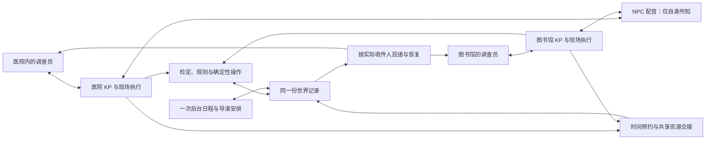

# 0.0.5 发布验收

2026-10-23。发布前合并、程序检查与真实主持验证集中记录在此。

## 本轮交付

- 私人证词按实际听众结算理智与神话知识，重复听闻及恢复不重复结算。调查员数值继续共享，不额外隐藏他人数值。
- 独立调查分支持有自己的模型会话、待处理行动、游戏时间和遭遇；同一建筑的不同房间共用主持上下文。世界、人物、物品及日程只有一份权威记录。
- 行动先登记预计完成边界；其他现场可以在此之前继续办理较短行动。共享人物和物件的争用由现有 KP 共同安排，再从实际世界重新裁定。
- 拆场保留每位调查员的真实行动时间、未开始原话与接收时刻；旧会话、后台任务和骰桥随现场关闭。恢复未完成私信只有一个消费者。
- 后台日程与长期复盘共用调度，避免按现场重复调用。全员昏迷、濒死的现场继续办理实际遭遇。
- 安装锁定正式版本；PyPI 缺少该版本时使用同标签 GitHub 包。稳定身份检查和战斗输入焦点竞态已补回归。
- 合入一分钟断线 AI 接管：保持真人座位归属、原声明和待答检定，返回后交还控制权；全员离线暂停。接管不额外使用幸运或发起孤注一掷，可由房主关闭。
- 合入KP自主判断时间衔接：实际出现跨场等待时，较慢一场可许可略过到所需时刻的空白时间，保留玩家决定和进行中的行动；新声明会撤销旧许可。该功能仅做离线回归，尚未追加真实模型验证。

## 运行结构

KP 读取完整底牌并负责情境判断，裁定员接收中立行动，NPC 配音接收其自己的资料。分场复用同一套执行循环；世界没有第二份独立事实，也不新增一个常驻审批模型。

## 程序与打包检查

第一轮全量测试：2995通过、4失败、4跳过，437.78秒。三个开房失败源于旧测试把 `Cast` 类型替换成函数，另一个是私人证词旧内部断言；分别修复测试契约并加强实际私密性验收，不删除失败记录。第二轮3001通过、4跳过，441.33秒，752个输入文件前后指纹一致，为 `818c6ce5f569ea4f57101bdfc4d1b6688e617e76e4ac1da7c41fc212414ff329`。

第三轮3002通过、4跳过，428.55秒；测试期间另有私信提示与网络测试同步修正，因此不将这一轮视为最终提交的完整验收。最终版本仍需重新冻结源码、核对前后指纹并运行完整测试。

第五轮冻结后的全量测试3012通过、4跳过，432.49秒；753个输入文件前后指纹一致，为 `8254089fbe0c1f96c0b2e3cda6d3cf9632f1692cd6f3dc8c3329091b595d9da2`。之后因真实试玩发现同行提交问题，补上修复及回归，再运行第六轮完整验收，以下以最终结果为准。

第六轮：3019通过、4跳过，425.39秒。完整输入在运行前后核对，文件未变；Ruff、差异格式和四个共享技能校验通过。网络断线测试的结算等待统一使用既有网络测试的五秒上限，保留骰点、询问身份、实际回合和恢复结果的全部断言。之后合入断线接管，最终结果以下一轮冻结验收为准。

合入断线接管后的全量：3035通过、4跳过，428.75秒。755个输入文件前后指纹一致，为 `b3731c3f4ea8511939d3c0b2526d0c74554130b231cf344d101461154e8e322f`。验证基线为 `0e7878c`。之后按用户要求合入KP自主判断时间衔接，另做最终验收。合并时补上两处边界：代管的零分钟行动不再重复调用模型；纯AI房间有观战者时运行、无人时暂停，观战重连可唤醒。

中间验收保留失败与中止记录：一项手稿遮盖大场景的测试依赖0.2秒内完成挂载，已改为挂载后启动真实计时；应对窗口测试使用独立逻辑时钟，保留真实计时回调与超时结果断言。它们不再依赖运行机器的装载速度。源码调整后的旧一轮中止，未冒充最终通过结果。

三平台CI暴露了本机没有失败的情况：Windows读取完整记录时，打开的文件句柄阻止日志轮转；另有几个网络测试在收到正文后立即断言日志已关闭，或在关闭玩家连接后才停止仍会驱动AI的测试主机。日志改为有界读取并在交出每批记录前关闭句柄；测试按真实结算和生命周期边界同步，保留原断言。设置弹窗测试也改为等待挂载与关闭回调完成后再交互，不在产品代码中吞掉异常。

0.0.5 wheel与sdist已重新构建，从GitHub草稿下载后通过SHA256校验。仓库外隔离安装确认版本、存档格式与运行源码一致，BCDice实际掷骰通过；格式样例和三本模组全部编译、校验通过，82张原图均存在，生成的模组技能分别含70、79和145个文件。Linux、macOS、Windows三平台打包和仓库外安装均通过；同一源码与测试基线的完整CI结果见[最终运行检查](https://github.com/satoshinji2992/autokeeper/actions/runs/39952890322)。

## 真实主持验证

本轮重新授权最多1小时、10美元，从第一次实际模型请求开始计时。验证使用DeepSeek、真实BCDice和三个独立玩家连接；每位试玩者只读取自己收到的画面，不读取模组底牌、服务器存档或其他座位的记录。费用账本及时间窗口与此前两次试玩分开。

首次调用为2026-10-23 19:18:47（北京时间），硬截止20:18:47。之前的预检只连接房间，账本为0美元，日志均保留。三个玩家通过实际WebSocket连接操作同一局《有些人油盐不进》。

首段实际验证发现三处问题，修复后从失败存档继续，没有重开剧情、重掷已结算的骰或重设账本：

- 私信主动提及尚未发生的人物和事件。明确来信回复范围，KP仍读全部备课；用原提问时刻的完整上下文重新调用，未再提及未来事件，原存档未改动。
- NPC突袭、开战提示先于上一人的日常经过。旧叙述在新配音、场面打断和开战之前交代，断线恢复只交付一次。
- 战斗不同声明复用显示轮次构成的操作编号。按遭遇、战斗轮次、行动者与本轮修订编号，并预先保存身份；全部226项遭遇相关回归通过，原失败存档已恢复继续。
- 玩家确认骰子后的状态片段没有将新快照交回原回合，造成“已经解除压制，正式快照仍说被制住”。现在合并应答时同步该片段的结算快照，不重新读取全局未来状态；三种读档时机均有回归。
- NPC已经真实同意同行，但后台较晚的动作使旧旅程提交时漏带。现在顺延同一旅程的共同出发与抵达时间，再一起移动；明确独行仍有效。独立回归复用了实际同行同意和后台动作，真实DeepSeek叙述确认NPC在身边，原局文件未改动。该验证是聚焦案例，不冒充三人重跑完整剧情。

三人自然试玩于19:59:36停止，约40分49秒，推进到第34轮；包括修复、暂停与原存档接续，故事未通关。另做了私信与同行两次聚焦复测，最后一次于20:04:59完成。账本于20:06封存：**130次调用，估算0.292411美元**，没有沿用此前的余额，也没有追加授权。输入约168.9万token，其中缓存读取约115.4万，输出约10.4万；没有相同案例的0.0.3对照，不宣称这组数字证明版本间的消耗改善。

实际通过的范围：三人完成回合制战斗与各自骰子确认；真实重连恢复同一个未答骰子的编号；各自到餐馆、会堂、警局后继续获得本地回应；NPC能接住报警求助，也能发展借会堂、准备食物等日常安排。私人消息原文只出现在本人连接。确认之外仍保留观察记录，不把NPC声称“已打电话”当作远端接收者已经执行的证据。

## 验收边界

- 真实短测不能替代三本模组的完整长局，也不证明模型叙述永远正确。
- 世界记录支持现有事件与移动依据的时间读取，没有承诺任意历史时刻的完整人物、物品和知识快照。
- 已开始的普通长行动，尚不承诺可以在任意时点撤销全部流程；已经成立的事实不会随撤回消失。
- 浏览器笔记目前随页面会话存在，浏览器本地持久化仍待补齐；终端本地笔记照常保存。
- 跨场时间边界仍可能造成明显等待：本轮一段返程从声明到移动约9分30秒，等待者没有自己的待答选项。独立会话和模型调用已并行，不代表长行动的提交已完全无等待。
- 进展摘要可能落后于当前所在地点；本轮会堂的摘要仍保留先前三人在屋外的表述。现场记录和个人叙述继续推进，摘要的新鲜程度仍需改进。
- 会合时可直接略过等待，推进到合理的共同时间，这是用户确认的正常主持方式，不列为缺陷。在线玩家的检定与选择仍等待本人；启用断线接管后按一分钟宽限期办理。
- NPC的非标准战斗动作若没有裁定，目前只记录为尝试，不把自由文字冒充伤害、控制或移动结果；完整的自定义动作裁定通路仍可继续完善。
