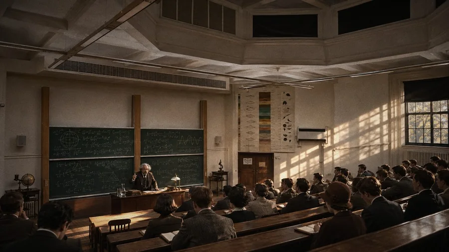

# 失落的对称

[返回模组库](../../README.md) · [按规则浏览](../../catalog/CoC7/README.md)



Lost Symmetry

| 规则 | 时代 | 人数 | 时长 |
| --- | --- | --- | --- |
| CoC7 | 1920 年代 | 1-4 人 | 约 3-4 小时 |

明天就要考试了。你们的同学、数学系最有前途的学生之一詹姆斯·布莱恩特，在考前最后一堂课上没有出现。
詹姆斯痴迷数学，不善交际，却是可靠、忠实、值得信赖的朋友。他很少谈自己，唯一提起过的“家人”是住在佛蒙特州的科拉阿姨。

来源：Lost Symmetry © 2019 Benjamin Schäfer（Miskatonic Repository），中文个人汉化

版权说明：免费模组，仅供学习，版权归原作者所有

## 主持资料

下列内容含剧透。人物、地点和线索可分层展开查看；修改时以 module/ 内的原文件为准。

<details>
<summary>地点（20）</summary>

- [大学校园](browse/places/campus.md)
- [数学系教室](browse/places/classroom.md)
- [哈特曼教授的办公室](browse/places/hartman_office.md)
- [大学图书馆](browse/places/library.md)
- [图书馆后台办公室](browse/places/library_office.md)
- [大学行政办公室](browse/places/registrar.md)
- [寄宿公寓门前](browse/places/dorm_yard.md)
- [寄宿公寓](browse/places/dorm.md)
- [公寓一楼走廊](browse/places/dorm_hall.md)
- [伯纳德的房间](browse/places/bernard_room.md)
- [詹姆斯的宿舍](browse/places/james_room.md)
- [门卫的地下办公室](browse/places/janitor_office.md)
- [勒德洛北街](browse/places/ludlow.md)
- [科拉阿姨的房子](browse/places/cora_house.md)
- [一楼起居室与厨房](browse/places/cora_ground.md)
- [二楼楼梯口](browse/places/cora_landing.md)
- [二楼浴室](browse/places/cora_bath.md)
- [二楼卧室](browse/places/cora_bedroom.md)
- [地下室走廊](browse/places/cora_basement_hall.md)
- [主地下室](browse/places/cora_basement.md)

</details>

<details>
<summary>人物（7）</summary>

- [爱德华·哈特曼教授](browse/people/hartman.md)
- [伯纳德·富勒](browse/people/bernard.md)
- [玛杰里·霍尔科姆](browse/people/holcomb.md)
- [凯莱布·莫罗](browse/people/caleb.md)
- [鲁比·托伦斯](browse/people/ruby.md)
- [科拉·韦布](browse/people/cora.md)
- [詹姆斯·布莱恩特](browse/people/james.md)

</details>

<details>
<summary>线索（34）</summary>

- [空着的座位](browse/clues/c_absence.md)
- [同学的说法](browse/clues/c_classmates.md)
- [邻居几天没见他](browse/clues/c_bernard_unseen.md)
- [宿醉的邻居](browse/clues/c_bernard_breath.md)
- [门卫的备用钥匙](browse/clues/c_spare_key.md)
- [微开的窗户](browse/clues/c_window.md)
- [门边的钥匙](browse/clues/c_second_key.md)
- [墙上的草图](browse/clues/c_greek_sketches.md)
- [奇怪的图形](browse/clues/c_strange_sigil.md)
- [科赫的论著](browse/clues/c_koch.md)
- [逾期通知](browse/clues/c_overdue.md)
- [欧几里得的手稿](browse/clues/c_manuscript.md)
- [手稿是赝品](browse/clues/c_manuscript_fake.md)
- [科拉阿姨的明信片](browse/clues/c_postcard.md)
- [旧信上的地址](browse/clues/c_old_letter.md)
- [图书管理员的抱怨](browse/clues/c_holcomb_overdue.md)
- [找不到的书](browse/clues/c_holcomb_books.md)
- [署名 C 的人](browse/clues/c_holcomb_c.md)
- [她说的是实话](browse/clues/c_holcomb_truth.md)
- [凯莱布的交代](browse/clues/c_caleb_sale.md)
- [阿姨家的打算](browse/clues/c_caleb_aunt.md)
- [学生档案](browse/clues/c_student_record.md)
- [变质的食物](browse/clues/c_spoiled_food.md)
- [楼梯上的恶臭](browse/clues/c_stench.md)
- [毯子下的尸体](browse/clues/c_corpse.md)
- [奇怪的嗡嗡声](browse/clues/c_humming.md)
- [楼梯上的脚印](browse/clues/c_footprints.md)
- [悬浮的詹姆斯](browse/clues/c_james_floating.md)
- [胸口的图形](browse/clues/c_chest_sigil.md)
- [一桶血](browse/clues/c_bucket.md)
- [过量的失血](browse/clues/c_blood_amount.md)
- [古老的书](browse/clues/c_onyx_book.md)
- [阅读《缟玛瑙石板》](browse/clues/c_onyx_read.md)
- [切断联系的办法](browse/clues/c_gate_hint.md)

</details>

## 原文件与素材

- [art](module/art)
- [clues.yaml](module/clues.yaml)
- [module.yaml](module/module.yaml)
- [people.yaml](module/people.yaml)
- [places.yaml](module/places.yaml)
- [situation.yaml](module/situation.yaml)
- [source](module/source)
- [story.yaml](module/story.yaml)

## 游戏内安装

```sh
autokeeper library get shiluodeduichen
```
