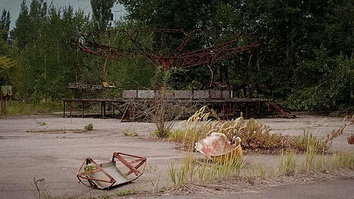

# 鱼！鱼！鱼！

[返回模组库](../../README.md) · [按规则浏览](../../catalog/CoC7/README.md)



[封面来源](../../catalog/cover-credits.md#yuyuyu)

石头屿的夏天，十岁的我们去找阿宁

| 规则 | 时代 | 人数 | 时长 |
| --- | --- | --- | --- |
| CoC7 | 2009 年夏（原作融合 00 年代与 10 年代的时代风貌） | 2-4 人（原文未写人数） | 约 4-6 小时（原文未写，按各地点时长估算） |

2009 年 8 月 7 日，一个闷热的夏天。你们约好在废弃的海洋乐园交换小浣熊卡片、互抄暑假作业，可一向准时的阮施宁一直没来。下午一点，你们决定自己去找她。

来源：《鱼！鱼！鱼！》，作者 莫妮卡博士的魔鬼欲望机器

版权说明：免费模组，禁止任何形式的商用（原作声明）

## 主持资料

下列内容含剧透。人物、地点和线索可分层展开查看；修改时以 module/ 内的原文件为准。

<details>
<summary>地点（11）</summary>

- [废弃的海洋乐园](browse/places/ocean_park.md)
- [阮施宁的家](browse/places/ruan_home.md)
- [黄懿的家](browse/places/huang_home.md)
- [少儿图书馆](browse/places/library.md)
- [音乐广场](browse/places/music_square.md)
- [夜市](browse/places/night_market.md)
- [石坡尾](browse/places/shipowei.md)
- [排水通道](browse/places/drain_tunnel.md)
- [闸门口](browse/places/drain_gate.md)
- [有电脑的伙伴家](browse/places/player_home.md)
- [老张的看守室](browse/places/shipowei_guardroom.md)

</details>

<details>
<summary>人物（15）</summary>

- [阮施宁](browse/people/ruan_shining.md)
- [阮施宁的母亲](browse/people/ruan_mother.md)
- [阮施宁的父亲](browse/people/ruan_father.md)
- [剥豆的阿婆们](browse/people/grannies.md)
- [黄懿](browse/people/huang_yi.md)
- [黄懿的阿嫲](browse/people/huang_grandma.md)
- [图书馆管理员](browse/people/librarian.md)
- [流浪汉](browse/people/busker.md)
- [杨纵溪](browse/people/yang_zongxi.md)
- [塑料玩具摊主](browse/people/toy_vendor.md)
- [建福](browse/people/jianfu.md)
- [丽英](browse/people/liying.md)
- [阿宝](browse/people/abao.md)
- [陈工](browse/people/chen_gong.md)
- [老张](browse/people/lao_zhang.md)

</details>

<details>
<summary>线索（37）</summary>

- [伙伴们商量的去处](browse/clues/c_directions.md)
- [侧门外的两组痕迹](browse/clues/c_park_tracks.md)
- [井盖下的死鱼](browse/clues/c_park_manhole.md)
- [井盖里的咕嘟声](browse/clues/c_park_bubbling.md)
- [旋转木马上的不适](browse/clues/c_park_vision.md)
- [阮母的回答](browse/clues/c_ruan_mother_says.md)
- [阮父的告诫](browse/clues/c_ruan_father_warns.md)
- [平静得出奇的语气](browse/clues/c_ruan_calm.md)
- [阿婆们的话](browse/clues/c_grannies.md)
- [发抖的手](browse/clues/c_huang_hands.md)
- [阮施宁的日记本](browse/clues/c_diary.md)
- [偷看日记本](browse/clues/c_diary_peek.md)
- [涂鸦里的路](browse/clues/c_diary_drain.md)
- [涂鸦里的路（偷看）](browse/clues/c_diary_drain_peek.md)
- [比对报纸和日记](browse/clues/c_diary_compare.md)
- [比对报纸和偷看的日记](browse/clues/c_diary_compare_peek.md)
- [阿嫲的心愿](browse/clues/c_grandma_wish.md)
- [管理员的话](browse/clues/c_librarian.md)
- [崭新的深海绘本](browse/clues/c_picture_book.md)
- [今天的《石头屿晚报》](browse/clues/c_newspaper.md)
- [报道里的闸门位置](browse/clues/c_newspaper_where.md)
- [报道里的闸门位置（工地对照）](browse/clues/c_newspaper_where_site.md)
- [喷泉边的深夜访客](browse/clues/c_busker_talk.md)
- [掏出来的黏稠物](browse/clues/c_busker_ear.md)
- [费力的喘息](browse/clues/c_busker_breath.md)
- [工地的狗](browse/clues/c_yang_dogs.md)
- [今晚的采访](browse/clues/c_yang_interview.md)
- [玩具摊主的耳朵](browse/clues/c_toy_ears.md)
- [建福阿伯的嘱咐](browse/clues/c_jianfu_help.md)
- [排队大人的手](browse/clues/c_webbed_hand.md)
- [丽英的话](browse/clues/c_liying_talk.md)
- [夜市里的零碎谈话](browse/clues/c_market_rumors.md)
- [阿宝的涨潮口诀](browse/clues/c_tide_rhyme.md)
- [陈工的施工安排](browse/clues/c_chen_seal.md)
- [清出来的怪东西](browse/clues/c_chen_strange.md)
- [闸板的缝隙](browse/clues/c_gate_gap.md)
- [湿透的卡片和纸条](browse/clues/c_ruan_note.md)

</details>

## 原文件与素材

- [art](module/art)
- [clues.yaml](module/clues.yaml)
- [module.yaml](module/module.yaml)
- [people.yaml](module/people.yaml)
- [places.yaml](module/places.yaml)
- [plugins](module/plugins)
- [situation.yaml](module/situation.yaml)
- [story.yaml](module/story.yaml)

## 游戏内安装

```sh
autokeeper library get yuyuyu
```
